# Evidencia R5.1 — Dispositivos en BalenaCloud con OTA

| Campo | Valor |
|---|---|
| Criterio de aceptación | Actualización OTA ejecutada sin intervención manual; dispositivos visibles en dashboard de Balena. |
| Responsable | Rol 1 |
| Estado | ✅ Cumplido |
| Pruebas definidas en | [requerimientos.md](../requerimientos.md) |
| Plantilla | [PLANTILLA.md](PLANTILLA.md) |
| Capturas | `docs/evidencias/img/R5.1/` |

## Resumen

| ID | Prueba | Veredicto | Fecha | Revisado por |
|---|---|---|---|---|
| P1.1 | Dispositivos Online en Balena | ✅ | 2026-11-01 | Alejandro Domínguez Torres |
| P1.2 | Push OTA sin tocar las VM | ✅ (Intento 2) | 2026-11-02 | Alejandro Dominguez Torres |
| P1.3 | Tiempo de la actualización OTA | ✅ (41 s) | 2026-11-02 | Alejandro Dominguez Torres |
| P1.4 | Variables por dispositivo | ✅ | 2026-11-02 | Alejandro Dominguez Torres |

Leyenda: ⬜ Pendiente · ✅ Pasa · ❌ Falla · 🟨 Parcial

---

### P1.1 — Dispositivos Online en Balena · Intento 1

| Campo | Valor |
|---|---|
| Requerimiento | R5.1 |
| Ejecutada por | Kevin Aristizabal (Rol 1) |
| Fecha y hora | 2026-11-01 19:18 |
| Entorno | 2 VM VirtualBox en Windows (`p5-dev01`, `p5-dev02`) · flota `proyecto5-iot` (x86-64) · balenaOS 9.0.4 |
| Precondiciones | Flota creada en BalenaCloud; imagen Generic x86_64 (GPT) instalada en cada VM con su propia imagen |

**Qué se probó:** Que `dev01` y `dev02` aparecen Online en el dashboard de la flota con la misma release.

**Cómo (pasos y comandos exactos):**

1. Crear la flota `proyecto5-iot` (Generic x86_64 GPT) en BalenaCloud.
2. Descargar una imagen balenaOS por cada dispositivo, convertirla a VDI e instalarla en su VM de VirtualBox.
3. Renombrar los dispositivos a `dev01` y `dev02` y abrir el dashboard de la flota.

**Resultado esperado:** `dev01` y `dev02` aparecen **Online** con la misma release.

**Resultado obtenido:**

```
dev01  8f4c51b  Operational  heartbeat OK  cloudlink OK  balenaOS 9.0.4  10.0.2.15
dev02  c9d69b9  Operational  heartbeat OK  cloudlink OK  balenaOS 9.0.4  10.0.2.15
Devices: 2 (operational) · Releases: 0
```

**Mediciones:** No aplica.

**Captura:**

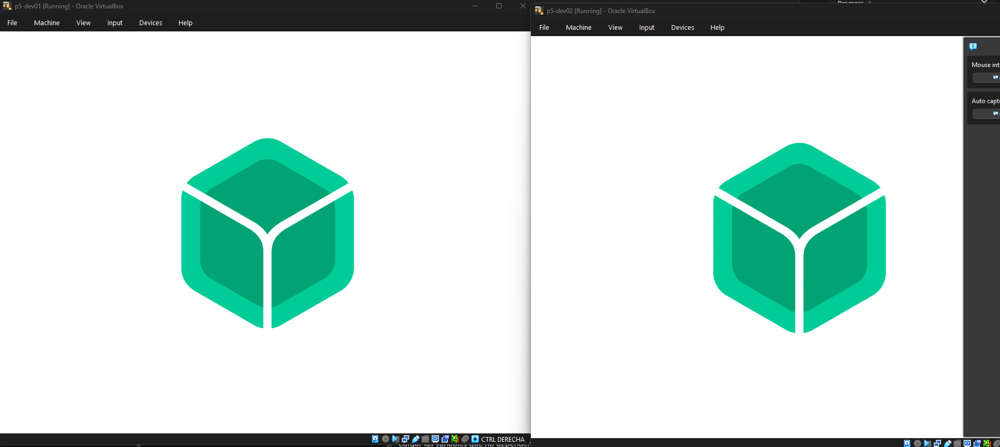

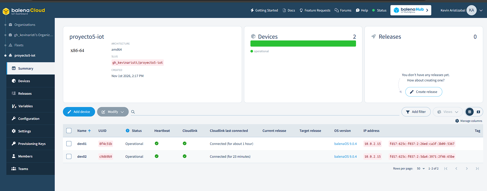

**Veredicto:** 🟨 Parcial

**Observaciones:** Los dos dispositivos están Online, pero todavía no hay ninguna release porque no se ha hecho el primer `balena push`. Se repite la prueba como Intento 2 después del primer push.

**Revisado por:** Alejandro Domínguez Torres, 2026-11-02

### P1.1 — Dispositivos Online en Balena · Intento 2

| Campo | Valor |
|---|---|
| Requerimiento | R5.1 |
| Ejecutada por | Kevin Aristizabal (Rol 1) |
| Fecha y hora | 2026-11-01 20:03 |
| Entorno | 2 VM VirtualBox en Windows (`p5-dev01`, `p5-dev02`) · flota `proyecto5-iot` (x86-64) · balenaOS 9.0.4 · balena CLI 25.2.7 · release `62f246b` |
| Precondiciones | Primer `balena push` ejecutado; release creada y descargada en ambos dispositivos |

**Qué se probó:** Que `dev01` y `dev02` aparecen Online en el dashboard con la misma release.

**Cómo (pasos y comandos exactos):**

1. Desde la carpeta `device/` del repo, con las dos VM encendidas y Online:

```cmd
   balena push gh_kevinaristi/proyecto5-iot
```

2. Esperar a que la release se construya y se descargue en los dos dispositivos.
3. Abrir **Devices** en el dashboard de la flota y comparar la columna *Current release*.

**Resultado esperado:** `dev01` y `dev02` aparecen **Online** con la misma release.

**Resultado obtenido:**

```
[Success] Release successfully created!
Release: 62f246b80447a00f3cdb75673ed0452f (id: 4466885)
Servicio simulador · 122.24 MB · build 4 s
dev01  Operational  Current release: 62f246b
dev02  Operational  Current release: 62f246b
```

**Mediciones:** Build en 10 segundos.

**Captura:**

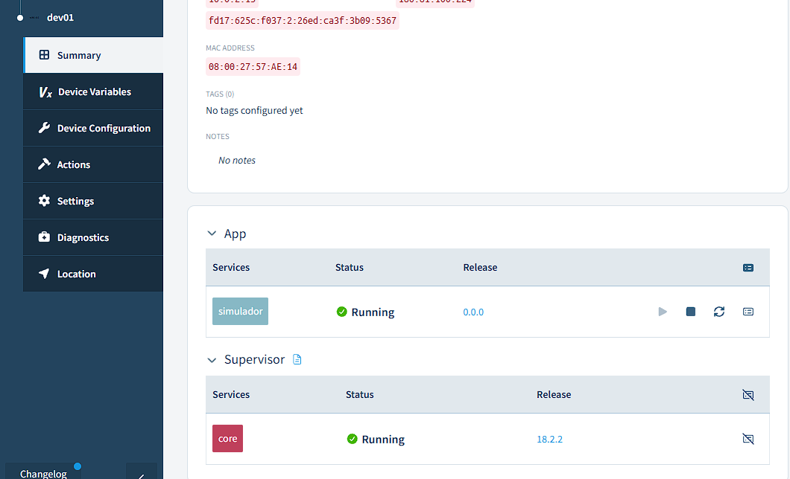

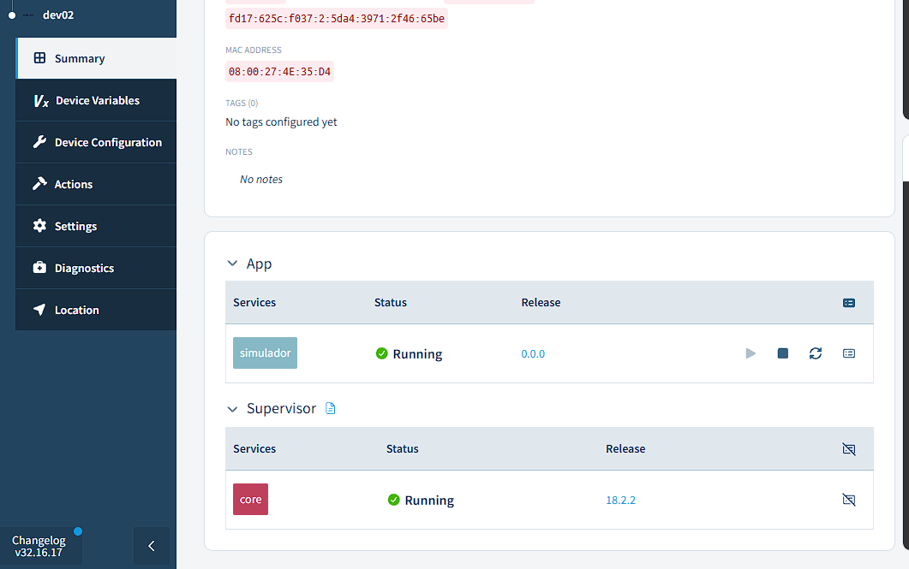

**Veredicto:** ✅ Pasa

**Observaciones:** Ambos dispositivos ejecutan el servicio `simulador` en la misma release (versión `0.0.0`, que Balena asigna por defecto a la release `62f246b`). El simulador aún no puede conectarse al broker (falta el `ca.crt` real y `BROKER_HOST`), pero eso no afecta esta prueba. El primer intento de push falló porque faltaba `version: '2.1'` en `docker-compose.yml`; ya se corrigió.

**Revisado por:** Alejandro Domínguez Torres, 2026-11-02

### P1.2 — Push OTA sin tocar las VM · Intento 1

| Campo | Valor |
|---|---|
| Requerimiento | R5.1 |
| Ejecutada por | Kevin Aristizabal (Rol 1) |
| Fecha y hora | 2026-11-02 13:29 |
| Entorno | 2 VM VirtualBox (`p5-dev01`, `p5-dev02`) · flota `proyecto5-iot` · balenaOS 9.0.4 · balena CLI 25.2.7 · release `2f2b01a` |
| Precondiciones | `dev01` y `dev02` Online con la release `0.0.0` (`62f246b`) |

**Qué se probó:** Que una release nueva llega sola a las dos VM después de un `balena push`, sin tocarlas.

**Cómo (pasos y comandos exactos):**

```cmd
cd /d "C:\Users\Kevin Aristizabal\Documents\proyecto5-iot\device"
balena push gh_kevinaristi/proyecto5-iot && echo FIN DEL PUSH %date% %time%
```

**Resultado esperado:** Release nueva y ambos dispositivos se actualizan solos.

**Resultado obtenido:**

```
[Success] Release successfully created!
Release: 2f2b01a1cc6b33f4c0b001a2a3b9233c (id: 4468895)
simulador · 122.24 MB · delta 1.55 KB · Build finished in 26 seconds
FIN DEL PUSH 02/11/2026 13:29:09.28
```

**Mediciones:** Build en 26 segundos; delta de 1.55 KB.

**Captura:**

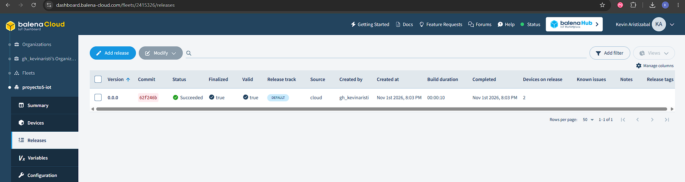

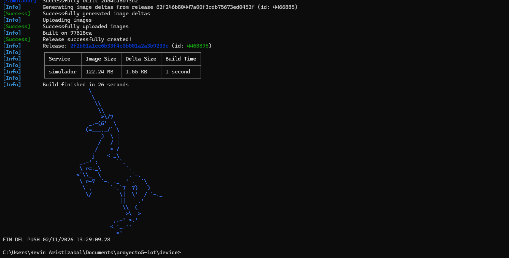

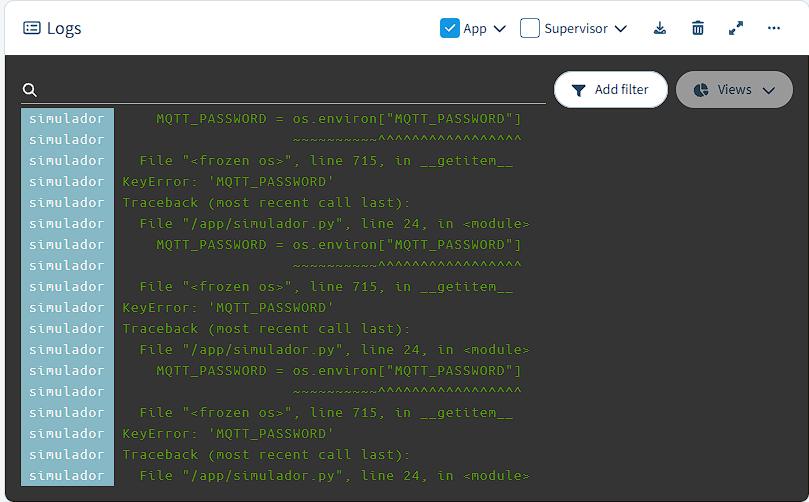

**Veredicto:** 🟨 Parcial

**Observaciones:** La release llegó a las dos VM sin tocarlas, pero esa versión del simulador no escribía ninguna marca de versión en el log: el programa se caía con `KeyError: 'MQTT_PASSWORD'` antes de llegar a `main()` y la marca estaba dentro de `main()`. No se pudo demostrar con el log el instante exacto del cambio. Se repite como Intento 2 con la marca de versión justo después de los `import`.

**Revisado por:** Alejandro Dominguez Torres, 2026-11-02

### P1.2 — Push OTA sin tocar las VM · Intento 2

| Campo | Valor |
|---|---|
| Requerimiento | R5.1 |
| Ejecutada por | Kevin Aristizabal (Rol 1) |
| Fecha y hora | 2026-11-02 20:34 |
| Entorno | 2 VM VirtualBox (`p5-dev01`, `p5-dev02`) · flota `proyecto5-iot` · balenaOS 9.0.4 · balena CLI 25.2.7 · release `0e9b355` · broker en VM Azure `vm-iot-backend` |
| Precondiciones | `dev01` y `dev02` con la release `0.0.0+rev2` (`e1082db`, simulador con marca `v1`), conectados al broker con TLS y con `BROKER_HOST` y `MQTT_PASSWORD` cargadas |

**Qué se probó:** Que una release nueva llega sola a las dos VM y que el log de cada una muestra la marca de la versión nueva.

**Cómo (pasos y comandos exactos):**

1. Cambiar en `device/simulador.py` la marca `simulador v1` por `simulador v2` (justo después de los `import`).
2. Sin tocar las VM, hacer el push y anotar la hora de fin:

```cmd
cd /d "C:\Users\Kevin Aristizabal\Documents\proyecto5-iot\device"
balena push gh_kevinaristi/proyecto5-iot
```

3. Leer en cada dispositivo la primera línea `simulador v2 <hora UTC>`:

```cmd
balena device logs <UUID>
```

**Resultado esperado:** Release nueva y ambos dispositivos se actualizan solos.

**Resultado obtenido:**

```
Release: 0e9b355b971188e5ad45042b2c417fc1 (version 0.0.0+rev3) · Build finished in 9 seconds
dev01  Current release: 0.0.0+rev3  Update status: Done
dev02  Current release: 0.0.0+rev3  Update status: Done
[dev01] simulador v2 2026-11-03T01:34:55+00:00
[dev02] simulador v2 2026-11-03T01:34:57+00:00
```

**Mediciones:** Build en 9 segundos. Ver P1.3 para el tiempo de actualización.

**Captura:**

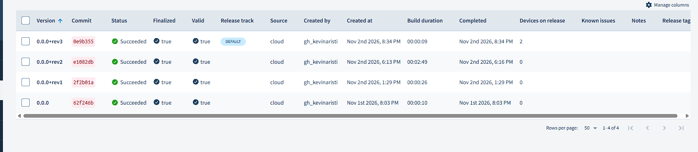

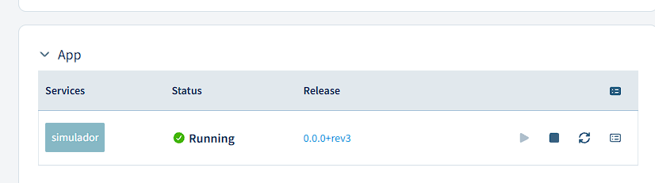

**Veredicto:** ✅ Pasa

**Observaciones:** Un primer intento de `balena push` a las 20:33 falló antes de subir nada con `ENOTFOUND builder.balena-cloud.com` (error de DNS momentáneo del PC) y no creó ninguna release; se repitió a las 20:34 sin cambios. La captura del servicio es un recorte del panel de cada dispositivo (ambos muestran `0.0.0+rev3`), recortada para no publicar la IP pública del PC.

**Revisado por:** Alejandro Dominguez Torres, 2026-11-02

### P1.3 — Tiempo de la actualización OTA · Intento 1

| Campo | Valor |
|---|---|
| Requerimiento | R5.1 |
| Ejecutada por | Kevin Aristizabal (Rol 1) |
| Fecha y hora | 2026-11-02 20:34 |
| Entorno | 2 VM VirtualBox (`p5-dev01`, `p5-dev02`) · flota `proyecto5-iot` · balenaOS 9.0.4 · release `0e9b355` · broker en VM Azure `vm-iot-backend` (Mosquitto 2, puerto 8883 con TLS) |
| Precondiciones | Intento 2 de P1.2: marca `simulador v1` en la release anterior y `simulador v2` en la nueva; los dispositivos publican al broker |

**Qué se probó:** Cuánto tarda en estar corriendo la release nueva en las dos VM desde que termina el push, y que los datos MQTT siguen llegando después.

**Cómo (pasos y comandos exactos):**

1. Anotar la hora a la que termina el `balena push` (`FIN DEL PUSH`).
2. Anotar la primera línea `simulador v2 <hora UTC>` de cada dispositivo (hora de Bogotá = UTC − 5).
3. Tiempo = el mayor de los dos instantes − `FIN DEL PUSH`.
4. En la VM del broker, antes y después de la actualización (la clave de `nodered` se lee del `.env` de la VM, no se escribe):

```bash
cd ~/proyecto5-iot/backend
set -a; . ./.env; set +a
docker run --rm --network host -v "$PWD/mosquitto/config/certs:/certs:ro" eclipse-mosquitto:2.0.20 mosquitto_sub -h localhost -p 8883 --cafile /certs/ca.crt -u nodered -P "$MQTT_NODERED_PASSWORD" -t 'iot/#' -v -W 15
```

**Resultado esperado:** Tiempo registrado; los datos MQTT siguen llegando después.

**Resultado obtenido:**

```
FIN DEL PUSH            2026-11-02 20:34:16 (01:34:16 UTC)
dev01 primer v2         2026-11-03T01:34:55Z  (+39 s)
dev02 primer v2         2026-11-03T01:34:57Z  (+41 s)

mosquitto_sub antes (ts 01:29:47Z a 01:29:58Z) y después (ts 01:36:58Z a 01:37:09Z):
iot/dev01/temperatura {"device_id": "dev01", "sensor": "temperatura", "value": 28.4, "unit": "C", "ts": "2026-11-03T01:36:58Z"}
iot/dev02/humedad {"device_id": "dev02", "sensor": "humedad", "value": 62.7, "unit": "%", "ts": "2026-11-03T01:37:09Z"}
```

**Mediciones:** Tiempo de actualización: **41 s** (`dev02`, el más lento; `dev01` 39 s). Los dos dispositivos siguieron publicando temperatura y humedad cada 5 s después de la OTA.

**Captura:**

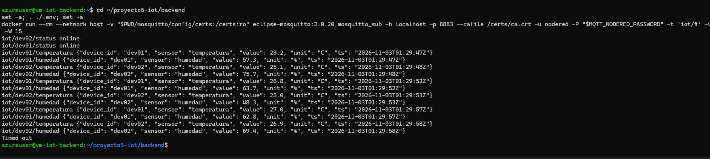

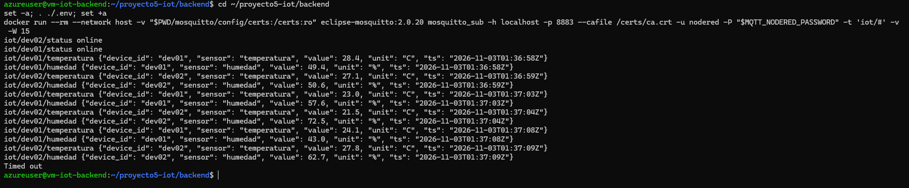

**Veredicto:** ✅ Pasa

**Observaciones:** Ninguna.

**Revisado por:** Alejandro Dominguez Torres, 2026-11-02

### P1.4 — Variables por dispositivo · Intento 1

| Campo | Valor |
|---|---|
| Requerimiento | R5.1 |
| Ejecutada por | Kevin Aristizabal (Rol 1) |
| Fecha y hora | 2026-11-02 20:50 |
| Entorno | Flota `proyecto5-iot` · balenaOS 9.0.4 · balena CLI 25.2.7 · release `0e9b355` |
| Precondiciones | `BROKER_HOST` cargada en la flota; `MQTT_PASSWORD` de cada dispositivo cargada a mano en el dashboard |

**Qué se probó:** Que cada dispositivo tiene su propio `DEVICE_ID`, `MQTT_USER` y `MQTT_PASSWORD`, y que los dos corren la misma imagen.

**Cómo (pasos y comandos exactos):**

1. En el dashboard, abrir cada dispositivo → **Device Variables**. La clave de `MQTT_PASSWORD` se tapó en la captura.
2. Comprobar por CLI, mostrando la clave oculta:

```cmd
balena env list --device 8f4c51b
balena env list --device c9d69b9
```

**Resultado esperado:** Cada uno con su `DEVICE_ID`, `MQTT_USER`, `MQTT_PASSWORD`; misma imagen.

**Resultado obtenido:**

```
dev01 (8f4c51b)  DEVICE_ID=dev01  MQTT_USER=dev01  MQTT_PASSWORD=***OCULTO***  release 0e9b355
dev02 (c9d69b9)  DEVICE_ID=dev02  MQTT_USER=dev02  MQTT_PASSWORD=***OCULTO***  release 0e9b355
Variables de flota (iguales en ambos): BROKER_HOST=68.211.147.97  BROKER_PORT=8883  CA_CERT_PATH=/app/ca.crt  PUBLISH_INTERVAL=5
```

**Mediciones:** No aplica.

**Captura:**

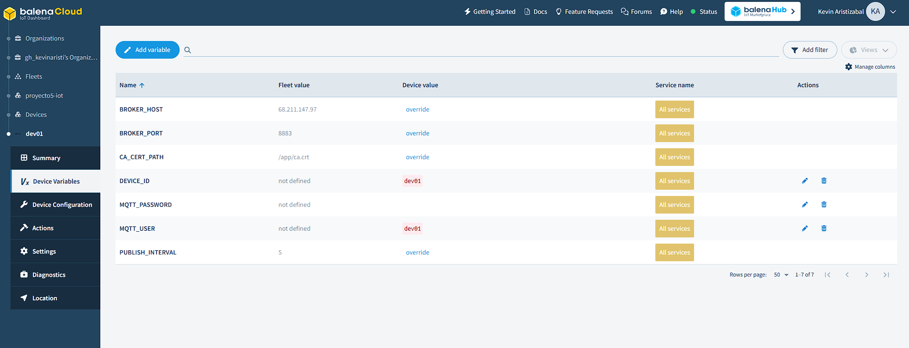

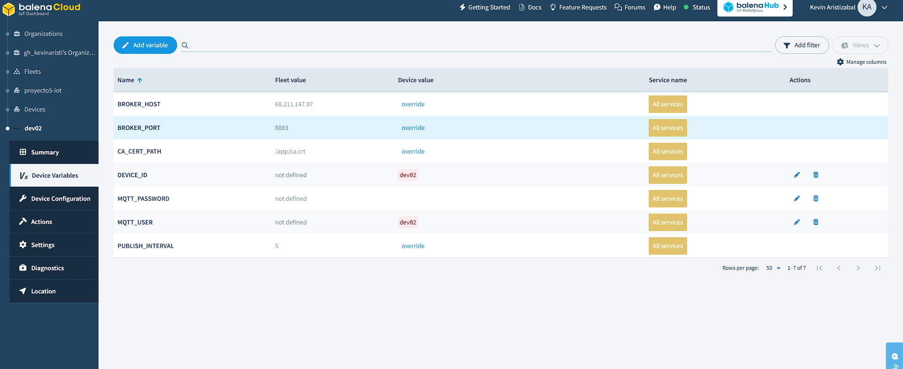

**Veredicto:** ✅ Pasa

**Observaciones:** Las dos claves funcionan: ambos dispositivos se conectaron al broker con TLS y el broker recibió sus mensajes (ver P1.3). El valor de `MQTT_PASSWORD` no aparece en ninguna captura.

**Revisado por:** Alejandro Dominguez Torres, 2026-11-04