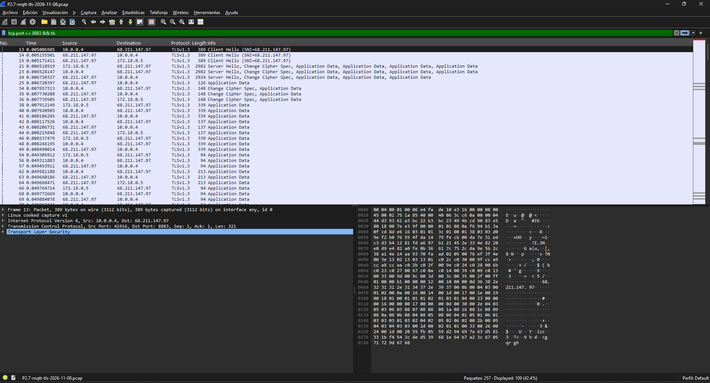

# Evidencia R5.2 — MQTT con TLS y autenticación

| Campo | Valor |
|---|---|
| Criterio de aceptación | Mensajes publicados correctamente; conexión verificada como cifrada con Wireshark o logs. |
| Responsable | Rol 2 |
| Estado | 🟨 En progreso (P2.1–P2.7 y P2.9 pasan; falta P2.8) |
| Pruebas definidas en | [requerimientos.md](../requerimientos.md) |
| Plantilla | [PLANTILLA.md](PLANTILLA.md) |
| Capturas | `docs/evidencias/img/R5.2/` |

## Resumen

| ID | Prueba | Veredicto | Fecha | Revisado por |
|---|---|---|---|---|
| P2.1 | Publicar y recibir con TLS y credenciales | ✅ | 2026-11-02 | |
| P2.2 | Conexión sin credenciales | ✅ | 2026-11-02 | |
| P2.3 | Conexión con clave incorrecta | ✅ | 2026-11-02 | |
| P2.4 | Conexión sin TLS | ✅ | 2026-11-02 | |
| P2.5 | Conexión con una CA distinta | ✅ (Intento 2) | 2026-11-08 | |
| P2.6 | ACL: dev01 no escribe en el topic de dev02 | ✅ | 2026-11-02 | |
| P2.7 | Tráfico cifrado en Wireshark | ✅ (Intento 2 + captura de Wireshark) | 2026-11-13 | |
| P2.8 | Reglas del NSG de Azure | ⬜ | | |
| P2.9 | Contraste sin TLS *(opcional)* | ✅ | 2026-11-08 | |

Leyenda: ⬜ Pendiente · ✅ Pasa · ❌ Falla · 🟨 Parcial

---

**Cómo se corrieron P2.1–P2.6.** En la misma sesión, por SSH en la VM, contra la IP
pública del broker (el tráfico sale y vuelve a entrar por el NSG de Azure). Las horas son
aproximadas (± 2 min): se reconstruyeron a partir del arranque del broker en su log
(`2026-11-02T18:18:56` UTC = 13:18 en Bogotá). Los clientes
`mosquitto_pub`/`mosquitto_sub` se ejecutan desde la imagen oficial de Mosquitto, así no hay
que instalarlos en la VM. Preparación, desde `~/proyecto5-iot/backend`:

```bash
set -a; . ./.env; set +a          # carga BROKER_HOST y MQTT_NODERED_PASSWORD
H=$BROKER_HOST                    # 68.211.147.97
CLAVE_DEV01='...'                 # clave de dev01 (nunca en el repo)
mqtt() { sudo docker run --rm --network host -v "$PWD/mosquitto/config/certs:/certs:ro" -v /tmp:/tmp eclipse-mosquitto:2.0.20 "$@"; }
```

En los bloques de abajo, `mqtt mosquitto_sub ...` equivale a `mosquitto_sub ...` de
[requerimientos.md](../requerimientos.md). En las pruebas que deben fallar se usa
`mosquitto_sub -W 5` (corta a los 5 s) en vez de `mosquitto_pub`, para que el comando no se
quede esperando.

## P2.1

### P2.1 — Publicar y recibir con TLS y credenciales · Intento 1

| Campo | Valor |
|---|---|
| Requerimiento | R5.2 |
| Ejecutada por | Santiago Osorio (Rol 2) |
| Fecha y hora | 2026-11-02 13:20 |
| Entorno | VM Azure `vm-iot-backend` (Chile Central, Ubuntu 24.04.5) · commit `7df62a0` · Mosquitto 2.0.20 · Docker 29.9.2 |
| Precondiciones | Stack levantado con `docker compose up -d`; certificados generados para `68.211.147.97`; usuarios `dev01` y `nodered` creados |

**Qué se probó:** Que un cliente con TLS, `ca.crt` y credenciales válidas publica y otro recibe el mensaje.

**Cómo (pasos y comandos exactos):**

1. Terminal A, escucha con `nodered`:

```bash
mqtt mosquitto_sub -h $H -p 8883 --cafile /certs/ca.crt -u nodered -P "$MQTT_NODERED_PASSWORD" -t 'iot/#' -v -W 12
```

2. Terminal B, publica con `dev01`:

```bash
mqtt mosquitto_pub -h $H -p 8883 --cafile /certs/ca.crt -u dev01 -P "$CLAVE_DEV01" -q 1 -t iot/dev01/temperatura \
  -m '{"device_id":"dev01","sensor":"temperatura","value":27.4,"unit":"C","ts":"2026-11-02T20:00:00Z"}'
```

**Resultado esperado:** El suscriptor recibe el mensaje.

**Resultado obtenido:** (terminal A; la terminal B termina sin errores)

```
iot/dev01/temperatura {"device_id":"dev01","sensor":"temperatura","value":27.4,"unit":"C","ts":"2026-11-02T20:00:00Z"}
```

**Mediciones:** No aplica.

**Captura:** Sin captura de pantalla; la evidencia es la salida de la terminal (el criterio admite logs).

**Veredicto:** ✅ Pasa

**Observaciones:** Ninguna.

**Revisado por:**

## P2.2

### P2.2 — Conexión sin credenciales · Intento 1

| Campo | Valor |
|---|---|
| Requerimiento | R5.2 |
| Ejecutada por | Santiago Osorio (Rol 2) |
| Fecha y hora | 2026-11-02 13:21 |
| Entorno | VM Azure `vm-iot-backend` · commit `7df62a0` · Mosquitto 2.0.20 |
| Precondiciones | Broker con TLS en 8883 y `allow_anonymous false` |

**Qué se probó:** Que el broker rechaza a un cliente con TLS pero sin usuario ni clave.

**Cómo (pasos y comandos exactos):**

```bash
mqtt mosquitto_sub -h $H -p 8883 --cafile /certs/ca.crt -t 'iot/#' -W 5
```

**Resultado esperado:** Conexión rechazada (`not authorised`).

**Resultado obtenido:**

```
Connection error: Connection Refused: not authorised.
```

**Mediciones:** No aplica.

**Captura:** Sin captura de pantalla; evidencia por salida de la terminal.

**Veredicto:** ✅ Pasa

**Observaciones:** Ninguna.

**Revisado por:**

## P2.3

### P2.3 — Conexión con clave incorrecta · Intento 1

| Campo | Valor |
|---|---|
| Requerimiento | R5.2 |
| Ejecutada por | Santiago Osorio (Rol 2) |
| Fecha y hora | 2026-11-02 13:21 |
| Entorno | VM Azure `vm-iot-backend` · commit `7df62a0` · Mosquitto 2.0.20 |
| Precondiciones | Usuario `dev01` creado con otra clave |

**Qué se probó:** Que el broker rechaza a un usuario existente con una clave incorrecta.

**Cómo (pasos y comandos exactos):**

```bash
mqtt mosquitto_sub -h $H -p 8883 --cafile /certs/ca.crt -u dev01 -P malaclave -t 'iot/#' -W 5
```

**Resultado esperado:** Conexión rechazada.

**Resultado obtenido:**

```
Connection error: Connection Refused: not authorised.
```

**Mediciones:** No aplica.

**Captura:** Sin captura de pantalla; evidencia por salida de la terminal.

**Veredicto:** ✅ Pasa

**Observaciones:** Ninguna.

**Revisado por:**

## P2.4

### P2.4 — Conexión sin TLS · Intento 1

| Campo | Valor |
|---|---|
| Requerimiento | R5.2 |
| Ejecutada por | Santiago Osorio (Rol 2) |
| Fecha y hora | 2026-11-02 13:21 |
| Entorno | VM Azure `vm-iot-backend` · commit `7df62a0` · Mosquitto 2.0.20; parte (a) repetida desde el PC del Rol 2 por internet |
| Precondiciones | `mosquitto.conf` con un único listener (8883 con TLS); el 1883 no está publicado en Docker ni abierto en el NSG |

**Qué se probó:** Que no se puede usar MQTT sin cifrar: el 1883 no responde y el 8883 rechaza texto plano.

**Cómo (pasos y comandos exactos):**

```bash
# (a) puerto 1883, desde la VM
timeout 6 bash -c "</dev/tcp/$H/1883"
# (b) texto plano (sin --cafile) contra el 8883
mqtt mosquitto_sub -h $H -p 8883 -u dev01 -P "$CLAVE_DEV01" -t 'iot/#' -W 5
```

```powershell
# (a) puerto 1883 y 8883 desde el PC, por internet
Test-NetConnection 68.211.147.97 -Port 1883
Test-NetConnection 68.211.147.97 -Port 8883
```

**Resultado esperado:** Puerto 1883 cerrado; 8883 sin TLS falla.

**Resultado obtenido:**

```
(a) VM: la conexión al 1883 no se establece (OK: 1883 no responde)
(a) PC: puerto 1883: cerrado · puerto 8883: abierto
(b) Error: Protocol error
```

**Mediciones:** No aplica.

**Captura:** Sin captura de pantalla; evidencia por salida de la terminal.

**Veredicto:** ✅ Pasa

**Observaciones:** Ninguna.

**Revisado por:**

## P2.5

### P2.5 — Conexión con una CA distinta · Intento 1

| Campo | Valor |
|---|---|
| Requerimiento | R5.2 |
| Ejecutada por | Santiago Osorio (Rol 2) |
| Fecha y hora | 2026-11-02 13:22 |
| Entorno | VM Azure `vm-iot-backend` · commit `7df62a0` · Mosquitto 2.0.20 |
| Precondiciones | Certificado del broker firmado por la CA propia `iot-ca` |

**Qué se probó:** Que un cliente que confía en otra CA no acepta el certificado del broker.

**Cómo (pasos y comandos exactos):**

```bash
openssl req -x509 -newkey rsa:2048 -nodes -keyout /tmp/otra-ca.key -out /tmp/otra-ca.crt -subj /CN=otra-ca -days 1
mqtt mosquitto_sub -h $H -p 8883 --cafile /tmp/otra-ca.crt -u nodered -P "$MQTT_NODERED_PASSWORD" -t 'iot/#' -W 5
```

**Resultado esperado:** Falla la verificación del certificado.

**Resultado obtenido:**

```
Error: Protocol error
```

**Mediciones:** No aplica.

**Captura:** Sin captura de pantalla; evidencia por salida de la terminal.

**Veredicto:** 🟨 Parcial

**Observaciones:** La conexión se rechaza con las mismas credenciales que sí funcionan en P2.1;
lo único distinto es la CA. Pero `mosquitto_sub` muestra un error genérico (`Protocol error`) y
no el texto de la verificación fallida. En el Intento 2 se mostrará el motivo con
`openssl s_client -connect 68.211.147.97:8883 -CAfile /tmp/otra-ca.crt`, que debe terminar en
`Verify return code` distinto de 0, comparado con `-CAfile ca.crt`, que debe dar `0 (ok)`.

**Revisado por:**

### P2.5 — Conexión con una CA distinta · Intento 2

| Campo | Valor |
|---|---|
| Requerimiento | R5.2 |
| Ejecutada por | Santiago Osorio (Rol 2) |
| Fecha y hora | 2026-11-08 12:52 |
| Entorno | VM Azure `vm-iot-backend` · commit `4bcc90e` · Mosquitto 2.0.20 · OpenSSL 3 de Ubuntu 24.04 |
| Precondiciones | Las mismas del Intento 1 |

**Qué se probó:** Lo mismo que el Intento 1, mostrando el motivo exacto del rechazo y una prueba de control con la CA correcta.

**Cómo (pasos y comandos exactos):** desde `~/proyecto5-iot/backend`, en la VM:

```bash
openssl req -x509 -newkey rsa:2048 -nodes -keyout /tmp/otra-ca.key -out /tmp/otra-ca.crt -subj /CN=otra-ca -days 1
# (a) con otra CA
echo | openssl s_client -connect 68.211.147.97:8883 -CAfile /tmp/otra-ca.crt -verify_return_error
# (b) control: con la CA del proyecto
echo | openssl s_client -connect 68.211.147.97:8883 -CAfile mosquitto/config/certs/ca.crt -verify_return_error
```

**Resultado esperado:** Falla la verificación del certificado.

**Resultado obtenido:**

```
(a) verify error:num=19:self-signed certificate in certificate chain
    Verify return code: 19 (self-signed certificate in certificate chain)
(b) subject=CN = 68.211.147.97
    issuer=CN = iot-ca
    Verify return code: 0 (ok)
```

**Mediciones:** No aplica.

**Captura:** Sin captura de pantalla; evidencia por salida de la terminal.

**Veredicto:** ✅ Pasa

**Observaciones:** Con otra CA el cliente no confía en la cadena del broker (código 19) y corta
la conexión; con `ca.crt` la verificación da `0 (ok)`. Esto explica el `Protocol error` del
Intento 1.

**Revisado por:**

## P2.6

### P2.6 — ACL: dev01 no escribe en el topic de dev02 · Intento 1

| Campo | Valor |
|---|---|
| Requerimiento | R5.2 |
| Ejecutada por | Santiago Osorio (Rol 2) |
| Fecha y hora | 2026-11-02 13:21 |
| Entorno | VM Azure `vm-iot-backend` · commit `7df62a0` · Mosquitto 2.0.20 · `acl.conf` con `user dev01` → `topic write iot/dev01/#` |
| Precondiciones | Suscriptor `nodered` escuchando `iot/#` (el mismo de P2.1) |

**Qué se probó:** Que `dev01` no puede publicar en la rama de topics de `dev02`.

**Cómo (pasos y comandos exactos):**

1. Con el suscriptor de P2.1 abierto en la terminal A, publicar desde la terminal B:

```bash
mqtt mosquitto_pub -h $H -p 8883 --cafile /certs/ca.crt -u dev01 -P "$CLAVE_DEV01" -q 1 -t iot/dev02/temperatura -m "P2.6-dev01-escribiendo-en-dev02"
```

2. Revisar todo lo que recibió la terminal A.

**Resultado esperado:** El mensaje **no** llega (ACL).

**Resultado obtenido:** La terminal A solo recibió el mensaje legítimo de P2.1:

```
iot/dev01/temperatura {"device_id":"dev01","sensor":"temperatura","value":27.4,"unit":"C","ts":"2026-11-02T20:00:00Z"}
```

El texto `P2.6-dev01-escribiendo-en-dev02` no aparece.

**Mediciones:** No aplica.

**Captura:** Sin captura de pantalla; evidencia por salida de la terminal.

**Veredicto:** ✅ Pasa

**Observaciones:** Con MQTT 3.1.1, Mosquitto descarta el mensaje en silencio y el publicador no
recibe error; por eso la prueba se verifica del lado del suscriptor. El suscriptor usa el mismo
usuario (`nodered`) y un filtro que incluye el `iot/+/+` de Node-RED, así que Node-RED tampoco lo
recibiría.

**Revisado por:**

## P2.7

### P2.7 — Tráfico cifrado (captura de red) · Intento 1

| Campo | Valor |
|---|---|
| Requerimiento | R5.2 |
| Ejecutada por | Santiago Osorio (Rol 2) |
| Fecha y hora | 2026-11-08 12:54 |
| Entorno | VM Azure `vm-iot-backend` · commit `4bcc90e` · Mosquitto 2.0.20 · TShark (Wireshark) 4.2.2 |
| Precondiciones | Broker con TLS en 8883. dev01 y dev02 de Balena estaban apagados, así que el publicador fue `mosquitto_pub` con el usuario `dev01` |

**Qué se probó:** Que en el tráfico al 8883 se ve el handshake TLS y luego datos ilegibles, sin el topic ni el JSON en claro.

**Cómo (pasos y comandos exactos):** en la VM, desde `~/proyecto5-iot/backend`:

```bash
# Capturar 15 s el tráfico del 8883 (entra y sale por la IP pública)
sudo tshark -q -i any -f "tcp port 8883" -w /tmp/p27.pcap -a duration:15 &
# Publicar 3 veces el mensaje del contrato como dev01
MSG='{"device_id":"dev01","sensor":"temperatura","value":27.4,"unit":"C","ts":"2026-11-08T17:55:00Z"}'
for i in 1 2 3; do mqtt mosquitto_pub -h 68.211.147.97 -p 8883 --cafile /certs/ca.crt -u dev01 -P "$CLAVE_DEV01" -q 1 -t iot/dev01/temperatura -m "$MSG"; done
wait
# Analizar
tshark -r /tmp/p27.pcap -Y tls -T fields -e frame.number -e ip.src -e ip.dst -e tcp.dstport -e _ws.col.Info
tshark -r /tmp/p27.pcap -Y 'tls.handshake.type==2' -T fields -e tls.handshake.extensions.supported_version
grep -a -o 'iot/dev01/temperatura' /tmp/p27.pcap | wc -l
tshark -r /tmp/p27.pcap -d tcp.port==8883,mqtt -Y 'mqtt.msgtype==3' | wc -l
```

**Resultado esperado:** Se ve el handshake TLS y luego datos ilegibles; ni el topic ni el JSON aparecen en claro.

**Resultado obtenido:** (257 paquetes capturados)

```
13  10.0.0.4       68.211.147.97  8883   Client Hello (SNI=68.211.147.97)
21  172.18.0.5     68.211.147.97  41916  Server Hello, Change Cipher Spec, Application Data, ...
34  10.0.0.4       68.211.147.97  8883   Change Cipher Spec, Application Data
38  172.18.0.5     68.211.147.97  41916  Application Data
...
Versión TLS negociada: 0x0304 (TLS 1.3)
'iot/dev01/temperatura' en claro: 0 veces
'device_id' en claro: 0 veces
'"value":27.4' en claro: 0 veces
Mensajes PUBLISH de MQTT que se pueden leer: 0
```

**Mediciones:** 3 mensajes publicados, 257 paquetes, 0 apariciones del topic o del JSON.

**Captura:** El archivo `P2.7-mqtt-tls-2026-11-08.pcap` lo guarda el Rol 2, porque `*.pcap` no se
sube al repo. Falta la captura de pantalla de Wireshark: `img/R5.2/P2.7-wireshark-tls-<fecha>.png`.

**Veredicto:** 🟨 Parcial

**Observaciones:** El cifrado queda demostrado (TLS 1.3, cero texto en claro), y el criterio del
curso admite logs. Queda parcial por dos cosas que pide `requerimientos.md`: (1) el publicador
fue `mosquitto_pub` y no un dispositivo de Balena, y (2) falta la captura de pantalla de
Wireshark. El Intento 2 se hará con dev01 y dev02 publicando y abriendo el `.pcap` en Wireshark.
Las direcciones `10.0.0.4` (VM) y `172.18.0.5` (contenedor de Mosquitto) aparecen porque la
prueba sale por la IP pública y vuelve a entrar.

**Revisado por:**

### P2.7 — Tráfico cifrado (captura de red) · Intento 2

| Campo | Valor |
|---|---|
| Requerimiento | R5.2 |
| Ejecutada por | Santiago Osorio (Rol 2) |
| Fecha y hora | 2026-11-08 13:45 |
| Entorno | VM Azure `vm-iot-backend` · commit `b7f0f67` · Mosquitto 2.0.20 · TShark (Wireshark) 4.2.2 |
| Precondiciones | **dev01 y dev02 de Balena publicando** desde la red del Rol 1 por internet (simulador del commit de `device/`, TLS con `ca.crt`) |

**Qué se probó:** Lo mismo que el Intento 1, pero con el tráfico real de los dispositivos de Balena.

**Cómo (pasos y comandos exactos):** en la VM, captura de 30 s del tráfico que entra desde
internet (se excluye la propia IP pública para no mezclar pruebas internas):

```bash
sudo tshark -q -i eth0 -f "tcp port 8883 and not host 68.211.147.97" -w /tmp/p27b.pcap -a duration:30
tshark -r /tmp/p27b.pcap -T fields -e ip.src -e tcp.dstport | awk '$2==8883 {print $1}' | sort | uniq -c
tshark -r /tmp/p27b.pcap -Y tls | head -6
grep -a -o 'temperatura' /tmp/p27b.pcap | wc -l
tshark -r /tmp/p27b.pcap -d tcp.port==8883,mqtt -Y 'mqtt.msgtype==3' | wc -l
```

**Resultado esperado:** Se ve el handshake TLS y luego datos ilegibles; ni el topic ni el JSON aparecen en claro.

**Resultado obtenido:** (89 paquetes; IP del Rol 1 acortada porque el repositorio es público)

```
Orígenes hacia el 8883:   50 paquetes desde 186.81.x.x (red del Rol 1)
 1  186.81.x.x → 10.0.0.4      TLSv1.2  209  Application Data
 2  10.0.0.4   → 186.81.x.x    TLSv1.2   80  Application Data
 3  186.81.x.x → 10.0.0.4      TLSv1.2  200  Application Data
 ...
Registros TLS: 52, todos de tipo 23 (Application Data)
'iot/dev0': 0 veces · 'temperatura': 0 · 'humedad': 0 · 'device_id': 0
Mensajes PUBLISH de MQTT que se pueden leer: 0
```

**Mediciones:** 89 paquetes en 30 s, 0 apariciones de topic o JSON en claro.

**Captura:** Archivo `P2.7-dispositivos-reales-2026-11-08.pcap` (lo guarda el Rol 2) y la
captura de pantalla de Wireshark 4.6.9:



La captura de pantalla abre el `.pcap` del **Intento 1** con el filtro `tcp.port == 8883 && tls`:
se ve el handshake TLS 1.3 (Client Hello con `SNI=68.211.147.97`, Server Hello, Change Cipher
Spec) y luego solo registros `Application Data`. En los bytes del paquete no se lee ningún topic
ni JSON. Se usó ese archivo y no el de este intento porque el de los dispositivos reales muestra
la IP pública de la casa del Rol 1, y el repositorio es público. El contenido de este intento se
verificó arriba con `tshark` (52 registros, todos `Application Data`, 0 textos en claro).

**Veredicto:** ✅ Pasa

**Observaciones:** Con los dispositivos reales todo el contenido va cifrado. En esta ventana no
aparece el handshake porque dev01 y dev02 ya estaban conectados (MQTT mantiene la conexión
abierta); el handshake quedó registrado en el Intento 1 (TLS 1.3) y se ve en la captura de
pantalla. Wireshark muestra "TLSv1.2" en este archivo porque, sin ver el handshake, solo lee la
versión de la capa de registro, que en TLS 1.3 también es `0x0303`. Para la presentación, esta
captura va al lado de la de P2.9 (sin TLS), donde sí se leen el topic y el JSON.

**Revisado por:**

## P2.8
<!-- Pendiente: captura de las reglas del NSG en el portal y nmap desde una red ajena al equipo (por ejemplo, datos del celular). -->

## P2.9

### P2.9 — Contraste sin TLS *(opcional)* · Intento 1

| Campo | Valor |
|---|---|
| Requerimiento | R5.2 |
| Ejecutada por | Santiago Osorio (Rol 2) |
| Fecha y hora | 2026-11-08 12:55 |
| Entorno | VM Azure `vm-iot-backend` · Mosquitto 2.0.20 temporal sin TLS · TShark 4.2.2 |
| Precondiciones | Broker temporal escuchando **solo en `127.0.0.1:1884`**, sin exponerse a internet y apagado al terminar |

**Qué se probó:** Que el mismo mensaje de P2.7, enviado sin TLS, sí se lee completo en la captura.

**Cómo (pasos y comandos exactos):**

```bash
printf 'listener 1884 127.0.0.1\nallow_anonymous true\n' > /tmp/plano.conf
sudo docker run -d --rm --name mqtt-plano --network host -v /tmp/plano.conf:/mosquitto/config/mosquitto.conf:ro eclipse-mosquitto:2.0.20
sudo tshark -q -i lo -f "tcp port 1884" -w /tmp/p29.pcap -a duration:8 &
sudo docker run --rm --network host eclipse-mosquitto:2.0.20 mosquitto_pub -h 127.0.0.1 -p 1884 -q 1 -t iot/dev01/temperatura -m "$MSG"
wait; sudo docker stop mqtt-plano
tshark -r /tmp/p29.pcap -d tcp.port==1884,mqtt -Y mqtt -T fields -e frame.number -e _ws.col.Info
tshark -r /tmp/p29.pcap -d tcp.port==1884,mqtt -Y 'mqtt.msgtype==3' -T fields -e mqtt.topic -e mqtt.msg
```

**Resultado esperado:** Ahí sí se leen el topic y el JSON.

**Resultado obtenido:**

```
4   Connect Command
6   Connect Ack
8   Publish Message (id=1) [iot/dev01/temperatura]
9   Publish Ack (id=1)
10  Disconnect Req
topic:   iot/dev01/temperatura
mensaje: {"device_id":"dev01","sensor":"temperatura","value":27.4,"unit":"C","ts":"2026-11-08T17:55:00Z"}
```

**Mediciones:** Topic y JSON en claro: 1 vez cada uno (contra 0 en P2.7).

**Captura:** Archivo `P2.9-mqtt-sin-tls-2026-11-08.pcap` (lo guarda el Rol 2). Para la presentación conviene una captura de Wireshark al lado de la de P2.7.

**Veredicto:** ✅ Pasa

**Observaciones:** Contraste directo con P2.7: el mismo mensaje sin TLS se lee entero; con TLS
no aparece nada.

**Revisado por:**
