# Evidencia R5.4 — Node-RED hacia InfluxDB

| Campo | Valor |
|---|---|
| Criterio de aceptación | Datos almacenados correctamente; reglas de transformación verificadas con datos de prueba. |
| Responsable | Rol 3 |
| Estado | 🟨 En progreso (pendiente de revisión) |
| Pruebas definidas en | [requerimientos.md](../requerimientos.md) |
| Plantilla | [PLANTILLA.md](PLANTILLA.md) |
| Flujo | [backend/nodered/flows.json](../../backend/nodered/flows.json) |
| Capturas | `docs/evidencias/img/R5.4/` |

## Resumen

| ID | Prueba | Veredicto | Fecha | Revisado por |
|---|---|---|---|---|
| P4.1 | Mensaje válido guardado en lecturas | ✅ | 2026-11-08 | |
| P4.2 | Mensaje fuera de rango descartado | ✅ | 2026-11-08 | |
| P4.3 | Mensaje malformado sin detener el flujo | ✅ (intento 2) | 2026-11-08 | |
| P4.4 | Estado online/offline | ✅ | 2026-11-08 | |
| P4.5 | Regla de umbral (alerta=1) | ✅ | 2026-11-08 | |
| P4.6 | Exportación del flujo sin credenciales | ✅ | 2026-11-08 | |

Leyenda: ⬜ Pendiente · ✅ Pasa · ❌ Falla · 🟨 Parcial

### Entorno común a P4.1–P4.5

| Elemento | Valor |
|---|---|
| Backend | VM Azure `vm-iot-backend` (68.211.147.97) |
| Node-RED | 4.0 + `node-red-contrib-influxdb`, flujo "Proyecto 5 - Ingesta" ([flows.json](../../backend/nodered/flows.json)), rama `rol3-nodered` |
| Broker | Mosquitto 2.0.20, puerto 8883 con TLS; Node-RED conectado como `nodered` |
| InfluxDB | 2.7, organización `curso`, bucket `iot` |
| Envío de pruebas | Desde el PC con `mosquitto_pub` (imagen `eclipse-mosquitto:2.0.20`) como usuario `dev01`, con TLS y la clave leída con `read -rsp` (no queda escrita) |
| Datos reales | dev01 y dev02 publicando cada 5 s durante las pruebas |

Función de envío usada en todas las pruebas:

```bash
read -rsp "Clave MQTT de dev01: " CLAVE_DEV01; echo
P() { MSYS_NO_PATHCONV=1 docker run --rm -v "$(cygpath -w ~)":/w eclipse-mosquitto:2.0.20 \
      mosquitto_pub -h 68.211.147.97 -p 8883 --cafile /w/ca.crt -u dev01 -P "$CLAVE_DEV01" -q 1 "$@"; }
```

Las horas `_time` de InfluxDB están en UTC (Bogotá = UTC − 5). Como los dispositivos reales también publican lecturas de 27.x °C, las consultas filtran por la hora exacta (`_time`) del mensaje de prueba.

---


## P4.1 — Mensaje válido guardado en lecturas · Intento 1

| Campo | Valor |
|---|---|
| Requerimiento | R5.4 |
| Ejecutada por | Alejandro Domínguez Torres (Rol 3, reemplazo) |
| Fecha y hora | 2026-11-08 14:10 |
| Entorno | Ver "Entorno común" |
| Precondiciones | Flujo desplegado en Azure, `iot/+/+` en *connected* |

**Qué se probó:** Que un mensaje válido se guarda en `lecturas` con las etiquetas del contrato.

**Cómo (pasos y comandos exactos):**

```bash
TS=$(date -u +%Y-%m-%dT%H:%M:%SZ)
P -t iot/dev01/temperatura -m "{\"device_id\":\"dev01\",\"sensor\":\"temperatura\",\"value\":27.4,\"unit\":\"C\",\"ts\":\"$TS\"}"
```

Consulta en InfluxDB:

```
from(bucket: "iot")
  |> range(start: 2026-11-08T19:10:00Z, stop: 2026-11-08T19:11:00Z)
  |> filter(fn: (r) => r._measurement == "lecturas" and r.device_id == "dev01" and r.sensor == "temperatura" and r._field == "value")
  |> filter(fn: (r) => r._time == 2026-11-08T19:10:31Z)
```

**Resultado esperado:** Punto nuevo en `lecturas` con `device_id=dev01`, `sensor=temperatura`, `value=27.4`.

**Resultado obtenido:**

```
Debug Node-RED 14:10:33: lecturas · value: 27.4 · time: "2026-11-08T19:10:31.000Z"
InfluxDB: lecturas · value · 27.4 · 2026-11-08T19:10:31Z · dev01 · temperatura   (una sola fila)
```

**Mediciones:** No aplica.

**Captura:**

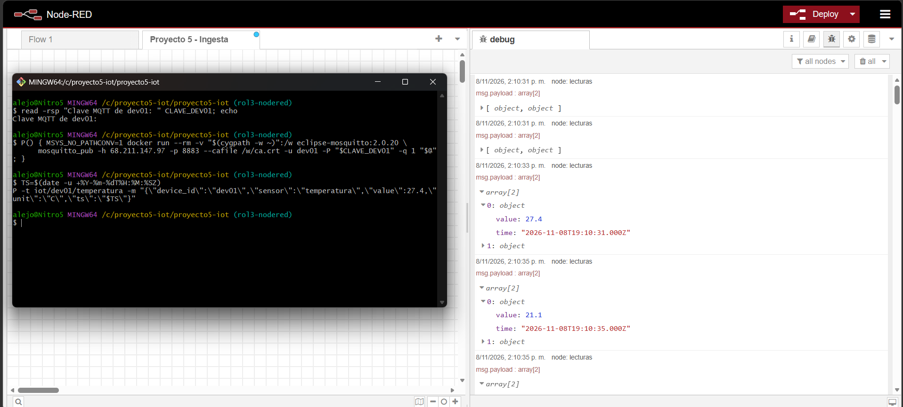

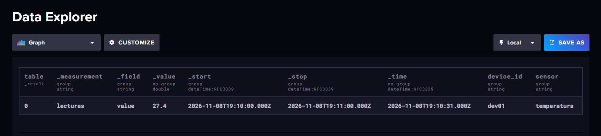

**Veredicto:** ✅ Pasa

**Observaciones:** El punto se guarda con la hora del campo `ts` del mensaje (no con la hora de llegada), como define el contrato.

**Revisado por:** Pendiente

---


## P4.2 — Mensaje fuera de rango descartado · Intento 1

| Campo | Valor |
|---|---|
| Requerimiento | R5.4 |
| Ejecutada por | Alejandro Domínguez Torres (Rol 3, reemplazo) |
| Fecha y hora | 2026-11-08 14:15 y 14:16 |
| Entorno | Ver "Entorno común" |
| Precondiciones | Flujo desplegado en Azure, `iot/+/+` en *connected* |

**Qué se probó:** Que una temperatura fuera del rango físico (−20 a 80 °C) no se guarda como lectura y queda registrada como descartada.

**Cómo (pasos y comandos exactos):**

```bash
TS=$(date -u +%Y-%m-%dT%H:%M:%SZ)
P -t iot/dev01/temperatura -m "{\"device_id\":\"dev01\",\"sensor\":\"temperatura\",\"value\":150,\"unit\":\"C\",\"ts\":\"$TS\"}"
```

Consultas en InfluxDB:

```
import "strings"
from(bucket: "iot")
  |> range(start: -3h)
  |> filter(fn: (r) => r._measurement == "descartados")
  |> pivot(rowKey: ["_time"], columnKey: ["_field"], valueColumn: "_value")
  |> filter(fn: (r) => strings.containsStr(v: r.motivo, substr: "fuera de rango"))
  |> keep(columns: ["_time", "device_id", "topic", "motivo", "payload"])
```

```
from(bucket: "iot")
  |> range(start: -3h)
  |> filter(fn: (r) => r._measurement == "lecturas" and r._field == "value" and r._value > 80)
```

**Resultado esperado:** **No** está en `lecturas`; sí en `descartados` con el motivo.

**Resultado obtenido:**

```
Debug Node-RED 14:16:34: (warn) "Descartado iot/dev01/temperatura: fuera de rango: 150 (-20 a 80)"
descartados: 2026-11-08T19:15:58Z · dev01 · fuera de rango: 150 (-20 a 80) · {"device_id":"dev01",...,"value":150,...}
descartados: 2026-11-08T19:16:34Z · dev01 · fuera de rango: 150 (-20 a 80) · {"device_id":"dev01",...,"value":150,...}
lecturas con value > 80: No Results
```

**Mediciones:** No aplica.

**Captura:**

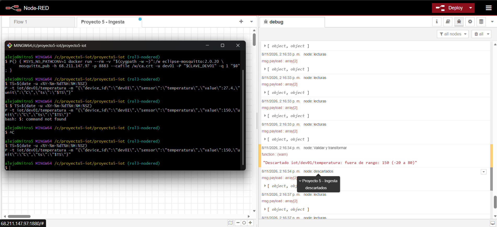

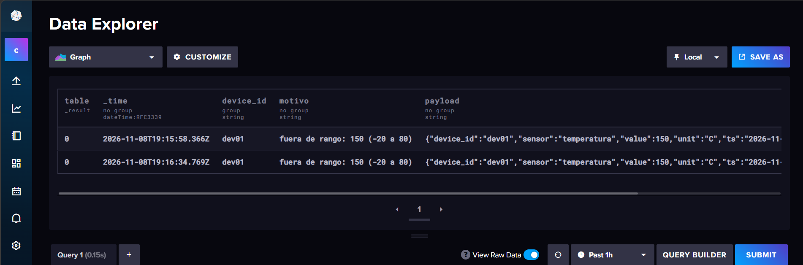

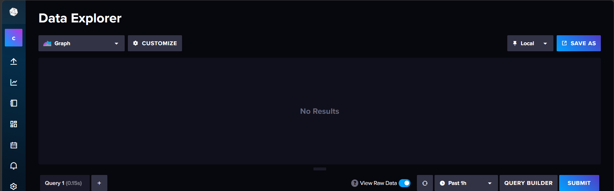

**Veredicto:** ✅ Pasa

**Observaciones:** El mensaje se envió dos veces (19:15:58Z y 19:16:34Z) y ambas quedaron descartadas con el mismo motivo.

**Revisado por:** Pendiente

---


## P4.3 — Mensaje malformado sin detener el flujo · Intento 1

| Campo | Valor |
|---|---|
| Requerimiento | R5.4 |
| Ejecutada por | Alejandro Domínguez Torres (Rol 3, reemplazo) |
| Fecha y hora | 2026-11-08 14:18 y 14:20 |
| Entorno | Ver "Entorno común" |
| Precondiciones | Flujo desplegado en Azure, `iot/+/+` en *connected* |

**Qué se probó:** Que un mensaje que no es JSON se descarta y que el flujo sigue procesando el siguiente mensaje válido.

**Cómo (pasos y comandos exactos):**

```bash
P -t iot/dev01/temperatura -m 'temperatura=27.4'
P -t iot/dev01/temperatura -m "{\"device_id\":\"dev01\",\"sensor\":\"temperatura\",\"value\":27.4,\"unit\":\"C\",\"ts\":\"$TS\"}"
```

**Resultado esperado:** El malformado queda como descartado; el válido sí se guarda (el flujo no se detuvo).

**Resultado obtenido:**

```
Debug Node-RED 14:20:51: (warn) "Descartado iot/dev01/temperatura: no es JSON"
Debug Node-RED 14:20:51: descartados · motivo: "no es JSON" · payload: "temperatura=27.4"
Debug Node-RED 14:20:53: lecturas · value: 27.4 · time: "2026-11-08T19:20:51.000Z"
descartados: 2026-11-08T19:18:24Z y 2026-11-08T19:20:52Z · dev01 · no es JSON · temperatura=27.4
```

**Mediciones:** No aplica.

**Captura:**

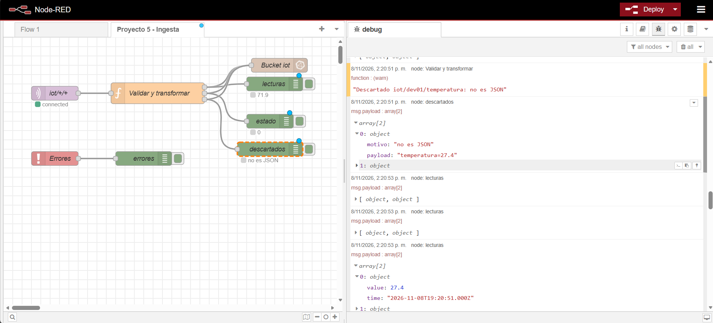

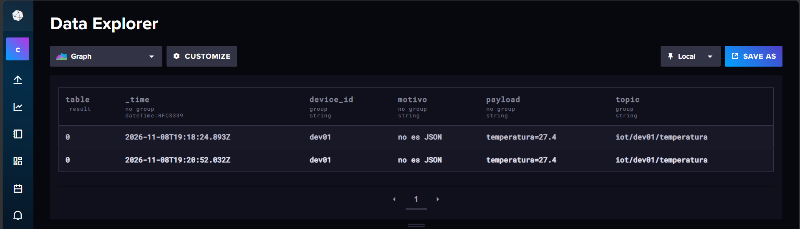

**Veredicto:** 🟨 Parcial

**Observaciones:** El descarte y la continuidad del flujo se ven en el debug, pero la lectura válida (`ts` 19:20:51Z) ya no está en InfluxDB: en P4.5 se reutilizó la misma variable `TS`, y el punto de 31.2 con la misma hora, dispositivo y sensor sobrescribió al de 27.4. Se repite como intento 2 generando una hora nueva antes de cada envío.

**Revisado por:** Pendiente

## P4.3 — Mensaje malformado sin detener el flujo · Intento 2

| Campo | Valor |
|---|---|
| Requerimiento | R5.4 |
| Ejecutada por | Alejandro Domínguez Torres (Rol 3, reemplazo) |
| Fecha y hora | 2026-11-08 16:04 |
| Entorno | Ver "Entorno común" |
| Precondiciones | Flujo desplegado en Azure, `iot/+/+` en *connected* |

**Qué se probó:** Lo mismo que el intento 1, con una hora nueva para la lectura válida.

**Cómo (pasos y comandos exactos):**

```bash
P -t iot/dev01/temperatura -m 'temperatura=27.4'
TS=$(date -u +%Y-%m-%dT%H:%M:%SZ); echo $TS
P -t iot/dev01/temperatura -m "{\"device_id\":\"dev01\",\"sensor\":\"temperatura\",\"value\":27.4,\"unit\":\"C\",\"ts\":\"$TS\"}"
```

Consulta en InfluxDB:

```
from(bucket: "iot")
  |> range(start: 2026-11-08T21:04:00Z, stop: 2026-11-08T21:05:00Z)
  |> filter(fn: (r) => r._measurement == "lecturas" and r.device_id == "dev01" and r.sensor == "temperatura" and r._field == "value")
  |> filter(fn: (r) => r._time == 2026-11-08T21:04:57Z)
```

**Resultado esperado:** El malformado queda como descartado; el válido sí se guarda.

**Resultado obtenido:**

```
TS usado: 2026-11-08T21:04:57Z
Debug Node-RED 16:04:54: (warn) "Descartado iot/dev01/temperatura: no es JSON"
Debug Node-RED 16:04:55: descartados · motivo: "no es JSON" · payload: "temperatura=27.4"
Debug Node-RED 16:04:56: lecturas · value: 27.4 · time: "2026-11-08T21:04:57.000Z"
InfluxDB: lecturas · value · 27.4 · 2026-11-08T21:04:57Z · dev01 · temperatura   (una sola fila)
```

**Mediciones:** No aplica.

**Captura:**

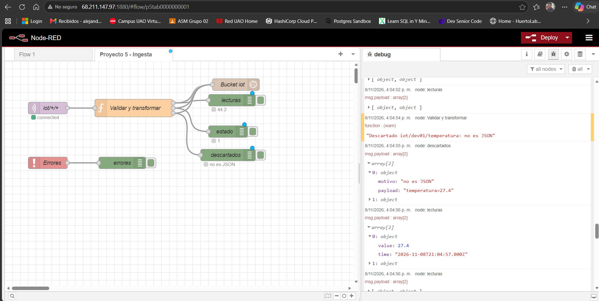

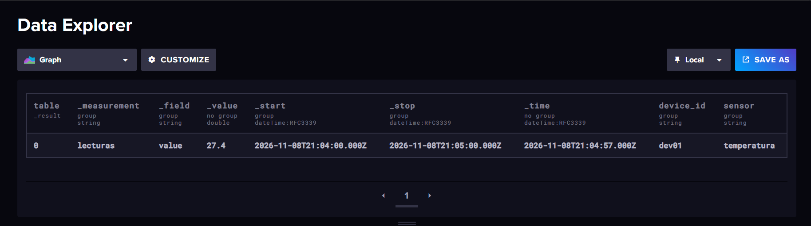

**Veredicto:** ✅ Pasa

**Observaciones:** El mensaje inválido no detuvo el flujo: dos segundos después se procesó y guardó la lectura válida. La hora del `ts` (21:04:57Z) es un segundo posterior a la de llegada en Node-RED porque el reloj del PC va levemente adelantado respecto a la VM; no afecta la prueba.

**Revisado por:** Pendiente

---


## P4.4 — Estado online/offline · Intento 1

| Campo | Valor |
|---|---|
| Requerimiento | R5.4 |
| Ejecutada por | Alejandro Domínguez Torres (Rol 3, reemplazo) |
| Fecha y hora | 2026-11-08 14:24 (y repetida a las 14:27) |
| Entorno | Ver "Entorno común" |
| Precondiciones | dev01 conectado y publicando `online` retenido |

**Qué se probó:** Que los mensajes de estado se guardan en la medición `estado` como `online` 1 o 0.

**Cómo (pasos y comandos exactos):**

```bash
P -t iot/dev01/status -r -m offline
P -t iot/dev01/status -r -m online
```

Consulta en InfluxDB:

```
from(bucket: "iot")
  |> range(start: -3h)
  |> filter(fn: (r) => r._measurement == "estado" and r.device_id == "dev01")
  |> keep(columns: ["_time", "device_id", "_field", "_value"])
```

**Resultado esperado:** En `estado`, `online` pasa de 1 a 0 y vuelve a 1.

**Resultado obtenido:**

```
estado · online · 1 · 2026-11-08T18:09:17Z · dev01   (conexión inicial de dev01)
estado · online · 0 · 2026-11-08T19:24:12Z · dev01   (prueba: offline)
estado · online · 1 · 2026-11-08T19:24:21Z · dev01   (prueba: online)
Debug Node-RED 14:27:07: estado · online: 0 · 14:27:09: estado · online: 1   (segunda ejecución)
```

**Mediciones:** No aplica.

**Captura:**

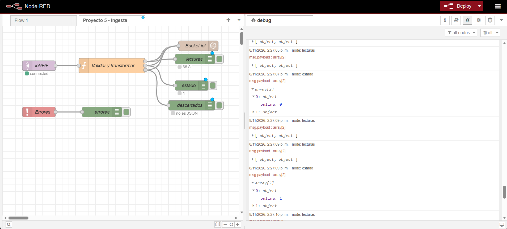

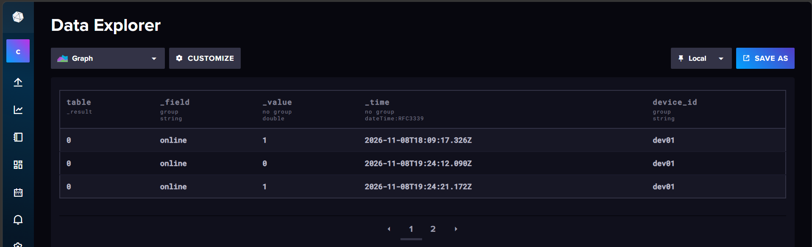

**Veredicto:** ✅ Pasa

**Observaciones:** Se publicó con `-r` (retenido) y se terminó siempre con `online`, para que el estado retenido de dev01 quede correcto.

**Revisado por:** Pendiente

---


## P4.5 — Regla de umbral (alerta=1) · Intento 1

| Campo | Valor |
|---|---|
| Requerimiento | R5.4 |
| Ejecutada por | Alejandro Domínguez Torres (Rol 3, reemplazo) |
| Fecha y hora | 2026-11-08 14:29 |
| Entorno | Ver "Entorno común" |
| Precondiciones | Flujo desplegado en Azure, `iot/+/+` en *connected* |

**Qué se probó:** Que una temperatura mayor al umbral de 30 °C se guarda con el campo `alerta = 1`, y las normales no.

**Cómo (pasos y comandos exactos):**

```bash
P -t iot/dev01/temperatura -m "{\"device_id\":\"dev01\",\"sensor\":\"temperatura\",\"value\":31.2,\"unit\":\"C\",\"ts\":\"$TS\"}"
```

Consulta en InfluxDB:

```
from(bucket: "iot")
  |> range(start: -3h)
  |> filter(fn: (r) => r._measurement == "lecturas" and r.device_id == "dev01" and r.sensor == "temperatura")
  |> pivot(rowKey: ["_time"], columnKey: ["_field"], valueColumn: "_value")
  |> filter(fn: (r) => exists r.alerta)
  |> keep(columns: ["_time", "device_id", "sensor", "value", "alerta"])
```

**Resultado esperado:** El punto se guarda con `alerta=1`; los normales no la tienen.

**Resultado obtenido:**

```
Debug Node-RED 14:29:51: lecturas · value: 31.2 · time: "2026-11-08T19:20:51.000Z" · alerta: 1
InfluxDB: 2026-11-08T19:20:51Z · alerta 1 · dev01 · temperatura · value 31.2   (única fila con alerta)
```

**Mediciones:** No aplica.

**Captura:**


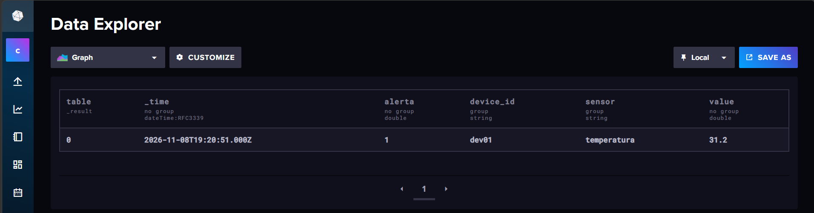

**Veredicto:** ✅ Pasa

**Observaciones:** Solo la lectura de 31.2 tiene `alerta`; ninguna lectura del simulador (20–29 °C) la tiene. El mensaje se envió con el `TS` de la prueba anterior (19:20:51Z), por eso su hora en InfluxDB no es la del envío (19:29 UTC) y sobrescribió la lectura de P4.3 (ver P4.3, intento 2). El envío a Telegram depende de la alerta de Grafana, que todavía no está integrada en Azure; se prueba en R5.6.

**Revisado por:** Pendiente

---


## P4.6 — Exportación del flujo sin credenciales · Intento 1

| Campo | Valor |
|---|---|
| Requerimiento | R5.4 |
| Ejecutada por | Alejandro Domínguez Torres (Rol 3, reemplazo) |
| Fecha y hora | 2026-11-08 16:53 |
| Entorno | Exportado desde Node-RED de Azure; importado en Node-RED 4.0 local (Docker Desktop, contenedores recreados con `docker compose down -v`) con Mosquitto 2.0.20 e InfluxDB 2.7 locales, sin TLS |
| Precondiciones | `backend/nodered/flows.json` exportado desde Azure (Export → All flows); `node-red-contrib-influxdb` instalado desde *Manage palette* antes de importar |

**Qué se probó:** Que el flujo exportado se importa en un Node-RED limpio, funciona y no contiene contraseñas ni tokens.

**Cómo (pasos y comandos exactos):**

1. Revisión de credenciales, en la carpeta del repositorio:

```bash
grep -iE '"(password|token|user)"' backend/nodered/flows.json
```

2. En Node-RED local (`localhost:1880`): Import → `flows.json` → importar "Proyecto 5 - Ingesta" y sus 3 nodos de configuración → desmarcar *Use TLS* en el broker (el Mosquitto local no usa TLS) → en *InfluxDB (contrato)* escribir Token `${INFLUXDB_TOKEN}` → Deploy.
3. Mensaje de prueba local, en la carpeta del simulacro:

```bash
TS=$(date -u +%Y-%m-%dT%H:%M:%SZ); echo $TS
docker compose exec -T mosquitto mosquitto_pub -q 1 -t iot/dev01/temperatura -m "{\"device_id\":\"dev01\",\"sensor\":\"temperatura\",\"value\":25.5,\"unit\":\"C\",\"ts\":\"$TS\"}"
```

4. Consulta en InfluxDB local (`localhost:8086`):

```
from(bucket: "iot")
  |> range(start: -1h)
  |> filter(fn: (r) => r._measurement == "lecturas" and r._field == "value" and r._value == 25.5)
```

**Resultado esperado:** Se importa sin errores y no contiene contraseñas ni tokens.

**Resultado obtenido:**

```
grep: sin resultados (el export de Node-RED no incluye credenciales)
Node-RED local: pestaña "Proyecto 5 - Ingesta" importada; iot/+/+ connected; nodos de configuración InfluxDB, Mosquitto y CA del broker con 1 uso cada uno.
Primer envío (16:51, token sin configurar): errores · influx_error: "HttpError: unauthorized access"
Segundo envío (16:53, token ${INFLUXDB_TOKEN}): TS usado 2026-11-08T21:53:20Z
Debug local 16:53:27: lecturas · value: 25.5 · time: "2026-11-08T21:53:20.000Z" · dev01 · temperatura (sin errores)
InfluxDB local: lecturas · value · 25.5 · 2026-11-08T21:53:20Z · dev01 · temperatura   (una sola fila)
```

**Mediciones:** No aplica.

**Captura:**

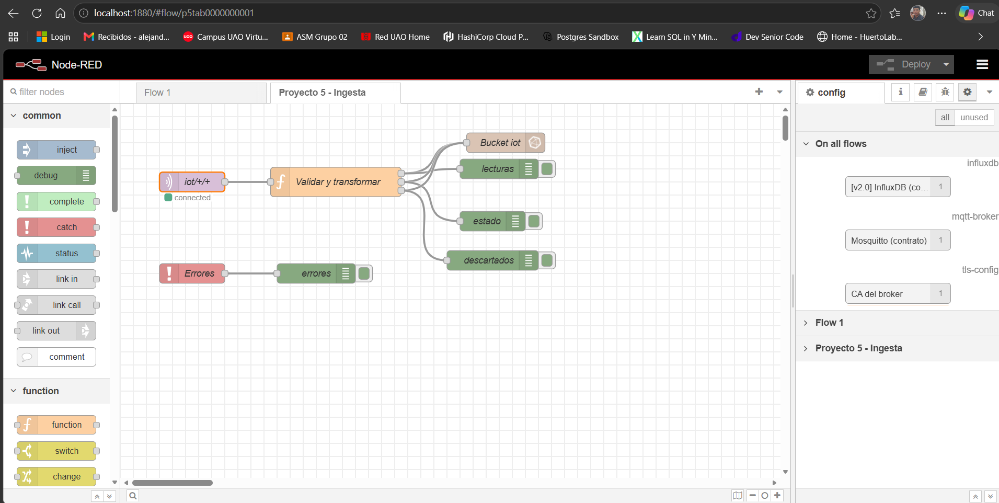

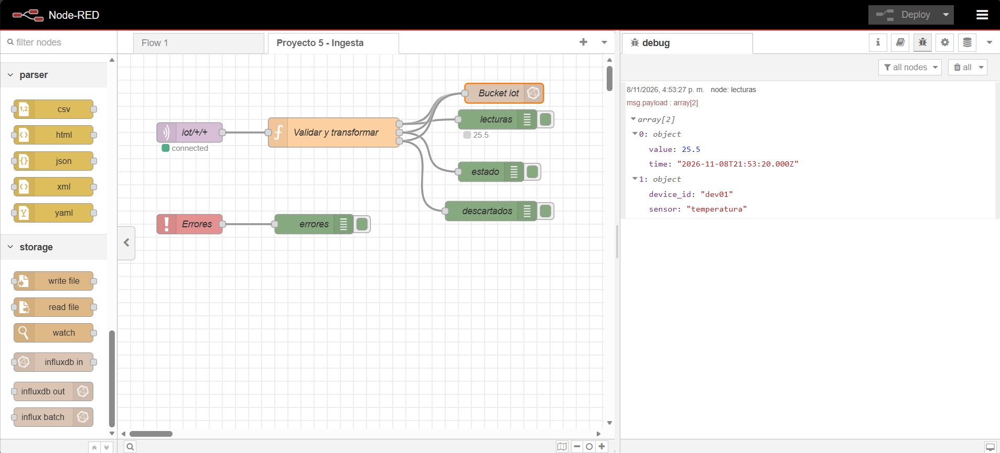

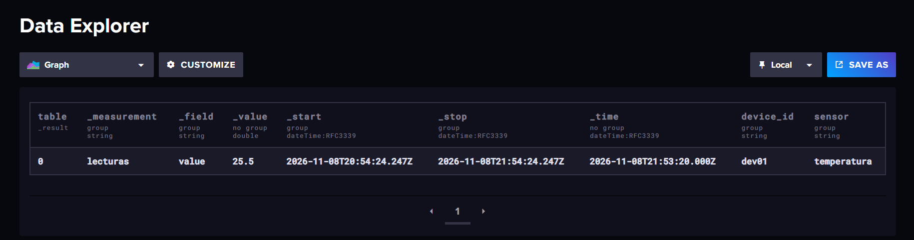

**Veredicto:** ✅ Pasa

**Observaciones:** Al importar, Node-RED avisó que la pestaña vacía "Flow 1" ya existía (es la pestaña por defecto); se importaron solo "Proyecto 5 - Ingesta" y sus nodos de configuración, sin conflictos. El export de Node-RED no incluye credenciales, lo que confirma que el archivo no tiene claves, pero por eso, tras importar `flows.json`, hay que volver a escribir en los nodos de configuración las referencias a variables de entorno: Token `${INFLUXDB_TOKEN}` en *InfluxDB (contrato)* y, en Azure, Username `${MQTT_NODERED_USER}` y Password `${MQTT_NODERED_PASSWORD}` en *Mosquitto (contrato)*. En el primer envío local se había omitido el token y la escritura falló con `unauthorized access`; al configurarlo, la lectura se guardó correctamente. El único otro cambio entre Azure y local es *Use TLS*.

**Revisado por:** Pendiente