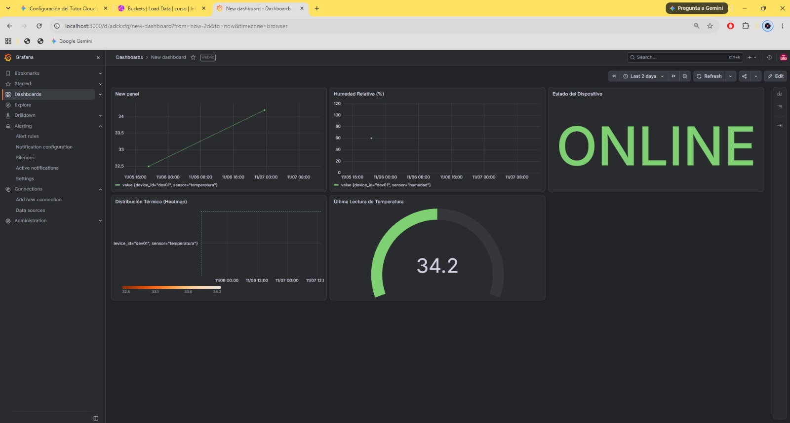
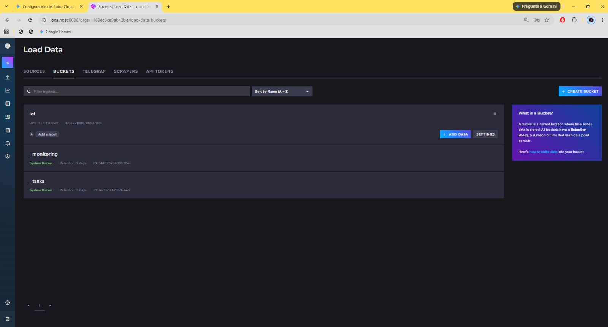
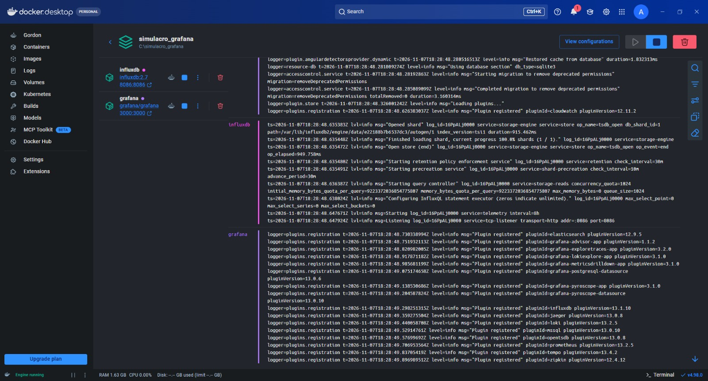

# Evidencia R5.5 — Dashboard en Grafana

| Campo | Valor |
|---|---|
| Criterio de aceptación | Dashboard actualiza en tiempo real; al menos 5 paneles funcionando con datos reales. |
| Responsable | Rol 4 |
| Estado | 🟨 En progreso |
| Pruebas definidas en | [requerimientos.md](../requerimientos.md) |
| Plantilla | [PLANTILLA.md](PLANTILLA.md) |
| Capturas | `docs/evidencias/img/R5.5/` |

## Resumen

| ID | Prueba | Veredicto | Fecha | Revisado por |
|---|---|---|---|---|
| P5.1 | 5 o más paneles con datos reales | 🟨 | 2026-11-07 | Alejandro Domínguez Torres |
| P5.2 | Actualización en tiempo real | ⬜ | | |
| P5.3 | Variable device_id | ⬜ | | |
| P5.4 | Importación del dashboard.json | ⬜ | | |

Leyenda: ⬜ Pendiente · ✅ Pasa · ❌ Falla · 🟨 Parcial

---

## P5.1

Paneles del dashboard:

| # | Panel | Tipo | ¿Datos reales? |
|---|---|---|---|
| 1 | Temperatura (titulado "New panel") | Serie de tiempo | ❌ Datos de prueba |
| 2 | Humedad Relativa (%) | Serie de tiempo | ❌ Datos de prueba |
| 3 | Estado del Dispositivo | Stat | ❌ Datos de prueba |
| 4 | Distribución Térmica (Heatmap) | Mapa de calor | ❌ Datos de prueba |
| 5 | Última Lectura de Temperatura | Gauge | ❌ Datos de prueba |
| 6 | Estadísticas mín / máx / promedio | — | No existe todavía |

### P5.1 — 5 o más paneles con datos reales · Intento 1

| Campo | Valor |
|---|---|
| Requerimiento | R5.5 |
| Ejecutada por | Alejandro Boris Garces. (Rol 4) |
| Fecha y hora | 2026-11-07 |
| Entorno | Simulacro local en Docker Desktop (`simulacro_grafana`): InfluxDB 2.7 y Grafana 13.3.0 en el PC · commit `9580c74` (`backend/grafana/dashboard.json`) |
| Precondiciones | Bucket `iot` en la organización `curso`; data source InfluxDB (Flux) configurado en Grafana |

**Qué se probó:** Que el dashboard tiene al menos 5 paneles que leen de la medición `lecturas` y `estado` según el contrato.

**Cómo (pasos y comandos exactos):**

1. Levantar InfluxDB y Grafana en Docker Desktop.
2. Escribir lecturas de prueba en el bucket `iot` (medición `lecturas`, etiquetas `device_id` y `sensor`, campo `value`).
3. Crear los paneles con consultas Flux, por ejemplo:

```
from(bucket: "iot")
  |> range(start: v.timeRangeStart, stop: v.timeRangeStop)
  |> filter(fn: (r) => r._measurement == "lecturas" and r.sensor == "temperatura" and r._field == "value")
  |> aggregateWindow(every: v.windowPeriod, fn: mean, createEmpty: false)
```

4. Exportar el dashboard a `backend/grafana/dashboard.json`.

**Resultado esperado:** Al menos 5 paneles con **datos reales** y sin errores.

**Resultado obtenido:**

```
5 paneles sin errores de consulta: temperatura, humedad, estado (ONLINE), mapa de calor y última lectura (34.2 °C).
Datos: solo dev01; 3 lecturas de temperatura (32.5 a 34.2 °C) y 1 de humedad en 2 días.
```

**Mediciones:** No aplica.

**Captura:**







**Veredicto:** 🟨 Parcial

**Observaciones:** Los 5 paneles funcionan, pero con datos de prueba en un entorno local, no con los datos reales que dev01 y dev02 publican al broker de Azure (los valores sobre 30 °C no los genera el simulador, que produce 20–29 °C cada 5 s). Falta repetir en el Grafana de la VM de Azure, con datos de Node-RED (Rol 3). Pendientes del dashboard: título del panel 1 ("New panel") y del dashboard ("New dashboard"), panel de estadísticas mín/máx/promedio y mapeo `0 → OFFLINE` en el panel de estado.

**Revisado por:** Alejandro Domínguez Torres, 2026-11-07

## P5.2
<!-- Pegar aquí el bloque de la plantilla llenado -->

## P5.3
<!-- Pegar aquí el bloque de la plantilla llenado -->

## P5.4
<!-- Pegar aquí el bloque de la plantilla llenado -->