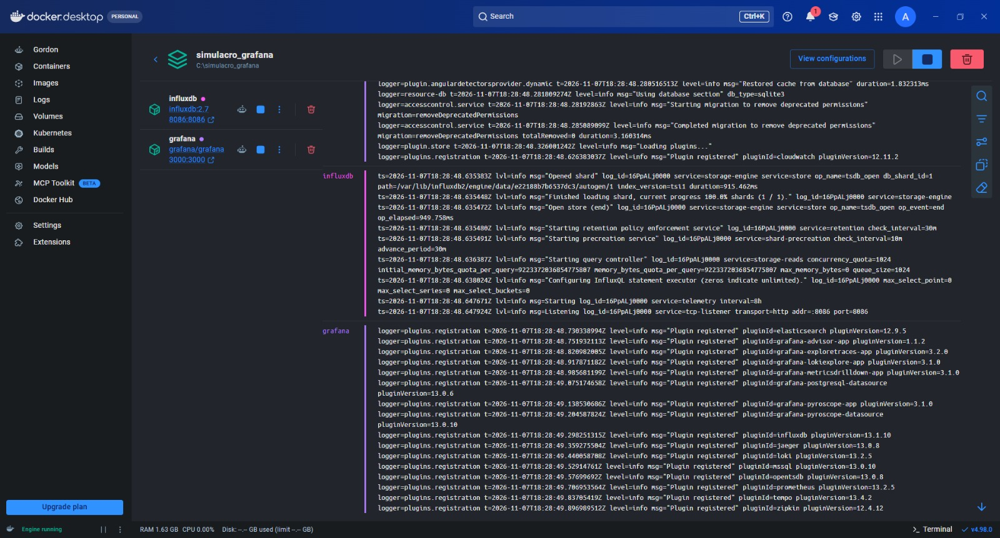
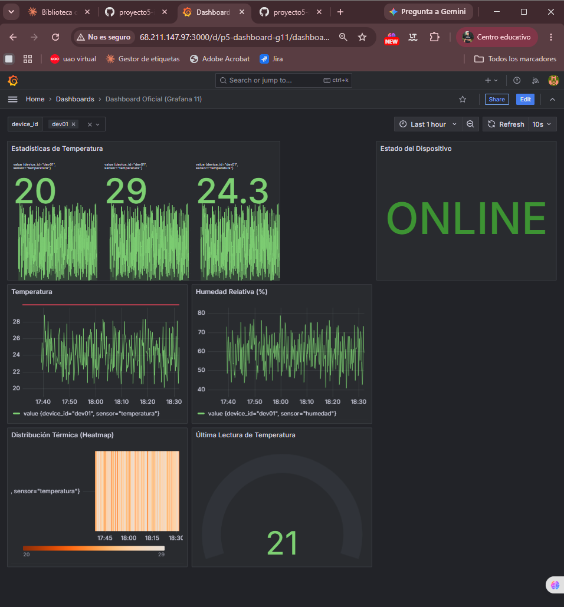
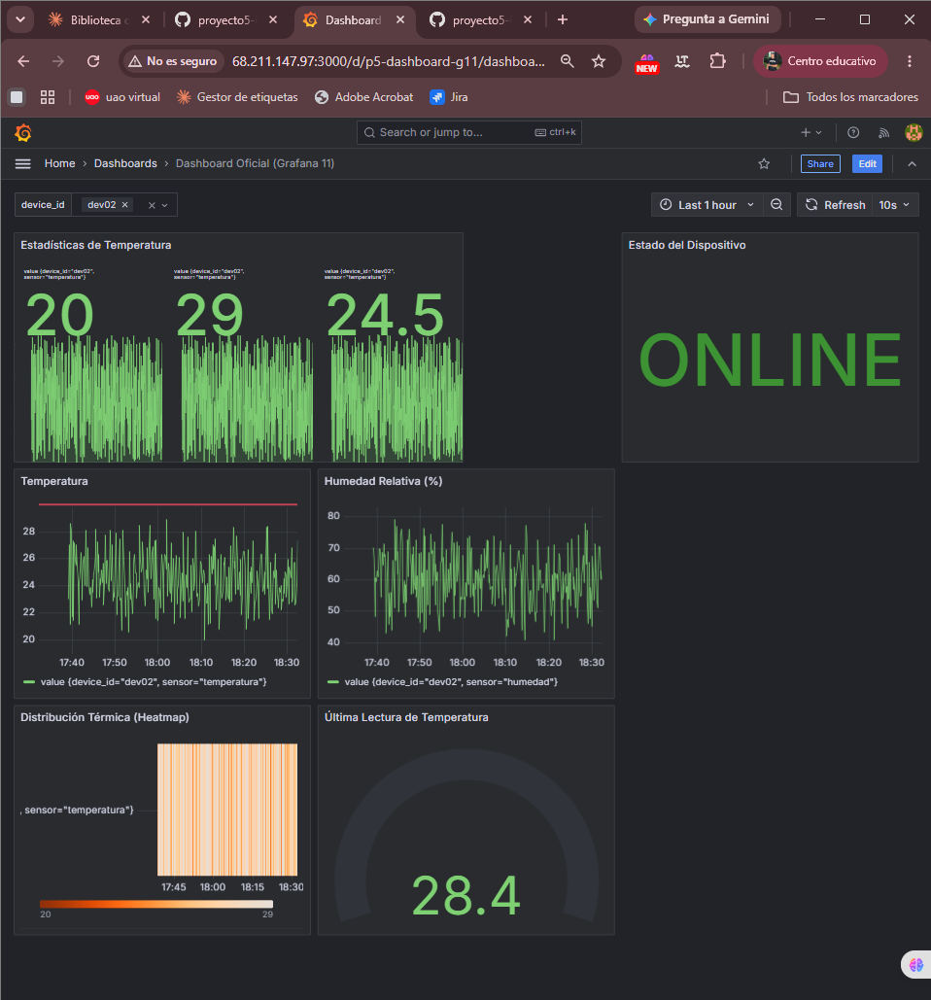
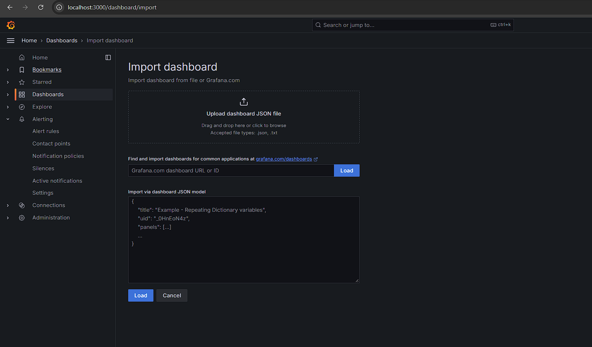
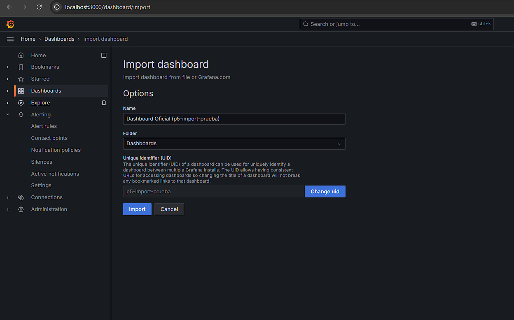
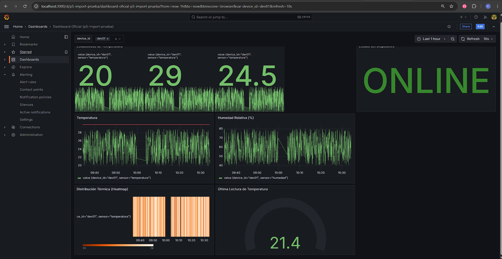

# Evidencia R5.5 — Dashboard en Grafana

| Campo | Valor |
|---|---|
| Criterio de aceptación | Dashboard actualiza en tiempo real; al menos 5 paneles funcionando con datos reales. |
| Responsable | Rol 4 |
| Estado | 🟨 Parcial (P5.4 Intento 2 hecho, pendiente de revisión por otra persona) |
| Pruebas definidas en | [requerimientos.md](../requerimientos.md) |
| Plantilla | [PLANTILLA.md](PLANTILLA.md) |
| Capturas | `docs/evidencias/img/R5.5/` |

## Resumen

| ID | Prueba | Veredicto | Fecha | Revisado por |
|---|---|---|---|---|
| P5.1 | 5 o más paneles con datos reales | ✅ (Intento 2) | 2026-11-07 y 2026-11-17 | Alejandro Domínguez Torres |
| P5.2 | Actualización en tiempo real | ✅ | 2026-11-17 | Alejandro Domínguez Torres |
| P5.3 | Variable device_id | ✅ | 2026-11-17 | Alejandro Domínguez Torres |
| P5.4 | Importación del dashboard.json | ✅ (Intento 2) | 2026-11-18 | Pendiente |

Leyenda: ⬜ Pendiente · ✅ Pasa · ❌ Falla · 🟨 Parcial

---

## P5.1

Paneles del dashboard:

| # | Panel | Tipo | ¿Datos reales? |
|---|---|---|---|
| 1 | Temperatura (titulado "New panel") | Serie de tiempo | ❌ Datos de prueba |
| 2 | Humedad Relativa (%) | Serie de tiempo | ❌ Datos de prueba |
| 3 | Estado del Dispositivo | Stat | ❌ Datos de prueba |
| 4 | Distribución Térmica (Heatmap) | Mapa de calor | ❌ Datos de prueba |
| 5 | Última Lectura de Temperatura | Gauge | ❌ Datos de prueba |
| 6 | Estadísticas mín / máx / promedio | — | No existe todavía |

### P5.1 — 5 o más paneles con datos reales · Intento 1

| Campo | Valor |
|---|---|
| Requerimiento | R5.5 |
| Ejecutada por | Alejandro Boris Garces. (Rol 4) |
| Fecha y hora | 2026-11-07 |
| Entorno | Simulacro local en Docker Desktop (`simulacro_grafana`): InfluxDB 2.7 y Grafana 13.3.0 en el PC · commit `9580c74` (`backend/grafana/dashboard.json`) |
| Precondiciones | Bucket `iot` en la organización `curso`; data source InfluxDB (Flux) configurado en Grafana |

**Qué se probó:** Que el dashboard tiene al menos 5 paneles que leen de la medición `lecturas` y `estado` según el contrato.

**Cómo (pasos y comandos exactos):**

1. Levantar InfluxDB y Grafana en Docker Desktop.
2. Escribir lecturas de prueba en el bucket `iot` (medición `lecturas`, etiquetas `device_id` y `sensor`, campo `value`).
3. Crear los paneles con consultas Flux, por ejemplo:

```flux
from(bucket: "iot")
  |> range(start: v.timeRangeStart, stop: v.timeRangeStop)
  |> filter(fn: (r) => r._measurement == "lecturas" and r.sensor == "temperatura" and r._field == "value")
  |> aggregateWindow(every: v.windowPeriod, fn: mean, createEmpty: false)
```

4. Exportar el dashboard a `backend/grafana/dashboard.json`.

**Resultado esperado:** Al menos 5 paneles con **datos reales** y sin errores.

**Resultado obtenido:**

```text
5 paneles sin errores de consulta: temperatura, humedad, estado (ONLINE), mapa de calor y última lectura (34.2 °C).
Datos: solo dev01; 3 lecturas de temperatura (32.5 a 34.2 °C) y 1 de humedad en 2 días.
```

**Mediciones:** No aplica.

**Captura:**




**Veredicto:** 🟨 Parcial

**Observaciones:** Los 5 paneles funcionan, pero con datos de prueba en un entorno local, no con los datos reales que dev01 y dev02 publican al broker de Azure (los valores sobre 30 °C no los genera el simulador, que produce 20–29 °C cada 5 s). Falta repetir en el Grafana de la VM de Azure, con datos de Node-RED (Rol 3). Pendientes del dashboard: título del panel 1 ("New panel") y del dashboard ("New dashboard"), panel de estadísticas mín/máx/promedio y mapeo `0 → OFFLINE` en el panel de estado.

**Revisado por:** Alejandro Domínguez Torres, 2026-11-07

### P5.1 — 5 o más paneles con datos reales · Intento 2

| Campo | Valor |
|---|---|
| Requerimiento | R5.5 |
| Ejecutada por | Boris Alejandro Garces Hoyos (Rol 4) |
| Fecha y hora | 2026-11-17 18:00 |
| Entorno | VM Azure `vm-iot-backend` (IP 68.211.147.97) · Grafana 11.3.0 · Datos MQTT |
| Precondiciones | VM Azure encendida; `dev01` y `dev02` publicando datos |

**Qué se probó:** Que el dashboard muestra al menos 5 paneles con datos reales desde Azure, corrigiendo las observaciones del Intento 1.

**Cómo (pasos y comandos exactos):**

1. Ingresar a Grafana desde la IP pública de la VM en Azure.
2. Verificar recepción de datos reales de los dispositivos generados en vivo.

**Resultado esperado:** Al menos 5 paneles con datos reales en el entorno de producción.

**Resultado obtenido:**

```text
Se muestran 6 paneles operativos con datos reales de dev01 y dev02. Títulos corregidos y mapeo de estado ONLINE funcional.
```

**Mediciones:** No aplica.

**Captura:**


**Veredicto:** ✅ Pasa

**Observaciones:** Se subsanaron todos los pendientes del Intento 1. La prueba se ejecutó exitosamente en la IP pública de Azure.

**Revisado por:** Alejandro Domínguez Torres (Rol 5), 2026-11-17

---

## P5.2

### P5.2 — Actualización en tiempo real · Intento 1

| Campo | Valor |
|---|---|
| Requerimiento | R5.5 |
| Ejecutada por | Boris Alejandro Garces Hoyos (Rol 4) |
| Fecha y hora | 2026-11-17 18:28 |
| Entorno | VM Azure `vm-iot-backend` (IP 68.211.147.97) · Grafana 11.3.0 |
| Precondiciones | Configuración de refresco automático de Grafana activada |

**Qué se probó:** Que los paneles se actualizan de forma automática sin recargar la página manualmente al ingresar nuevos datos.

**Cómo (pasos y comandos exactos):**

1. Configurar menú de refresco automático en Grafana a 10s.
2. Tomar captura.
3. Esperar el avance automático sin recargar y tomar una segunda captura.

**Resultado esperado:** El dato nuevo aparece en el panel en 10 s o menos.

**Resultado obtenido:**

```text
Las capturas marcan las 18:28 y 18:29. Esta diferencia visible de un minuto se debe a que el lapso de 10 segundos de refresco automático transcurrió justo durante el cambio de minuto. Se evidencian los valores nuevos graficados de forma autónoma sin recargar la página, cumpliendo con el criterio de actualización en tiempo real.
```

**Mediciones:** Refresco visual evidenciado con la llegada de nuevos datos. 

**Captura:**


**Veredicto:** ✅ Pasa

**Observaciones:** Las capturas no muestran segundos (18:28 y 18:29); se acepta porque los valores cambian sin recargar con el refresco configurado en 10 s, pero el tiempo de 10 s o menos no quedó medido con segundos.

**Revisado por:** Alejandro Domínguez Torres (Rol 5), 2026-11-17

---

## P5.3

### P5.3 — Variable device_id · Intento 1

| Campo | Valor |
|---|---|
| Requerimiento | R5.5 |
| Ejecutada por | Boris Alejandro Garces Hoyos (Rol 4) |
| Fecha y hora | 2026-11-17 18:10 |
| Entorno | VM Azure `vm-iot-backend` (IP 68.211.147.97) · Grafana 11.3.0 |
| Precondiciones | Variable de dashboard `device_id` configurada y mapeada |

**Qué se probó:** Que los paneles filtran por dispositivo al cambiar la variable en el menú desplegable.

**Cómo (pasos y comandos exactos):**

1. Seleccionar exclusivamente `dev01` en el menú superior y observar los paneles.
2. Seleccionar exclusivamente `dev02` en el mismo menú y observar los paneles.

**Resultado esperado:** Los paneles filtran por el dispositivo elegido.

**Resultado obtenido:**

```text
La selección de dev01 aísla correctamente sus métricas, y viceversa para dev02, en todos los paneles.
```

**Mediciones:** No aplica.

**Captura:**





**Veredicto:** ✅ Pasa

**Observaciones:** El filtrado se aplica transversalmente a todos los gráficos.

**Revisado por:** Alejandro Domínguez Torres (Rol 5), 2026-11-17

---

## P5.4

### P5.4 — Importación del dashboard.json · Intento 1

| Campo | Valor |
|---|---|
| Requerimiento | R5.5 |
| Ejecutada por | Boris Alejandro Garces Hoyos (Rol 4) |
| Fecha y hora | 2026-11-17 18:15 |
| Entorno | VM Azure `vm-iot-backend` (IP 68.211.147.97) · Grafana 11.3.0 |
| Precondiciones | Archivo `backend/grafana/dashboard.json` exportado y disponible |

**Qué se probó:** Que el dashboard opera normalmente tras ser importado desde el archivo fuente JSON en un entorno limpio.

**Cómo (pasos y comandos exactos):**

1. En la interfaz de Grafana, navegar a Dashboards -> New -> Import.
2. Cargar el contenido de `dashboard.json`.
3. Seleccionar la fuente de datos InfluxDB y confirmar la importación.

**Resultado esperado:** Funciona sin editarlo.

**Resultado obtenido:**

```text
El archivo JSON se importa correctamente y el dashboard resultante se renderiza.
```

**Mediciones:** No aplica.

**Captura:**


**Veredicto:** 🟨 Parcial

**Observaciones:** No se tomaron las capturas del menú previo de importación. Se adjunta el dashboard final (idéntico al de P5.1) como evidencia alternativa de que el archivo JSON cargó sin errores y es funcional.

**Revisado por:** Alejandro Domínguez Torres (Rol 5), 2026-11-17

---

### P5.4 — Importación del dashboard.json · Intento 2

| Campo | Valor |
|---|---|
| Requerimiento | R5.5 |
| Ejecutada por | Kevin Aristizabal (Rol 1), con el archivo `backend/grafana/dashboard.json` exportado por Boris Alejandro Garces Hoyos (Rol 4) |
| Fecha y hora | 2026-11-18, de 10:33 a 10:34 (Bogotá, según la hora de guardado de las capturas y el eje de tiempo del dashboard) |
| Entorno | Grafana 11.3.0 de la VM Azure `vm-iot-backend`, abierto desde el PC de Kevin en `localhost:3000` por un túnel SSH · datos MQTT en vivo |
| Precondiciones | El dashboard oficial (uid `p5-dashboard-g11`) ya existe en esa Grafana. Para no sobrescribirlo, la importación se hizo con un nombre y un UID nuevos |

**Qué se probó:** Que el archivo `dashboard.json` del repositorio se importa en Grafana con la pantalla Import y el dashboard resultante funciona sin editarlo.

**Este intento reemplaza al borrador anterior de este PR**, corregido según la revisión de Alejandro Domínguez Torres: la captura anterior abría el dashboard que ya existía (importar un JSON con el mismo UID lo sobrescribe), así que no demostraba la importación. Aquí se importa una copia con otro UID.

**Cómo (pasos y comandos exactos):**

1. Abrir un túnel SSH a la VM y entrar a `http://localhost:3000`:

```cmd
ssh -N -L 3000:localhost:3000 -i "%USERPROFILE%\Downloads\practica-iaas-key.pem" azureuser@68.211.147.97
```

2. En Grafana: Dashboards, New, Import. Captura 1: la pantalla Import, todavía sin archivo.
3. Subir el archivo `backend/grafana/dashboard.json` (Upload dashboard JSON file).
4. En Options, cambiar el nombre a "Dashboard Oficial (p5-import-prueba)" y el UID a `p5-import-prueba` (Change uid). Captura 2: la pantalla de opciones con el nombre y el UID nuevos.
5. Pulsar Import y abrir el dashboard resultante. Captura 3: la URL `/d/p5-import-prueba/...` con los paneles y datos.

**Resultado esperado:** El dashboard importado funciona sin editarlo, con sus 6 paneles y datos reales.

**Resultado obtenido:**

```text
Se creó el dashboard /d/p5-import-prueba/dashboard-oficial-p5-import-prueba, distinto del oficial (p5-dashboard-g11). Muestra los 6 paneles del archivo con datos de dev01 (variable device_id = dev01): Estadísticas de Temperatura (20 / 29 / 24,5), Estado del Dispositivo (ONLINE), Temperatura, Humedad Relativa (%), Distribución Térmica (heatmap) y Última Lectura de Temperatura (21,4).
```

**Mediciones:** No aplica.

**Capturas:**







**Veredicto:** ✅ Pasa

**Observaciones:**
- Las capturas no muestran la fecha, que está en esta ficha. La hora sale en el eje de tiempo de la tercera.
- La captura 2 es de la pantalla de opciones, que Grafana muestra una vez cargado el archivo; no muestra el nombre del archivo subido.
- El nombre de la copia se cambió a mano; el título original del archivo es "Dashboard Oficial (Grafana 11)".
- En las series de dev01 hay un hueco de unos minutos hacia las 10:00. No afecta la prueba.
- La copia `p5-import-prueba` es solo de prueba y no forma parte del entorno.

**Revisado por:** Pendiente
