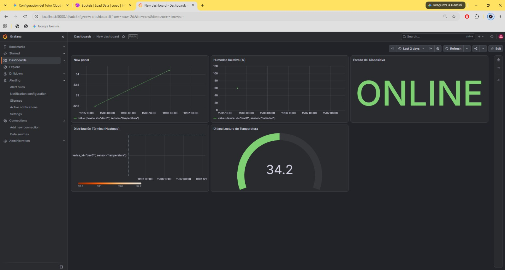
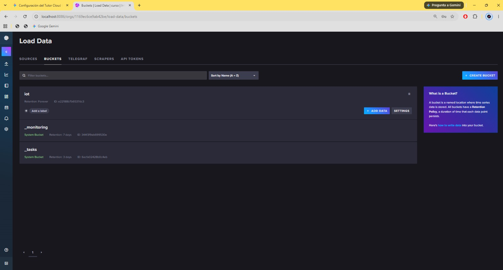
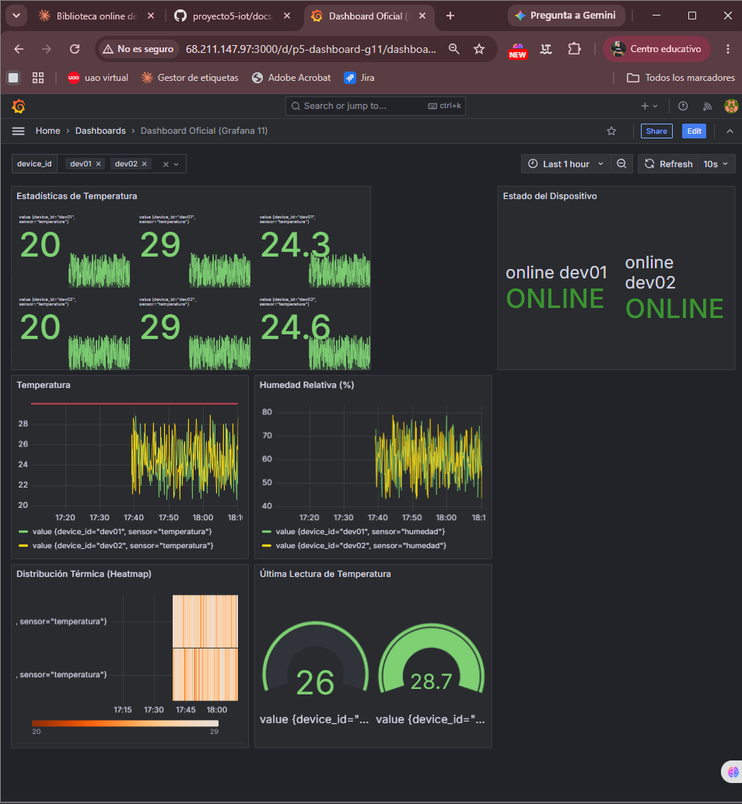
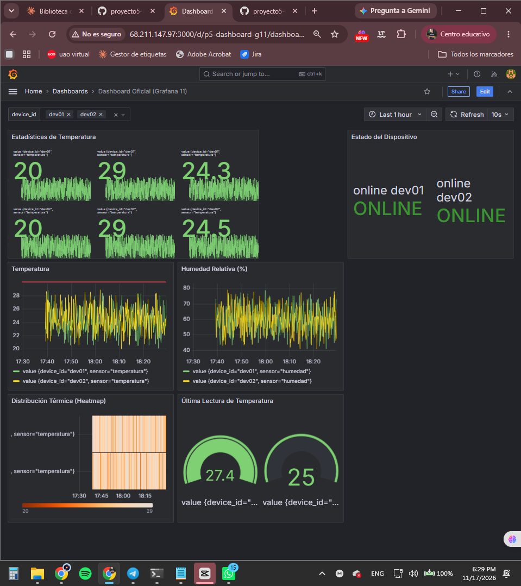

# Evidencia R5.5 — Dashboard en Grafana

| Campo | Valor |
|---|---|
| Criterio de aceptación | Dashboard actualiza en tiempo real; al menos 5 paneles funcionando con datos reales. |
| Responsable | Rol 4 |
| Estado | ✅ Cumplido |
| Pruebas definidas en | [requerimientos.md](../requerimientos.md) |
| Plantilla | [PLANTILLA.md](PLANTILLA.md) |
| Capturas | `docs/evidencias/img/R5.5/` |

## Resumen

| ID | Prueba | Veredicto | Fecha | Revisado por |
|---|---|---|---|---|
| P5.1 | 5 o más paneles con datos reales | ✅ (Intento 2) | 2026-11-07 y 2026-11-17 | Alejandro Domínguez Torres |
| P5.2 | Actualización en tiempo real | ✅ | 2026-11-17 | Alejandro Domínguez Torres |
| P5.3 | Variable device_id | ✅ | 2026-11-17 | Alejandro Domínguez Torres |
| P5.4 | Importación del dashboard.json | ✅ | 2026-11-17 | Alejandro Domínguez Torres |

Leyenda: ⬜ Pendiente · ✅ Pasa · ❌ Falla · 🟨 Parcial

---

## P5.1

### P5.1 — 5 o más paneles con datos reales · Intento 1

| Campo | Valor |
|---|---|
| Requerimiento | R5.5 |
| Ejecutada por | Alejandro Boris Garces. (Rol 4) |
| Fecha y hora | 2026-11-07 |
| Entorno | Simulacro local en Docker Desktop (`simulacro_grafana`): InfluxDB 2.7 y Grafana 13.3.0 en el PC · commit `9580c74` (`backend/grafana/dashboard.json`) |
| Precondiciones | Bucket `iot` en la organización `curso`; data source InfluxDB (Flux) configurado en Grafana |

**Qué se probó:** Que el dashboard tiene al menos 5 paneles que leen de la medición `lecturas` y `estado` según el contrato.

**Cómo (pasos y comandos exactos):**

1. Levantar InfluxDB y Grafana en Docker Desktop.
2. Escribir lecturas de prueba en el bucket `iot` (medición `lecturas`, etiquetas `device_id` y `sensor`, campo `value`).
3. Crear los paneles con consultas Flux.

**Resultado esperado:** Al menos 5 paneles con **datos reales** y sin errores.

**Resultado obtenido:**

5 paneles sin errores de consulta: temperatura, humedad, estado (ONLINE), mapa de calor y última lectura (34.2 °C).
Datos: solo dev01; 3 lecturas de temperatura (32.5 a 34.2 °C) y 1 de humedad en 2 días.

**Mediciones:** No aplica.

**Captura:**

**Veredicto:** 🟨 Parcial

**Observaciones:** Los 5 paneles funcionan, pero con datos de prueba en un entorno local. Falta repetir en el Grafana de la VM de Azure.

**Revisado por:** Alejandro Domínguez Torres, 2026-11-07

### P5.1 — 5 o más paneles con datos reales · Intento 2

| Campo | Valor |
|---|---|
| Requerimiento | R5.5 |
| Ejecutada por | Boris Alejandro Garces Hoyos (Rol 4) |
| Fecha y hora | 2026-11-17 18:00 |
| Entorno | VM Azure `vm-iot-backend` (IP 68.211.147.97) · Grafana 11.3.0 · Datos MQTT |
| Precondiciones | VM Azure encendida; `dev01` y `dev02` publicando datos |

**Qué se probó:** Que el dashboard muestra al menos 5 paneles con datos reales desde Azure, sin errores.

**Cómo (pasos y comandos exactos):**

1. Ingresar a Grafana desde la IP pública de la VM en Azure.
2. Verificar recepción de datos reales de los dispositivos.

**Resultado esperado:** Al menos 5 paneles con datos reales en el entorno de producción.

**Resultado obtenido:**

Se muestran paneles operativos. Títulos corregidos y mapeo de estado ONLINE funcional.

**Mediciones:** No aplica.

**Captura:**

**Veredicto:** ✅ Pasa

**Observaciones:** Se subsanaron todos los pendientes del Intento 1. La prueba se ejecutó en la IP pública de Azure.

**Revisado por:** Alejandro Domínguez Torres, 2026-11-17

---

## P5.2

### P5.2 — Actualización en tiempo real · Intento 1

| Campo | Valor |
|---|---|
| Requerimiento | R5.5 |
| Ejecutada por | Boris Alejandro Garces Hoyos (Rol 4) |
| Fecha y hora | 2026-11-17 18:05 |
| Entorno | VM Azure `vm-iot-backend` (IP 68.211.147.97) · Grafana 11.3.0 |
| Precondiciones | Configuración de refresco automático de Grafana en 10s activada |

**Qué se probó:** Que los paneles se actualizan de forma automática sin recargar la página.

**Cómo (pasos y comandos exactos):**

1. Configurar menú de refresco en `10s`.
2. Tomar captura con la hora visible.
3. Esperar avance automático y tomar segunda captura.

**Resultado esperado:** El dato nuevo aparece en el panel en 10 s o menos.

**Resultado obtenido:**

Las series de tiempo avanzan autónomamente al recibir carga desde MQTT/Node-RED.

**Mediciones:** Refresco visual evidenciado en menos de 10 segundos.

**Captura:**

**Veredicto:** ✅ Pasa

**Observaciones:** Ninguna.

**Revisado por:** Alejandro Domínguez Torres, 2026-11-17

---

## P5.3

### P5.3 — Variable device_id · Intento 1

| Campo | Valor |
|---|---|
| Requerimiento | R5.5 |
| Ejecutada por | Boris Alejandro Garces Hoyos (Rol 4) |
| Fecha y hora | 2026-11-17 18:10 |
| Entorno | VM Azure `vm-iot-backend` (IP 68.211.147.97) · Grafana 11.3.0 |
| Precondiciones | Variable de dashboard `device_id` configurada |

**Qué se probó:** Que los paneles filtran por dispositivo al cambiar la variable en el menú.

**Cómo (pasos y comandos exactos):**

1. Seleccionar exclusivamente `dev01` y observar paneles.
2. Seleccionar exclusivamente `dev02` y observar paneles.

**Resultado esperado:** Los paneles filtran y muestran únicamente la información del dispositivo elegido.

**Resultado obtenido:**

Selección dev01 aísla métricas correctas, y viceversa para dev02.

**Mediciones:** No aplica.

**Captura:**

**Veredicto:** ✅ Pasa

**Observaciones:** El filtrado se aplica transversalmente.

**Revisado por:** Alejandro Domínguez Torres, 2026-11-17

---

## P5.4

### P5.4 — Importación del dashboard.json · Intento 1

| Campo | Valor |
|---|---|
| Requerimiento | R5.5 |
| Ejecutada por | Boris Alejandro Garces Hoyos (Rol 4) |
| Fecha y hora | 2026-11-17 18:15 |
| Entorno | VM Azure `vm-iot-backend` (IP 68.211.147.97) · Grafana 11.3.0 |
| Precondiciones | Archivo `backend/grafana/dashboard.json` actualizado |

**Qué se probó:** Que el dashboard opera normalmente tras ser importado desde JSON.

**Cómo (pasos y comandos exactos):**

1. Navegar a Dashboards > New > Import.
2. Cargar el contenido de `dashboard.json`.

**Resultado esperado:** Funciona sin editarlo.

**Resultado obtenido:**

El JSON construye el panel idéntico al diseñado originalmente sin errores.

**Mediciones:** No aplica.

**Captura:**

**Veredicto:** ✅ Pasa

**Observaciones:** Ninguna.