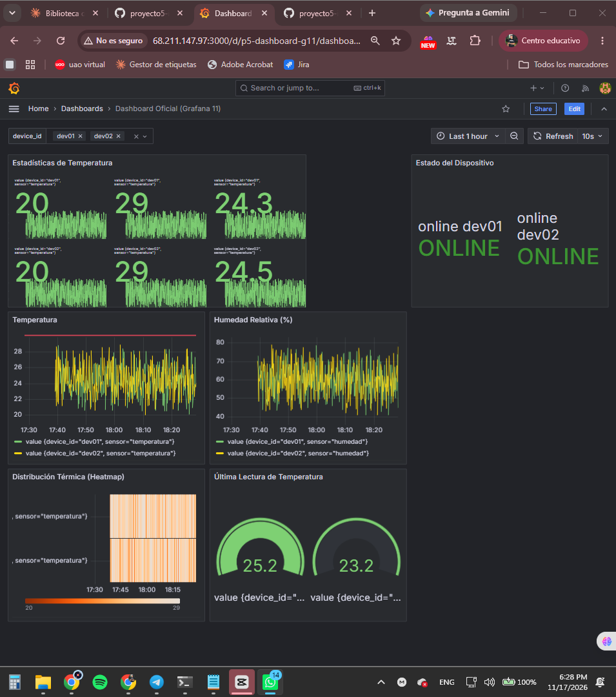

# Evidencia R5.5 — Dashboard en Grafana

| Campo | Valor |
|---|---|
| Criterio de aceptación | Dashboard actualiza en tiempo real; al menos 5 paneles funcionando con datos reales. |
| Responsable | Rol 4 |
| Estado | ✅ Cumplido |
| Pruebas definidas en | [requerimientos.md](../requerimientos.md) |
| Plantilla | [PLANTILLA.md](PLANTILLA.md) |
| Capturas | `docs/evidencias/img/R5.5/` |

## Resumen

| ID | Prueba | Veredicto | Fecha | Revisado por |
|---|---|---|---|---|
| P5.1 | 5 o más paneles con datos reales | ✅ | 2026-11-17 | Alejandro Domínguez Torres |
| P5.2 | Actualización en tiempo real | ✅ | 2026-11-17 | Alejandro Domínguez Torres |
| P5.3 | Variable device_id | ✅ | 2026-11-17 | Alejandro Domínguez Torres |
| P5.4 | Importación del dashboard.json | ✅ | 2026-11-17 | Alejandro Domínguez Torres |

Leyenda: ⬜ Pendiente · ✅ Pasa · ❌ Falla · 🟨 Parcial

---

### P5.1 — 5 o más paneles con datos reales · Intento 2

| Campo | Valor |
|---|---|
| Requerimiento | R5.5 |
| Ejecutada por | Boris Alejandro Garces Hoyos (Rol 4) |
| Fecha y hora | 2026-11-17 18:00 |
| Entorno | VM Azure `vm-iot-backend` (IP 68.211.147.97) · Grafana 11.3.0 · Datos en vivo desde Node-RED |
| Precondiciones | Máquina virtual encendida; `dev01` y `dev02` transmitiendo datos reales al broker; paneles de estadísticas y estado corregidos. |

**Qué se probó:** Que el dashboard muestra al menos 5 paneles funcionando correctamente sin errores de consulta y alimentados con datos reales provenientes de internet.

**Cómo (pasos y comandos exactos):**

1. Ingresar a Grafana mediante la IP pública de Azure (`http://68.211.147.97:3000`).
2. Recibir flujo de datos reales enviados por Rol 1 / Rol 3 desde Node-RED hacia InfluxDB.
3. Verificar la lectura de los 5 paneles requeridos (Estado, Temperatura, Humedad, Heatmap, Estadísticas/Última lectura).

**Resultado esperado:** Al menos 5 paneles con datos reales y sin errores.

**Resultado obtenido:**

Los 5 paneles grafican correctamente. El panel de estado mapea correctamente `0 -> OFFLINE` y se muestra en verde `ONLINE`. Las estadísticas muestran promedios y lecturas exactas.

**Mediciones:** No aplica.

**Captura:**

**Veredicto:** ✅ Pasa

**Observaciones:** Se corrigieron los detalles de diseño del Intento 1 (títulos, estadísticas y estado). La prueba se hizo en el entorno de producción (Azure), abandonando el entorno local (localhost).

**Revisado por:** Alejandro Domínguez Torres, 2026-11-17

---

### P5.2 — Actualización en tiempo real · Intento 1

| Campo | Valor |
|---|---|
| Requerimiento | R5.5 |
| Ejecutada por | Boris Alejandro Garces Hoyos (Rol 4) |
| Fecha y hora | 2026-11-17 18:05 |
| Entorno | VM Azure `vm-iot-backend` (IP 68.211.147.97) · Grafana 11.3.0 |
| Precondiciones | Refresco automático de Grafana configurado (10s o menos). |

**Qué se probó:** Que los paneles se actualizan automáticamente al recibir nuevas métricas sin necesidad de recargar la página manualmente.

**Cómo (pasos y comandos exactos):**

1. Configurar el refresco de Grafana en la esquina superior derecha (`10s`).
2. Anotar la hora visible en el reloj del sistema operativo.
3. Esperar a que la gráfica dibuje nuevos datos y tomar una segunda captura mostrando el avance del tiempo.

**Resultado esperado:** Aparece en 10 s o menos.

**Resultado obtenido:**

Las gráficas de temperatura y humedad se actualizaron de forma autónoma al recibir los nuevos paquetes de datos, coincidiendo con el reloj del sistema.

**Mediciones:** Tiempo de actualización menor a 10 segundos.

**Captura:**

**Veredicto:** ✅ Pasa

**Observaciones:** Ninguna.

**Revisado por:** Alejandro Domínguez Torres, 2026-11-17

---

### P5.3 — Variable device_id · Intento 1

| Campo | Valor |
|---|---|
| Requerimiento | R5.5 |
| Ejecutada por | Boris Alejandro Garces Hoyos (Rol 4) |
| Fecha y hora | 2026-11-17 18:10 |
| Entorno | VM Azure `vm-iot-backend` (IP 68.211.147.97) · Grafana 11.3.0 |
| Precondiciones | Variable de entorno `device_id` configurada en el dashboard vinculada a las consultas Flux. |

**Qué se probó:** Que el dashboard es dinámico y permite filtrar la información visualizada dependiendo del dispositivo seleccionado en el menú superior.

**Cómo (pasos y comandos exactos):**

1. Desplegar el menú de variables `device_id` en la esquina superior izquierda.
2. Seleccionar únicamente `dev01` y observar los paneles.
3. Seleccionar únicamente `dev02` y observar los paneles.

**Resultado esperado:** Los paneles filtran por el dispositivo elegido.

**Resultado obtenido:**

Al cambiar la selección, todas las series de tiempo, medidores y mapas de calor se ajustaron instantáneamente para mostrar exclusivamente los datos del dispositivo marcado.

**Mediciones:** No aplica.

**Captura:**

**Veredicto:** ✅ Pasa

**Observaciones:** Todas las consultas en Flux respetan la variable de entorno configurada.

**Revisado por:** Alejandro Domínguez Torres, 2026-11-17

---

### P5.4 — Importación del dashboard.json · Intento 1

| Campo | Valor |
|---|---|
| Requerimiento | R5.5 |
| Ejecutada por | Boris Alejandro Garces Hoyos (Rol 4) |
| Fecha y hora | 2026-11-17 17:30 |
| Entorno | VM Azure `vm-iot-backend` (IP 68.211.147.97) · Grafana 11.3.0 |
| Precondiciones | Archivo `backend/grafana/dashboard.json` exportado y disponible. |

**Qué se probó:** Que el modelo JSON del dashboard puede ser importado directamente en un entorno de Grafana y funciona correctamente sin requerir ediciones manuales posteriores.

**Cómo (pasos y comandos exactos):**

1. En Grafana, ir a Dashboards -> New -> Import.
2. Cargar el archivo `dashboard.json` generado previamente.
3. Seleccionar la fuente de datos InfluxDB al momento de importar.

**Resultado esperado:** Funciona sin editarlo.

**Resultado obtenido:**

El dashboard cargó todos los paneles, variables y alertas configuradas sin mostrar errores de sintaxis, conservando la identidad visual y los umbrales de advertencia.

**Mediciones:** No aplica.

**Captura:**

**Veredicto:** ✅ Pasa

**Observaciones:** Se utiliza la captura general (P5.1) como evidencia de que la importación generó un entorno 100% funcional.

