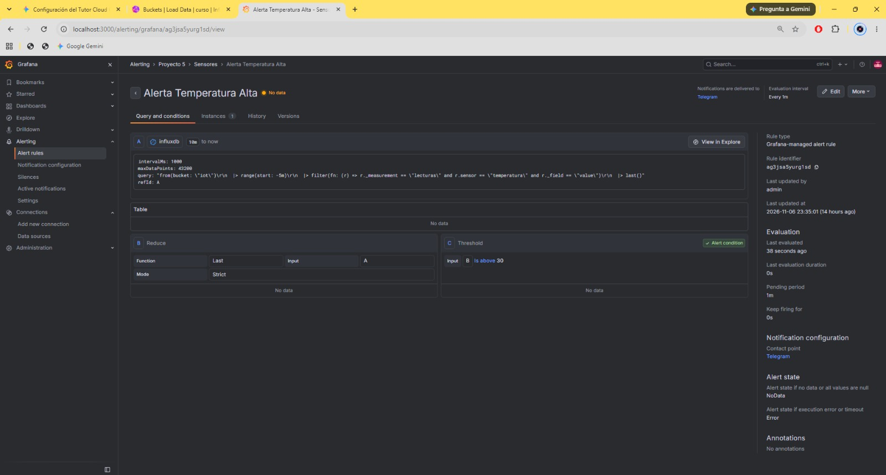
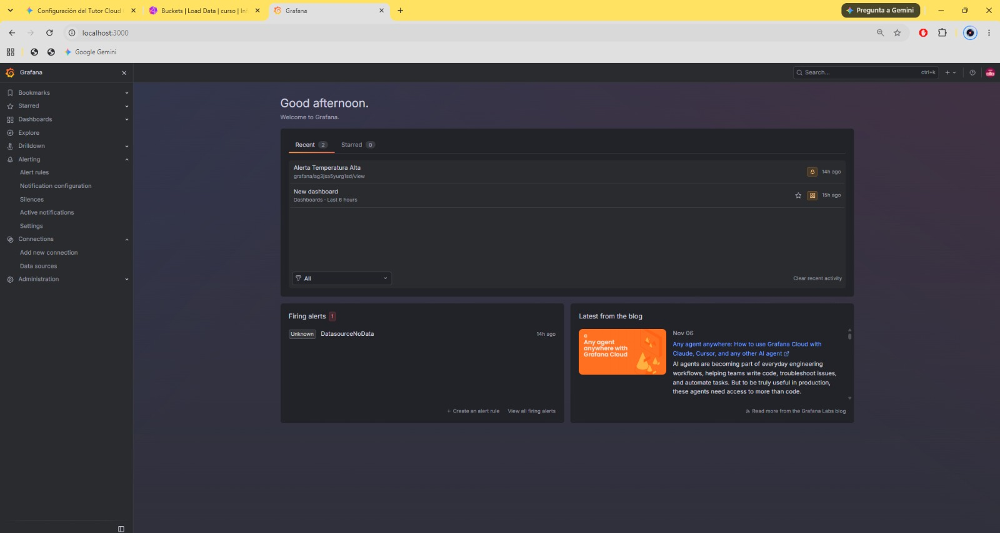

# Evidencia R5.6 — Alertas por umbral

| Campo | Valor |
|---|---|
| Criterio de aceptación | Alerta disparada y recibida en menos de 30 segundos tras superar el umbral; demostrado en vivo. |
| Responsable | Rol 4 · Rol 3 |
| Estado | 🟨 En progreso |
| Pruebas definidas en | [requerimientos.md](../requerimientos.md) |
| Plantilla | [PLANTILLA.md](PLANTILLA.md) |
| Capturas | `docs/evidencias/img/R5.6/` |

## Resumen

| ID | Prueba | Veredicto | Fecha | Revisado por |
|---|---|---|---|---|
| P6.1 | Test del contact point de Telegram | ⬜ | | |
| P6.2 | 5 mediciones por debajo de 30 s | ⬜ | | |
| P6.3 | Umbral configurable sin tocar código | 🟨 | 2026-11-06 | Alejandro Domínguez Torres |
| P6.4 | Sin alertas falsas en 10 minutos | ⬜ | | |

Leyenda: ⬜ Pendiente · ✅ Pasa · ❌ Falla · 🟨 Parcial

---

## P6.1
<!-- Pegar aquí el bloque de la plantilla llenado -->

## P6.2
<!-- Pegar aquí el bloque de la plantilla llenado y completar la tabla de tiempos de abajo -->

## P6.3 — Umbral configurable sin tocar código · Intento 1

| Campo | Valor |
|---|---|
| Requerimiento | R5.6 |
| Ejecutada por | Alejandro B. (Rol 4) |
| Fecha y hora | 2026-11-06 23:35 (última edición de la regla) |
| Entorno | Simulacro local en Docker Desktop: Grafana 13.3.0 e InfluxDB 2.7 en el PC |
| Precondiciones | Contact point de Telegram creado; data source InfluxDB configurado |

**Qué se probó:** Que el umbral de alerta se define en la interfaz de Grafana, sin código.

**Cómo (pasos y comandos exactos):**

1. Alerting → Alert rules → nueva regla "Alerta Temperatura Alta" (carpeta Proyecto 5, grupo Sensores).
2. Consulta A:

```
from(bucket: "iot")
  |> range(start: -5m)
  |> filter(fn: (r) => r._measurement == "lecturas" and r.sensor == "temperatura" and r._field == "value")
  |> last()
```

3. B = Reduce *Last* de A; C = Threshold *B is above 30* (condición de alerta).
4. Evaluación cada 1 min, periodo pendiente 1 min, contact point Telegram.

**Resultado esperado:** Con 28 °C la alerta se dispara; con 30 °C no.

**Resultado obtenido:**

```
Regla creada con umbral "is above 30", editable desde la interfaz.
Estado: No data (no hay lecturas en los últimos 5 min en el entorno local).
Firing alerts: DatasourceNoData.
No se cambió el umbral ni se recibió ninguna alerta en Telegram.
```

**Mediciones:** No aplica.

**Captura:**





**Veredicto:** 🟨 Parcial

**Observaciones:** La regla demuestra que el umbral se configura sin código, pero falta la prueba completa (cambiar a 28 °C, publicar 29 °C, ver la alerta y volver a 30 °C). Con evaluación cada 1 min y pendiente de 1 min la alerta tardaría de 1 a 2 minutos, por lo que P6.2 (< 30 s) no pasaría: hay que bajar la evaluación a 10 s y el pendiente a 0 s, o enviar la alerta desde Node-RED. El estado No data genera la alerta DatasourceNoData; conviene configurar "Alert state if no data" en Normal para esta regla (la desconexión se detecta en R5.7). La regla no está exportada al repositorio.

**Revisado por:** Alejandro Domínguez Torres, 2026-11-07

## P6.4
<!-- Pegar aquí el bloque de la plantilla llenado -->

---

## Tabla de tiempos (P6.2)

| Intento | Vía (Grafana / Node-RED) | Hora de publicación | Hora de llegada | Segundos | ¿< 30 s? |
|---|---|---|---|---|---|
| 1 | | | | | |
| 2 | | | | | |
| 3 | | | | | |
| 4 | | | | | |
| 5 | | | | | |
| **Promedio** | | | | | |
| **Máximo** | | | | | |

Si se implementan las dos vías (Grafana y Node-RED), se mide cada una por separado y en la demo se usa la más rápida.