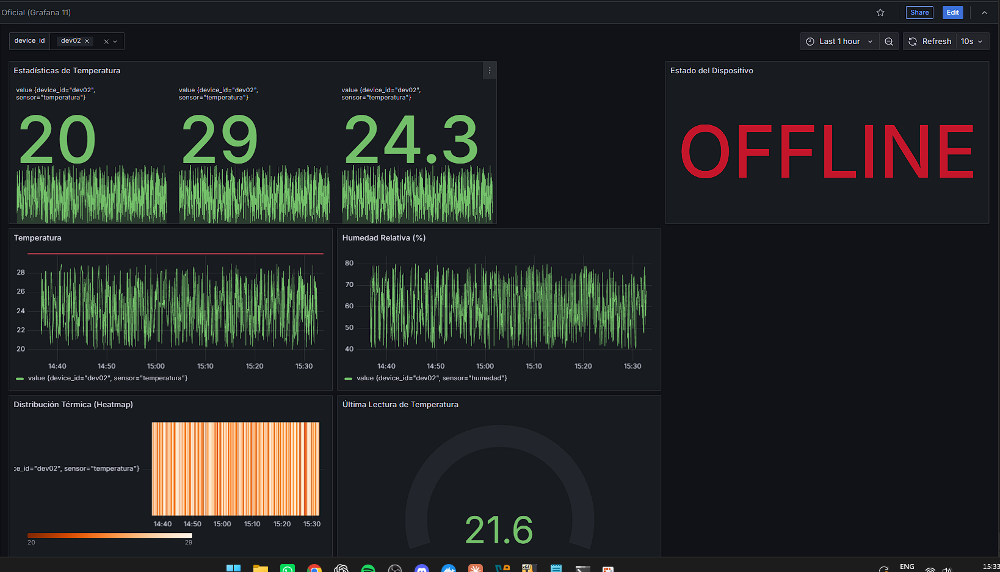
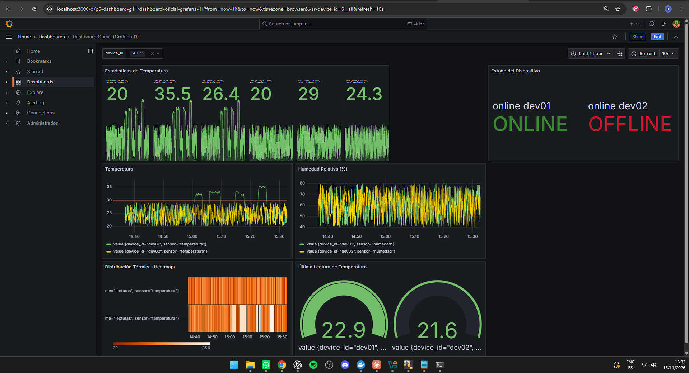

# Evidencia R5.7 — Detección de dispositivo offline

| Campo | Valor |
|---|---|
| Criterio de aceptación | Alerta generada al desconectar manualmente un dispositivo; recuperación detectada al reconectar. |
| Responsable | Rol 4 · Rol 1 |
| Estado | 🟨 En progreso |
| Pruebas definidas en | [requerimientos.md](../requerimientos.md) |
| Plantilla | [PLANTILLA.md](PLANTILLA.md) |
| Capturas | `docs/evidencias/img/R5.7/` |

## Resumen

| ID | Prueba | Veredicto | Fecha | Revisado por |
|---|---|---|---|---|
| P7.1 | Alerta de desconexión pasados 5 min | 🟨 | 2026-11-16 | Pendiente |
| P7.2 | Aviso de recuperación al reconectar | 🟨 | 2026-11-16 | Pendiente |
| P7.3 | Last Will publica offline | ✅ | 2026-11-03 | Alejandro Dominguez Torres |
| P7.4 | dev01 no se ve afectado | ❌ | 2026-11-16 | Pendiente |

Leyenda: ⬜ Pendiente · ✅ Pasa · ❌ Falla · 🟨 Parcial

---

## P7.1

### P7.1 — Alerta de desconexión pasados 5 minutos · Intento 1

| Campo | Valor |
|---|---|
| Requerimiento | R5.7 |
| Ejecutada por | Kevin Aristizabal (Rol 1), con otro integrante del grupo leyendo Telegram |
| Fecha y hora | 2026-11-16 ≈ 15:32 (Bogotá) |
| Entorno | VM Azure `vm-iot-backend` · `main` en `933bed9` · Grafana 11.3.0 con el dashboard del PR #13 · simulador `v3` (rev4) · `dev01` y `dev02` en VirtualBox |
| Precondiciones | `dev01` y `dev02` online y publicando; alertas de Grafana a Telegram activas; sin `TEMP_FORZADA` |

**Qué se probó:** Que al apagar la VM de `dev02` llegue una alerta de desconexión pasados 5 minutos, no antes.

**Cómo (pasos):**

1. *Machine → ACPI Shutdown* en `p5-dev02`. La VM seguía encendida, así que se hizo **power off** directo.
2. Se anotó la hora de la alerta en Telegram. El dashboard muestra `dev02` OFFLINE.

**Resultado esperado:** Alerta de desconexión **pasados 5 minutos**, no antes.

**Resultado obtenido:** A las **3:42 p. m.** llegó un mensaje de la regla "Alerta Dispositivo Offline" con este contenido:

- **Firing** para `device_id = dev01` (valor `B=20.5, C=1`), el dispositivo que **no** se apagó.
- **Resolved** para `device_id = dev02` (`grafana_state_reason = MissingSeries`), el dispositivo que sí estaba apagado.

**Mediciones:** (Bogotá; el apagado se estima por el panel de Grafana, no se cronometró)

| Medida | Valor |
|---|---|
| Hora del apagado | ≈ 15:32 (estimada) |
| Hora del mensaje en Telegram | 15:42 (precisión de minuto) |
| Retraso | ≈ 10 min, que cumple "más de 5 minutos" |

**Captura:**




**Veredicto:** 🟨 Parcial

**Observaciones:**
- El retraso de ≈ 10 min cumple el mínimo de 5 min, pero es largo para una detección de desconexión.
- **El contenido del mensaje parece invertido:** `dev02` (apagado) figura como *Resolved* y `dev01` (en línea) como *Firing*. Si es así, la regla se activa cuando **hay** datos y se resuelve cuando faltan. **No está confirmado:** lo comprueba Rol 4 abriendo la condición de la regla en Alerting → Alert rules.
- El texto de la alerta solo trae `Value: B=…, C=…`; no dice qué dispositivo está sin datos ni desde cuándo.
- El registro del broker con la hora del último dato de `dev02` no cubrió esta prueba (se había cerrado antes), por lo que no hay marca objetiva del apagado.
- Hay que repetir la prueba cuando Rol 4 revise la regla, con el registro del broker abierto durante toda la ventana.

**Revisado por:** Pendiente

## P7.2

### P7.2 — Aviso de recuperación al reconectar · Intento 1

| Campo | Valor |
|---|---|
| Requerimiento | R5.7 |
| Ejecutada por | Kevin Aristizabal (Rol 1), con otro integrante del grupo leyendo Telegram |
| Fecha y hora | 2026-11-16 ≈ 15:46 (Bogotá) |
| Entorno | VM Azure `vm-iot-backend` · `main` en `933bed9` · Grafana 11.3.0 con el dashboard del PR #13 · simulador `v3` (rev4) · `dev01` y `dev02` en VirtualBox |
| Precondiciones | Continúa P7.1: `dev02` apagado desde ≈ 15:32 |

**Qué se probó:** Que al encender de nuevo `dev02` llegue un aviso de recuperación y el panel vuelva a «en línea».

**Cómo (pasos):** Se encendió `p5-dev02` desde VirtualBox y se anotaron los tiempos hasta ver `ONLINE` en Grafana y hasta el mensaje de Telegram.

**Resultado esperado:** Aviso de recuperación; el panel vuelve a «en línea».

**Resultado obtenido:**
- Panel de Grafana: `dev02` vuelve a **ONLINE** con datos nuevos desde ≈ 15:49.
- Telegram, **3:52 p. m.**: un mensaje con **Firing** de "Alerta Dispositivo Offline" para `dev01` (`B=26.1`) y para `dev02` (`B=26.8`). **No llegó ningún aviso de tipo *Resolved* para `dev02`**.

**Mediciones:** (Bogotá; tiempos según el cronómetro de Rol 1)

| Medida | Valor |
|---|---|
| Encendido de la VM → mensaje de Telegram | 6 min 10 s (≈ 15:46 → 15:52) |
| Encendido → `dev02` visible como ONLINE en Grafana | ≈ 2 min 50 s |
| ONLINE en Grafana → mensaje de Telegram | ≈ 3 min 10 s |

**Captura:**


**Veredicto:** 🟨 Parcial

**Observaciones:**
- El panel sí vuelve a «en línea», pero el aviso de recuperación **no es claro**: el mensaje dice *Firing* de la alerta de offline, con valores de temperatura normales, para los dos dispositivos. Coincide con la posible inversión de la regla anotada en P7.1.
- Tiempo de aviso (≈ 3 min tras volver a ONLINE) por revisar junto con la configuración de notificaciones de Grafana (`group_wait`, `group_interval`).
- Repetir cuando Rol 4 confirme la condición de la regla.

**Revisado por:** Pendiente

## P7.3

### P7.3 — Last Will publica offline · Intento 1

| Campo | Valor |
|---|---|
| Requerimiento | R5.7 |
| Ejecutada por | Kevin Aristizabal (Rol 1) |
| Fecha y hora | 2026-11-03 22:18 (Bogotá) |
| Entorno | VM Azure `vm-iot-backend` · Mosquitto 2 (puerto 8883, TLS) · simulador `v2` (rev3) · `dev01` y `dev02` en VirtualBox |
| Precondiciones | `dev01` y `dev02` online en Balena y publicando; broker encendido |

**Qué se probó:** Que al cortar de golpe la red de la VM de `dev01`, el broker publica `offline` en `iot/dev01/status` (Last Will).

**Cómo (pasos y comandos exactos):**

1. En la VM de Azure, suscriptor de solo lectura con hora ISO por mensaje (usuario `nodered`, clave leída del `.env` de la VM, nunca escrita):

```bash
docker run --rm --network host -v "$PWD/mosquitto/config/certs:/certs:ro" eclipse-mosquitto:2.0.20 mosquitto_sub -h localhost -p 8883 --cafile /certs/ca.crt -u nodered -P "$MQTT_NODERED_PASSWORD" -t 'iot/+/status' -F '%I %t %p' -W 600
```

2. En el PC, desconectar el cable virtual del adaptador 1 de `p5-dev01` (equivale a quitar "Conectar adaptador de red"; la VM sigue encendida):

```cmd
VBoxManage controlvm "p5-dev01" setlinkstate1 off
```

3. Reconectar y comprobar la recuperación:

```cmd
VBoxManage controlvm "p5-dev01" setlinkstate1 on
```

**Resultado esperado:** El broker publica `offline` en `iot/dev01/status` (Last Will).

**Resultado obtenido:**

```
2026-11-04T03:16:53+0000 iot/dev02/status online
2026-11-04T03:16:53+0000 iot/dev01/status online
2026-11-04T03:19:22+0000 iot/dev01/status offline
2026-11-04T03:19:51+0000 iot/dev01/status online
```

**Mediciones:** (horas en UTC; Bogotá = UTC − 5)

| Evento | Hora UTC | Hora Bogotá | Desde el corte |
|---|---|---|---|
| Corte del adaptador de `p5-dev01` | 03:18:36 | 22:18:36 | 0 s |
| `iot/dev01/status offline` (Last Will) | 03:19:22 | 22:19:22 | **46 s** |
| Adaptador reconectado | 03:19:30 | 22:19:30 | 54 s |
| `iot/dev01/status online` de nuevo | 03:19:51 | 22:19:51 | 21 s tras reconectar |

`dev02` no cambió de estado durante la prueba.

**Captura:** Salida de `mosquitto_sub` pegada arriba (sin captura de pantalla).

**Veredicto:** ✅ Pasa

**Observaciones:** El Last Will tardó 46 s porque el broker espera el keepalive del cliente antes de darlo por desconectado. Esto cubre solo la publicación del `offline`; la alerta (P7.1) y el aviso de recuperación (P7.2) dependen de Rol 3 y Rol 4.

**Revisado por:** Alejandro Dominguez Torres, 2026-11-04

## P7.4

### P7.4 — `dev01` no se ve afectado · Intento 1

| Campo | Valor |
|---|---|
| Requerimiento | R5.7 |
| Ejecutada por | Kevin Aristizabal (Rol 1) |
| Fecha y hora | 2026-11-16 ≈ 15:32 a 15:52 (Bogotá), durante P7.1 y P7.2 |
| Entorno | VM Azure `vm-iot-backend` · `main` en `933bed9` · Grafana 11.3.0 con el dashboard del PR #13 · simulador `v3` (rev4) · `dev01` y `dev02` en VirtualBox |
| Precondiciones | Las de P7.1 |

**Qué se probó:** Que mientras `dev02` está apagado, `dev01` siga en línea y **no** genere alerta.

**Cómo (pasos):** Con `dev02` apagado, se revisó el panel de Grafana (`device_id = All`) y los mensajes de Telegram.

**Resultado esperado:** `dev01` sigue en línea y **no** genera alerta.

**Resultado obtenido:**
- Panel: `dev01` **ONLINE** y `dev02` **OFFLINE**, con datos de `dev01` continuos.
- Telegram: `dev01` **sí aparece** en los mensajes de "Alerta Dispositivo Offline" (Firing, 3:42 p. m. y 3:52 p. m.).

**Mediciones:** No aplica.

**Captura:**



**Veredicto:** ❌ Falla (en Telegram)

**Observaciones:** El dispositivo sigue en línea y publicando, pero aparece en una alerta de "offline" que no le corresponde. Lo más probable es el mismo defecto de la regla descrito en P7.1 (activa con datos presentes). Repetir tras la corrección de Rol 4.

**Revisado por:** Pendiente

---

## Línea de tiempo (P7.1 y P7.2)

| Evento | Hora | Minutos desde el apagado |
|---|---|---|
| VM de dev02 apagada (power off) | ≈ 15:32 (estimada) | 0 |
| Último dato de dev02 en InfluxDB | ≈ 15:32 (por el panel; sin marca exacta) | ≈ 0 |
| Alerta de desconexión recibida (Telegram) | 15:42 | ≈ 10 |
| VM de dev02 encendida | ≈ 15:46 (6 min 10 s antes del mensaje de las 15:52) | ≈ 14 |
| Primer dato tras reconectar | ≈ 15:49 (visible en Grafana) | ≈ 17 |
| Aviso de recuperación recibido (Telegram) | 15:52 (mensaje Firing, no Resolved; ver P7.2) | ≈ 20 |

Las horas de Telegram tienen precisión de minuto. El apagado y el encendido son estimados: no se cronometró el instante exacto. El registro del broker no cubrió la prueba.

La alerta de desconexión debe llegar **después** del minuto 5. Si llega antes, la regla está mal configurada.