# Evidencia R5.8 — Tercer dispositivo

| Campo | Valor |
|---|---|
| Criterio de aceptación | Nuevo dispositivo integrado en menos de 30 minutos siguiendo la guía; datos visibles en dashboard. |
| Responsable | Rol 5 · Rol 1 |
| Estado | ✅ Cumplido con el Intento 2 (Ruta A, Balena), pendiente de revisión |
| Pruebas definidas en | [requerimientos.md](../requerimientos.md) |
| Plantilla | [PLANTILLA.md](PLANTILLA.md) |
| Guía probada | [guia-nuevo-dispositivo.md](../guia-nuevo-dispositivo.md) |
| Capturas | `docs/evidencias/img/R5.8/` |

## Resumen


| ID | Prueba | Veredicto | Fecha | Revisado por |
|---|---|---|---|---|
| P8.1 | Guía seguida en menos de 30 min | ✅ Ruta B (2026-11-16) y Ruta A (Intento 2) | 2026-11-16 y 2026-11-18 | Ruta B: Kevin Aristizabal (Rol 1), 2026-11-16 · Intento 2: Pendiente |
| P8.2 | Sin cambios en el backend | ✅ | 2026-11-16 | Kevin Aristizabal (Rol 1), 2026-11-16 |
| P8.3 | dev03 visible en el dashboard | ✅ | 2026-11-16 | Kevin Aristizabal (Rol 1), 2026-11-16 |
| P8.4 | Alertas funcionan con dev03 | ✅ (Intento 2, Telegram) | 2026-11-16 y 2026-11-18 | Intento 1: Kevin Aristizabal (Rol 1), 2026-11-16 · Intento 2: Pendiente |

Leyenda: ⬜ Pendiente · ✅ Pasa · ❌ Falla · 🟨 Parcial

---

# R5.8 — Escalabilidad: incorporar un tercer dispositivo (dev03) sin modificar el backend

| Campo | Valor |
|---|---|
| **Requerimiento** | R5.8 — Un integrante que no escribió la guía agrega un dispositivo nuevo siguiendo `docs/guia-nuevo-dispositivo.md`, sin tocar el backend |
| **Ejecutada por** | Alejandro Domínguez Torres (Rol 5) |
| **Fecha y hora** | 2026-11-16, 8:38 a 9:42 (Bogotá, UTC−5) = 13:38 a 14:42 UTC |
| **Entorno** | PC Windows 11 (Nitro5), Git Bash (MINGW64), Docker Desktop (`desktop-linux`). Backend en la VM de Azure `vm-iot-backend` (68.211.147.97): Mosquitto 2.0.20, Node-RED 4.0, InfluxDB 2.7, Grafana 11.3.0 |
| **Ruta de la guía** | Ruta B (Docker local), dispositivo `dev03` |
| **Revisado por** | Kevin Aristizabal (Rol 1, autor de la guía), 2026-11-16 |

## Precondiciones

- VM de Azure encendida y los 4 contenedores del backend arriba (ver P8.2 "antes").
- Usuario `dev03` ya existente en Mosquitto, con su ACL (creado por Rol 2). Su clave se recibió por el chat privado del grupo y se cargó con `read -rsp`, así que no aparece en comandos, historial ni capturas.
- Clon **limpio** del repositorio en una carpeta nueva (`/c/prueba-r58`), para simular a un integrante nuevo.
- dev01 y dev02 no son necesarios para esta prueba.

---

## P8.1 — Agregar dev03 siguiendo la guía y medir el tiempo

**Qué se probó:** que una persona que no escribió la guía pueda conectar un dispositivo nuevo solo con la guía, y cuánto tarda.

**Cómo:** se ejecutaron los pasos 1 a 7 de la Ruta B de `docs/guia-nuevo-dispositivo.md`, con el tiempo de cada paso.

**Resultado esperado:** dev03 conectado por TLS (8883), publicando según el contrato y visible en InfluxDB y Grafana sin cambios en el backend.

### Tiempos

| Paso | Inicio | Fin | Duración activa | Problemas |
|---|---|---|---|---|
| 1. Broker responde (`Test-NetConnection … -Port 8883`) | 8:38 | 8:39 | 34 s | Ninguno |
| 2. Descargar repo (`git clone`) | 8:39 | 8:40 | 34 s | Ninguno |
| 3. Construir imagen (`docker build -t p5-simulador device/`) | 8:41 | 8:41 | 16,83 s | Ninguno |
| 4. Cargar clave (`read -rsp`) | 8:47 | 8:48 | 37,98 s | Ninguno |
| 5. Ejecutar dispositivo (`docker run`) | 8:49 | 8:49 | 5 s | **Sí: ver Problema 1** |
| 6. Revisar log (`docker logs dev03`) | 8:59 | 8:59 | 15,36 s | Ninguno, después de la corrección |
| 7. Datos en el sistema (broker, InfluxDB, Grafana) | 9:04 | 9:09 | 4 min 41 s | Ninguno |
| **Total** | **8:38** | **9:09** | **≈ 7 min 4 s activos** | **31 min de reloj** |

- La columna **Duración activa** mide solo la ejecución de cada paso; los saltos entre pasos no se contabilizan.
- Esos saltos se deben a dos causas ajenas al procedimiento:
  - el diagnóstico del Problema 1 (≈ 10 min, 8:49 a 8:59), un error exclusivo de Git Bash;
  - el tiempo dedicado a tomar las capturas de evidencia.
- Sumando solo los pasos, agregar dev03 toma **≈ 7 min 4 s**, muy por debajo del límite de 30 min.

### Problema 1: Git Bash convierte la ruta del certificado (hallazgo para la guía)

- **Síntoma:** el primer `docker run` (8:49) dejó a dev03 en un ciclo de reinicios con `FileNotFoundError` en `tls_set`.
- **Causa:** Git Bash (MSYS) convierte `-e CA_CERT_PATH=/app/ca.crt` en una ruta de Windows (`C:/Program Files/Git/app/ca.crt`), que no existe dentro del contenedor.
- **Verificación:** `docker inspect dev03 --format '{{range .Config.Env}}{{println .}}{{end}}' | grep CA_CERT`
- **Solución (8:59):** anteponer `MSYS_NO_PATHCONV=1` al comando:

```bash
MSYS_NO_PATHCONV=1 docker run -d --name dev03 --restart unless-stopped \
  -e DEVICE_ID=dev03 -e MQTT_USER=dev03 -e MQTT_PASSWORD \
  -e BROKER_HOST=68.211.147.97 -e BROKER_PORT=8883 \
  -e CA_CERT_PATH=/app/ca.crt -e PUBLISH_INTERVAL=5 \
  p5-simulador
```

- **Recomendación para Rol 1:** agregar `MSYS_NO_PATHCONV=1` a la guía, o quitar `-e CA_CERT_PATH`, porque el simulador v3 ya usa `/app/ca.crt` por defecto. Después, quitar la marca de "borrador".

### Resultado obtenido

**Paso 1.** Puerto 8883 alcanzable: `TcpTestSucceeded : True`.


**Paso 2.** Clon limpio (414 objetos), con `device/ca.crt` presente.

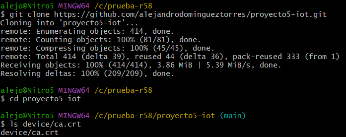

**Paso 3.** Imagen `p5-simulador` construida en 9,9 s (10/10 FINISHED). Se copia `simulador.py ca.crt` a `/app`.


**Paso 6.** Log de dev03: `simulador v3`, luego `conectado a 68.211.147.97:8883`, y lecturas cada 5 s de temperatura (26,7 a 28,1) y humedad.

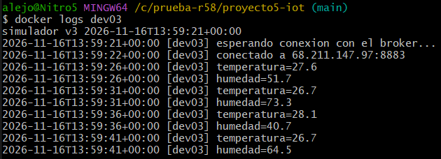

**Paso 7.** El broker de Azure recibe a dev03. Se verificó con `mosquitto_sub` en la VM, con el usuario `nodered`, el tópico `iot/dev03/#` y TLS:

```
iot/dev03/status online
iot/dev03/temperatura {"device_id": "dev03", "sensor": "temperatura", "value": 20.4, "unit": "C", "ts": "2026-11-16T14:11:26Z"}
iot/dev03/humedad {"device_id": "dev03", "sensor": "humedad", "value": 67.6, "unit": "%", "ts": "2026-11-16T14:11:26Z"}
iot/dev03/temperatura {"device_id": "dev03", "sensor": "temperatura", "value": 20.6, "unit": "C", "ts": "2026-11-16T14:11:31Z"}
iot/dev03/humedad {"device_id": "dev03", "sensor": "humedad", "value": 78.1, "unit": "%", "ts": "2026-11-16T14:11:31Z"}
iot/dev03/temperatura {"device_id": "dev03", "sensor": "temperatura", "value": 27.7, "unit": "C", "ts": "2026-11-16T14:11:36Z"}
iot/dev03/humedad {"device_id": "dev03", "sensor": "humedad", "value": 63.2, "unit": "%", "ts": "2026-11-16T14:11:36Z"}
Timed out
```

- Los tópicos (`iot/dev03/{sensor}` y `iot/dev03/status`) y el payload JSON cumplen el contrato, con `ts` en UTC terminado en `Z`.
- La clave de `nodered` se leyó del `.env` de la VM y no aparece en el comando.

**Veredicto P8.1:** ✅ **Cumple**. Criterio "menos de 30 min": la suma de las duraciones activas de los pasos 1 a 7 es ≈ 7 min 4 s. Los 31 min de reloj (8:38 a 9:09) no reflejan el procedimiento: incluyen ≈ 10 min de diagnóstico del Problema 1 (conversión de rutas propia de Git Bash, que no ocurre en CMD ni PowerShell) y el tiempo de las capturas de evidencia. Queda un hallazgo para corregir en la guía (Problema 1).

---

## P8.2 — El backend no se modificó

**Qué se probó:** que agregar dev03 no requirió cambios en el código ni reinicios del backend.

**Cómo:** se comparó el último commit que toca `backend/` en `origin/main` y el estado de los contenedores de la VM, antes y después de la prueba.

**Resultado esperado:** el mismo commit antes y después, y contenedores sin reinicio (el tiempo "Up" solo aumenta).

### Antes (8:38)

```
$ git log -1 --format="%h %ad %s" --date=iso origin/main -- backend/
a5febba 2026-11-15 21:05:27 -0500 Exporta dashboard Grafana 11 oficial con variable device_id (R5.5)

$ ssh azureuser@68.211.147.97 "sudo docker ps --format 'table {{.Names}}\t{{.Status}}'"
NAMES                 STATUS
backend-nodered-1     Up 12 minutes (healthy)
backend-grafana-1     Up 12 minutes
backend-influxdb-1    Up 12 minutes
backend-mosquitto-1   Up 12 minutes
```

### Después (9:42)

```
$ git fetch origin
$ git log -1 --format="%h %ad %s" --date=iso origin/main -- backend/
a5febba 2026-11-15 21:05:27 -0500 Exporta dashboard Grafana 11 oficial con variable device_id (R5.5)

$ ssh azureuser@68.211.147.97 "sudo docker ps --format 'table {{.Names}}\t{{.Status}}'"
NAMES                 STATUS
backend-nodered-1     Up About an hour (healthy)
backend-grafana-1     Up About an hour
backend-influxdb-1    Up About an hour
backend-mosquitto-1   Up About an hour
```


### Resultado obtenido

| Verificación | Antes (8:38) | Después (9:42) | ¿Igual? |
|---|---|---|---|
| Último commit en `backend/` (`origin/main`) | `a5febba` | `a5febba` | ✅ |
| `backend-nodered-1` | Up 12 minutes (healthy) | Up About an hour (healthy) | ✅ Sin reinicio |
| `backend-grafana-1` | Up 12 minutes | Up About an hour | ✅ Sin reinicio |
| `backend-influxdb-1` | Up 12 minutes | Up About an hour | ✅ Sin reinicio |
| `backend-mosquitto-1` | Up 12 minutes | Up About an hour | ✅ Sin reinicio |

- El commit de `backend/` es el mismo después de `git fetch`.
- El tiempo de actividad de los 4 contenedores solo aumentó, de unos 12 min a alrededor de una hora, lo que coincide con la hora de reloj transcurrida (8:38 a 9:42), así que ninguno se reinició.
- dev03 se incorporó, publicó, disparó alertas y se desconectó sin editar ningún archivo de `backend/` ni reiniciar ningún servicio.

**Veredicto P8.2:** ✅ **Cumple**

---

## P8.3 — dev03 aparece automáticamente en el dashboard

**Qué se probó:** que Grafana muestre el dispositivo nuevo sin editar el dashboard.

**Cómo:** se abrió "Dashboard Oficial (Grafana 11)" en Azure y se revisó la variable `device_id`.

**Resultado esperado:** `dev03` aparece en la lista de la variable y sus paneles muestran datos.

**Resultado obtenido:**

- `dev03` aparece en la variable `device_id`, junto a dev01 y dev02, sin cambios en el dashboard.
- Con dev03 seleccionado:
  - "Estado del Dispositivo" muestra **ONLINE**;
  - "Temperatura" muestra valores entre 20 y 28 °C;
  - "Última Lectura" muestra 27,8;
  - el tooltip de las 09:04:47 marca 23,8.


**Veredicto P8.3:** ✅ **Cumple**

---

## P8.4 — Alerta y estado OFFLINE del dispositivo nuevo

**Qué se probó:**
- que dev03 dispare la alerta de temperatura mayor a 30 °C;
- que su desconexión quede registrada (`estado = 0`).

**Cómo:**

1. **9:15:** se recreó dev03 con `TEMP_FORZADA=32` (simulador v3), con el mismo comando de P8.1 más `-e TEMP_FORZADA=32`.
2. Se revisaron el log, InfluxDB (measurement `lecturas`, campo `alerta`) y Grafana.
3. **9:31:** se ejecutó `docker stop dev03` y se consultó el measurement `estado`.

**Resultado esperado:**
- lecturas mayores a 30 con `alerta = 1` en InfluxDB;
- el dashboard refleja el valor;
- notificación de Telegram;
- `estado = 0` al detener el dispositivo.

### Resultado obtenido

**Log de dev03 con temperatura forzada:**

| Hora UTC | Temperatura (°C) |
|---|---|
| 14:16:18 | 31,9 |
| 14:16:23 | 32,0 |
| 14:16:28 | 31,5 |
| 14:16:33 | 32,2 |


**InfluxDB.** Node-RED marcó `alerta = 1` en todas las lecturas mayores a 30, por ejemplo de 14:25:28Z a 14:25:58Z, con valores entre 31,8 y 32,4.


**Grafana:**
- "Estadísticas de Temperatura" muestra `alerta = 1` y el valor 32,0;
- "Última Lectura" muestra **32,1 en rojo** (por encima del umbral);
- la serie de temperatura se mantiene por encima de la línea roja de 30.

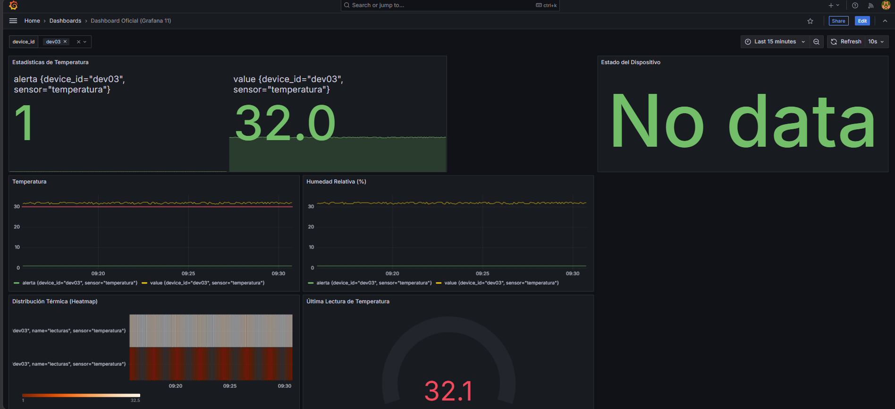

**Estado en InfluxDB (measurement `estado`, dev03):**

| `_time` (UTC) | `_value` | Evento |
|---|---|---|
| 2026-11-16T14:15:16.894Z | 0 | Se detuvo el dev03 normal para recrearlo con `TEMP_FORZADA` |
| 2026-11-16T14:15:28.654Z | 1 | Se conectó dev03 con `TEMP_FORZADA=32` (9:15) |
| 2026-11-16T14:31:52.142Z | 0 | `docker stop dev03` (9:31) → OFFLINE |


**Telegram:** no evaluado. La notificación de alertas en Azure (R5.6/R5.7, Rol 4) aún no está desplegada.

**Veredicto P8.4:** 🟨 **Parcial**
- La alerta se detecta y se almacena (`alerta = 1`) y se ve en Grafana.
- El estado OFFLINE se registra.
- Falta la notificación de Telegram, que depende de R5.6/R5.7.

---

## Mediciones

| Métrica | Valor |
|---|---|
| Tiempo activo para agregar dev03 (suma de los pasos 1–7) | ≈ 7 min 4 s |
| Tiempo de reloj 8:38 a 9:09 (no contabilizado: incluye diagnóstico y capturas) | 31 min |
| Diagnóstico del Problema 1 (solo Git Bash) | ≈ 10 min (8:49 a 8:59) |
| Cambios en el backend | 0 commits en `backend/` (`a5febba` antes y después) |
| Reinicios de contenedores del backend | 0 (de "Up 12 minutes" a "Up About an hour") |
| Intervalo de publicación | 5 s (`PUBLISH_INTERVAL=5`) |
| De `docker stop` a `estado = 0` en InfluxDB | Inmediato (14:31:52Z) |

## Observaciones

1. **Guía (Rol 1):** agregar `MSYS_NO_PATHCONV=1` en la Ruta B para Git Bash, o quitar `-e CA_CERT_PATH` (ver Problema 1). Después de corregirlo, quitar la marca de "borrador". Indicar también en la guía qué terminal usar: los comandos están escritos para Bash (`read -rsp`, `\` al final de línea). En CMD o PowerShell la ruta no se convierte, pero esos comandos necesitan otra sintaxis.
2. **Dashboard (Rol 4).** Las capturas en Azure se tomaron con la versión de `main` (commit `a5febba`) y muestran tres defectos que ya corrige el PR de revisión del Rol 5 sobre `rol4-grafana-y-alertas`:
   - El panel "Humedad Relativa (%)" grafica `sensor="temperatura"`. El PR lo cambia a `r.sensor == "humedad"`.
   - Los paneles "Temperatura", "Estadísticas" y el heatmap mezclan el campo `alerta` con `value`, porque falta el filtro `r._field == "value"`, que el PR agrega.
   - **Nuevo:** "Estado del Dispositivo" mostró **No data** durante la prueba de temperatura forzada. El estado solo se escribe al conectar o desconectar, y el último cambio (14:15:28Z) quedó fuera del rango "Last 15 minutes". Se recomienda que ese panel consulte un rango amplio (por ejemplo `range(start: -30d)` con `last()`) para mostrar siempre el último estado.
3. **Variable `device_id`:** la lista incluye identificadores de pruebas anteriores (`sim001`, `sim002`, `sim003`). Se recomienda limpiar esos datos de prueba del bucket `iot`, o restringir la variable a `dev*`.
4. **Contrato:** `TEMP_FORZADA` (simulador v3) se usó solo para forzar la alerta. Su inclusión en el contrato está pendiente de aprobación del grupo.
5. **Seguridad:** ninguna captura muestra claves, tokens ni la IP pública del hogar. La dirección 192.168.10.21 de P8.1 paso 1 es privada.
6. **Limpieza:** al terminar, se eliminó el contenedor (`docker rm dev03`) y se apagó la VM desde el portal de Azure.

## Veredicto general R5.8

🟨 **Parcial**
- P8.1 ✅, P8.2 ✅, P8.3 ✅.
- P8.4 🟨, pendiente solo de la notificación de Telegram (R5.6/R5.7).
- Cuando la alerta de Telegram esté desplegada, repetir solo la parte de Telegram de P8.4 (con `TEMP_FORZADA=32`) y actualizar este veredicto a ✅.

**Revisado por:** Kevin Aristizabal (Rol 1), 2026-11-16

---

## Revisión del Rol 1 (Kevin Aristizabal, 2026-11-16)

Se revisaron la ficha y las 11 capturas. No hay claves, tokens ni la IP pública de ningún integrante (la 192.168.10.21 es privada). Resultado por prueba:

| Prueba | Veredicto del Rol 5 | Veredicto tras la revisión | Motivo |
|---|---|---|---|
| P8.1 | ✅ | 🟨 | Ver abajo |
| P8.2 | ✅ | ✅ | Mismo commit de `backend/` y contenedores sin reinicio, antes y después |
| P8.3 | ✅ | ✅ | `dev03` aparece en la variable `device_id` y en los paneles sin editar el dashboard |
| P8.4 | 🟨 | 🟨 | Alerta y `estado = 0` registrados; falta la notificación de Telegram (R5.6/R5.7) |

**Por qué P8.1 queda 🟨:**
1. **Solo se probó la Ruta B (Docker).** El enunciado del proyecto pide Balena como tecnología de gestión de los dispositivos, y la Ruta A (Balena + VirtualBox) de la guía todavía no la ha seguido nadie que no la escribió. Hay que repetir P8.1 con la Ruta A, con cronómetro.
2. **Sobre el tiempo de la Ruta B:** el reloj marcó 31 min, pero Rol 5 explicó que la mayor parte se fue en tomar, renombrar y ordenar las capturas, y la suma de los pasos activos fue de ≈ 7 min. Se acepta ese tiempo para la Ruta B, con el descuento ya explicado de ≈ 10 min de diagnóstico del Problema 1. Para el intento de la Ruta A, las capturas se toman **después** de detener el cronómetro, o se anotan las pausas en la tabla.
3. **Defecto de la guía:** el Problema 1 (Git Bash convierte `/app/ca.crt`) se corrige en la guía por un PR de Rol 1.

**Detalles menores de la ficha (no cambian el veredicto):**
- El paso 7 termina a las 9:09 en la tabla, pero los mensajes de `mosquitto_sub` son de las 14:11 UTC (9:11).
- El paso 3 dice 16,83 s en la tabla y 9,9 s en la captura (el segundo es el tiempo de `docker build`; el primero incluye el comando completo).
- La captura de P8.3 muestra el panel "Humedad Relativa (%)" con la serie de temperatura: es el defecto del dashboard antiguo que corrige el PR de Rol 4, no un fallo de `dev03`.

**Pendiente para cerrar R5.8:**
- Rol 1: corregir la guía (`MSYS_NO_PATHCONV=1`, terminal a usar, quitar "borrador").
- Rol 1 y Rol 5: repetir P8.1 con la Ruta A (Balena) y otra persona que no escribió la guía; registrarlo como Intento 2.
- Rol 4: la alerta de Telegram, para repetir esa parte de P8.4.

---

# Intento 2 — Ruta A (BalenaCloud + VirtualBox) · 2026-11-18

| Campo | Valor |
|---|---|
| **Requerimiento** | R5.8, pruebas P8.1 a P8.4 (Intento 2), por la Ruta A de la guía |
| **Ejecutada por** | Alejandro Domínguez Torres (Rol 5), que no escribió la guía |
| **Fecha y hora** | 2026-11-18, 7:48 a 9:13 (Bogotá, UTC−5) |
| **Entorno** | PC Windows 11 (Nitro5) · VirtualBox 7.2.14 · CMD y PowerShell · BalenaCloud, flota `gh_kevinaristi/proyecto5-iot` (acceso por invitación) · balenaOS 9.0.4+rev2, Generic x86_64 (GPT) · backend en la VM de Azure `vm-iot-backend` (68.211.147.97) |
| **Guía** | [guia-nuevo-dispositivo.md](../guia-nuevo-dispositivo.md), Ruta A (versión del PR #18) |
| **Respaldo** | Grabación de pantalla de toda la prueba (35 min, con pausas). No se sube al repositorio por su tamaño (260 MB); está disponible a pedido |
| **Revisado por** | _Pendiente_ |

## Precondiciones

- Acceso a la flota por invitación. El rol de la flota permitió crear el dispositivo y descargar la imagen, lo que resuelve uno de los `[Verificar]` de la guía.
- Sin el contenedor Docker `dev03` de la Ruta B: `docker ps -a --filter name=dev03` sin resultados.
- Usuario MQTT `dev03` ya creado en el broker (Rol 2). Su clave se cargó solo en Balena; las capturas la tapan.
- VM de Azure encendida antes de A5.

---

## P8.1 — Incorporar dev03 por la Ruta A · Intento 2

**Qué se probó:** que una persona que no escribió la guía conecte `dev03` por la Ruta A (Balena + VirtualBox) solo con la guía, y cuánto tarda.

**Cómo:** pasos A1 a A6 y Paso 7 de la Ruta A, con la hora de cada paso tomada del reloj de Windows en la grabación.

**Resultado esperado:** `dev03` en **Online** en Balena, conectado al broker por TLS (8883) y visible en Grafana, sin cambios en `backend/`.

### Tiempos (horas de Bogotá)

| Paso | Inicio | Fin | Reloj | Sin problemas propios (estimado) | Problemas |
|---|---|---|---|---|---|
| Preparación (`VBoxManage --version`, carpeta, `docker ps`) | 7:48 | 7:50 | 2 min | 2 min | Ninguno |
| A1. Registrar y descargar la imagen | 7:51 | 7:59 | 8 min | 8 min | Ninguno (descarga ≈ 1,4 GB y extracción de ≈ 4,2 GB) |
| A2. Convertir la imagen | 8:00 | 8:00 | < 1 min | 1 min | Ninguno |
| A3. Crear la VM | 8:03 | 8:20 | 17 min | ≈ 3 min | Sí: Problema 2 |
| A4. Instalar balenaOS y renombrar | 8:20 | 8:46 | 26 min | ≈ 8 min | Sí: Problemas 3 y 4 |
| Pausa: broker y P8.2 "antes" | 8:36 | 8:36 | — | — | Ninguno |
| A5. Cargar variables | 8:38 | 8:51 | 13 min | ≈ 2 min | Sí: Problema 5 |
| A6. Comprobar el log | 8:46 | 8:52 | 6 min | ≈ 4 min | Afectado por el Problema 5 |
| 7. Ver en Grafana | 8:52 | 8:53 | 1 min | 1 min | Ninguno |
| **Total (A1 a Paso 7)** | **7:51** | **8:53** | **62 min** | **≈ 27 min** | |

- El reloj incluye las pausas de la grabación y el tiempo perdido en los Problemas 2 a 5, que fueron errores de ejecución, no de la guía.
- La columna "sin problemas propios" es una **estimación** hecha con la grabación: sumar la duración real de lo que el paso exige (por ejemplo, la instalación tardó ≈ 4 min y la descarga de la release ≈ 3 min). **No es una medición.**
- Los pasos A5 y A6 se solapan, porque las variables se cargaron mientras el dispositivo descargaba la release.

### Problemas encontrados

**Problema 2 (A3): discos mal conectados.** En *Configuración → Almacenamiento* se agregó dos veces el disco de 16 GB, y al corregirlo se quitó el controlador SATA completo. Se resolvió conectando los discos con `VBoxManage storageattach`: `p5-dev03.vdi` en el puerto 0 y `dev03-instalador.vdi` en el puerto 1. El selector de discos no muestra el instalador hasta registrarlo con *Añadir*.

**Problema 3 (A4): `Access Denied` en el primer arranque (8:20).** UEFI encontró el instalador (`Boot0002`) pero no lo arrancó. Antes de eso, la VM se había creado con el tipo **Windows 11 (64-bit)** que propone el asistente, y luego se cambió a *Other/Unknown (64-bit)*. Después de revisar la configuración de *Sistema*, el segundo arranque instaló balenaOS (8:24). En el detalle de VirtualBox, *Secure Boot* aparece como *Habilitado* también en el arranque que funcionó, así que **la causa exacta no quedó aislada**.

**Problema 4 (A4): la VM no se reinició.** Después de quitar el instalador del puerto 1 (8:28) no se volvió a iniciar la VM hasta ≈ 8:44. Por eso `dev03` siguió en *Post provisioning*. Fue un error del ejecutor.

**Problema 5 (A5): clave equivocada.** `MQTT_PASSWORD` se cargó con el valor `dev03` en lugar de la clave. El broker respondió `conexion rechazada: Not authorized` (13:49 UTC). Al pegar la clave correcta (8:51), conectó a las 13:52:00 UTC. Fue un error del ejecutor.

### Resultado obtenido

**Preparación:** VirtualBox 7.2.14, carpeta `C:\p5-vms\dev03` creada y ningún contenedor Docker `dev03`.

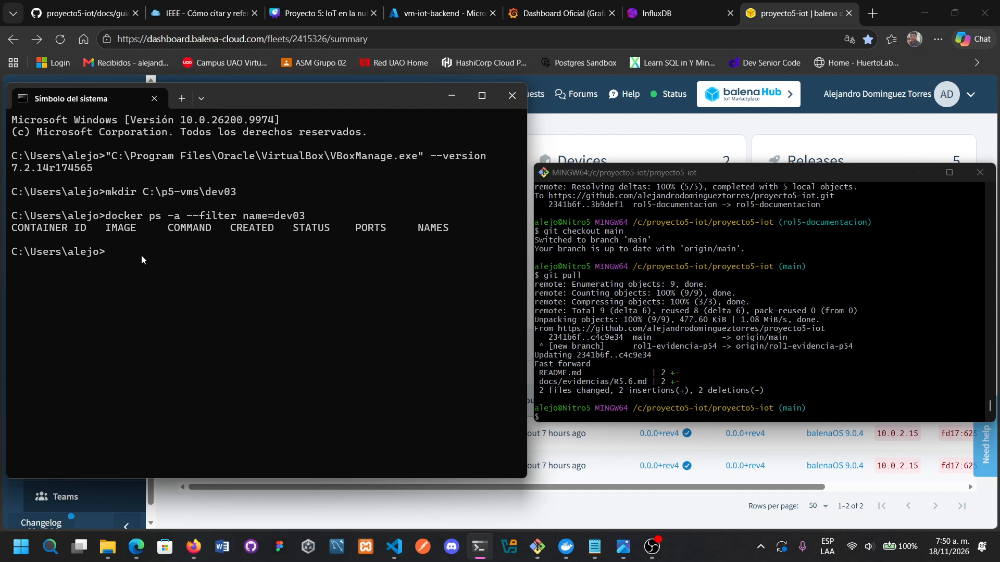

**A1:** Generic x86_64 (GPT), balenaOS 9.0.4+rev2, Production, Ethernet only, Secure Boot y cifrado apagados. Se descargó con *Download balenaOS (~1.4 GB)*. Queda un `.img` de 4.202.692.608 bytes (7:56).

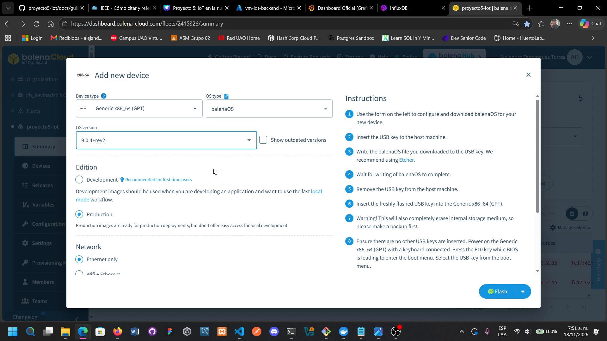
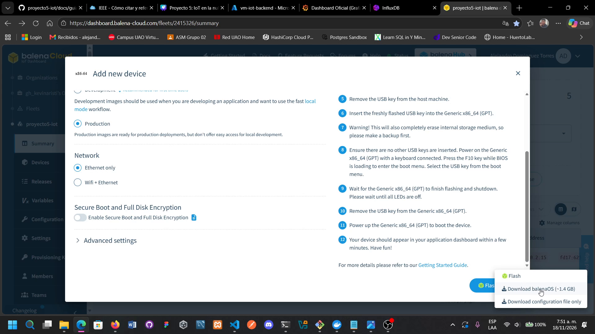
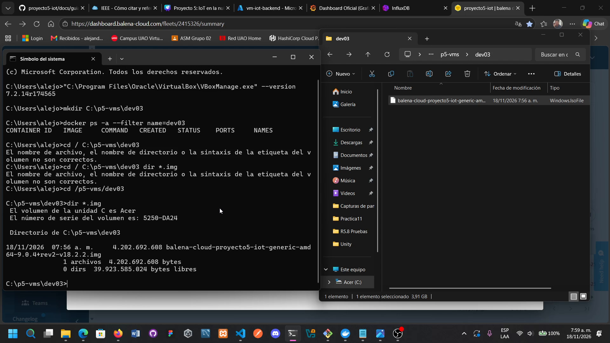

**A2:** `convertfromraw` crea `dev03-instalador.vdi` (8:00).

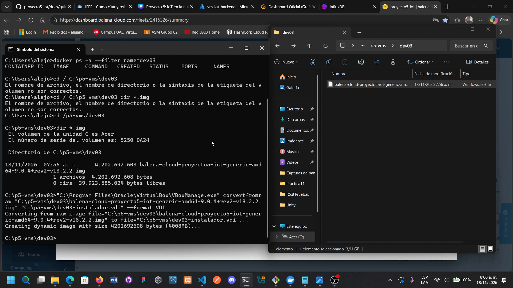

**A3:** disco nuevo de 16 GB (VDI). Después de corregir el Problema 2, `modifyvm --ioapic off --cpus 1` y `showvminfo` muestran `firmware="EFI"`, `ioapic="off"`, `cpus=1`, `SATA-0-0` = `p5-dev03.vdi` y `SATA-1-0` = `dev03-instalador.vdi`.

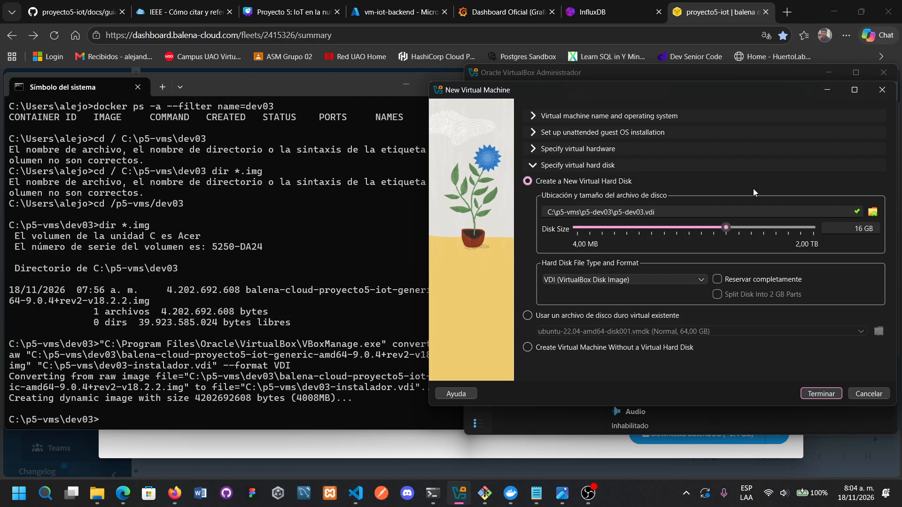
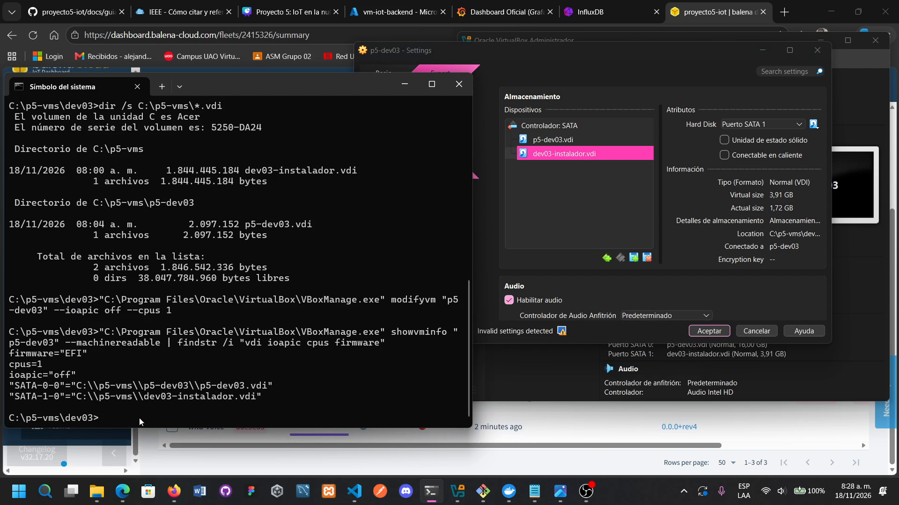

**A4:** primer arranque con `Access Denied` (Problema 3). Segundo arranque instalando (8:24); el dispositivo aparece en la flota como `wild-voice`. Se renombra a `dev03` (8:32) y queda en la flota junto a `dev01` y `dev02`. Tras reiniciar la VM: *Updating*, Cloudlink conectado, balenaOS 9.0.4+rev2, descargando la release (8:46).

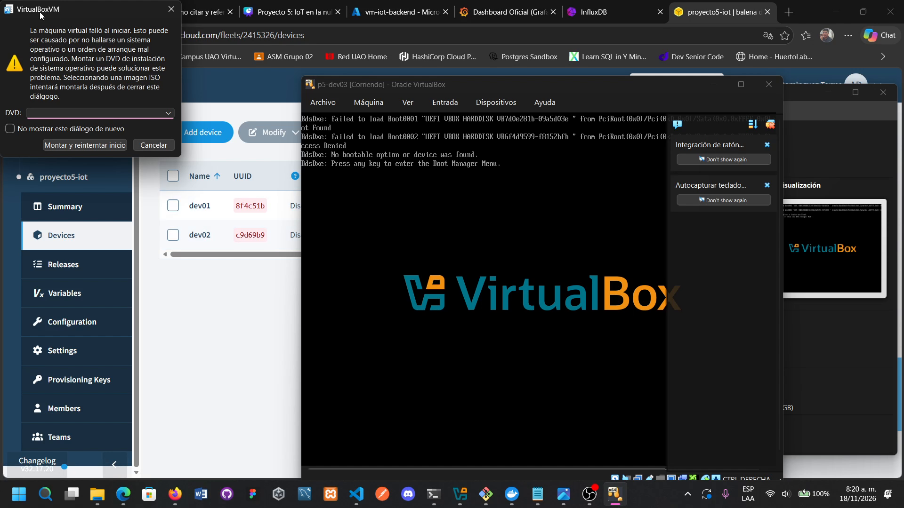
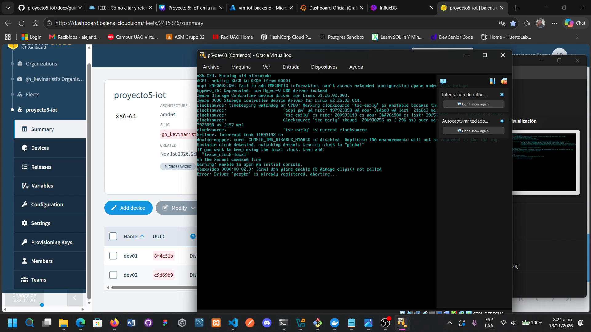
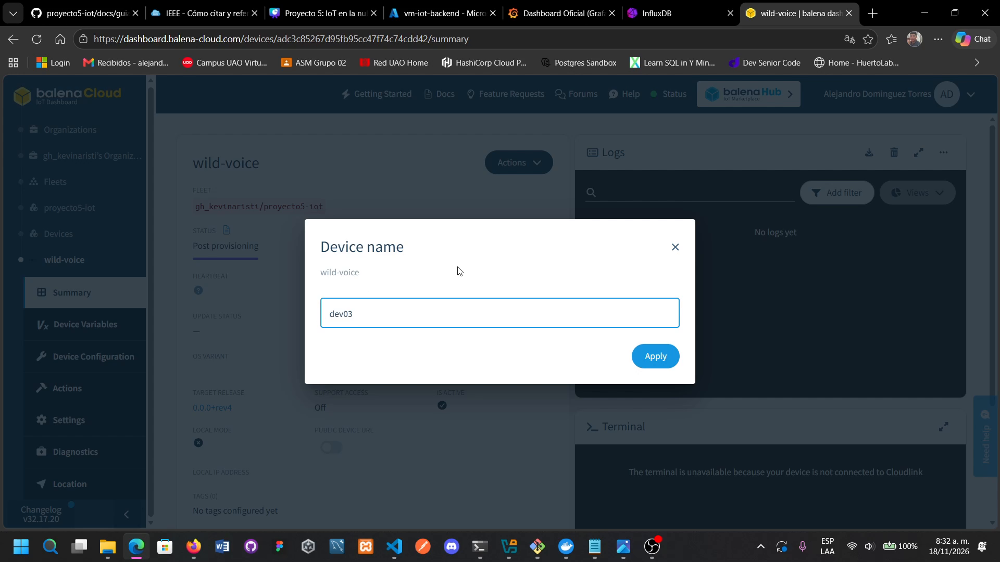
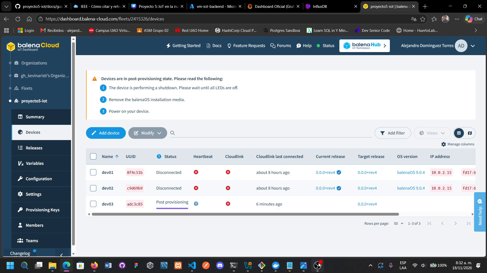
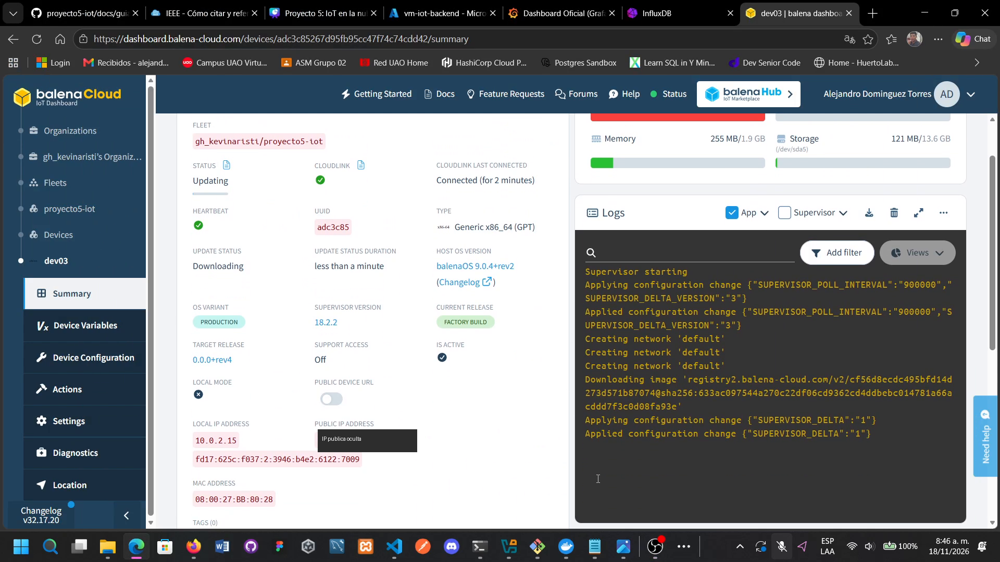

**Broker antes de A5:** `Test-NetConnection 68.211.147.97 -Port 8883` da `TcpTestSucceeded : True` (8:36).


**A5:** `DEVICE_ID` = `dev03`, `MQTT_USER` = `dev03` y `MQTT_PASSWORD` (tapada). `BROKER_HOST`, `BROKER_PORT`, `CA_CERT_PATH` y `PUBLISH_INTERVAL` vienen de la flota.

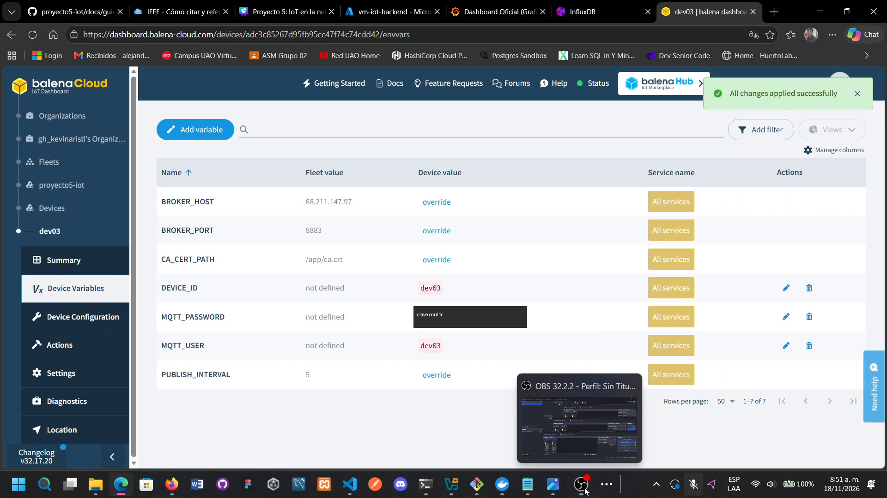

**A6:** con la clave equivocada, `Not authorized` (Problema 5). Con la correcta, el log muestra `simulador v3` (13:51:59 UTC), `conectado a 68.211.147.97:8883` (13:52:00 UTC) y lecturas cada 5 s.

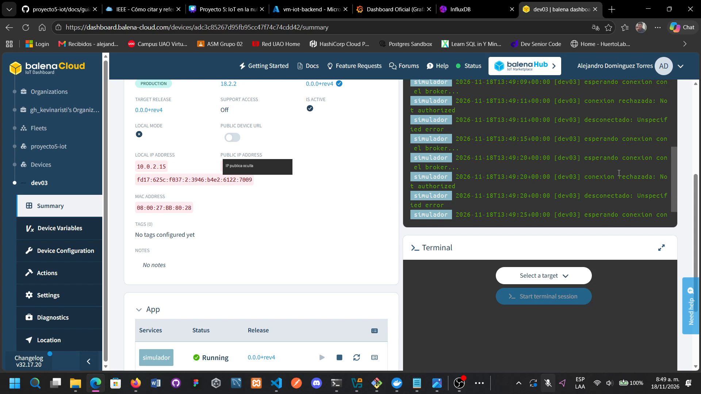
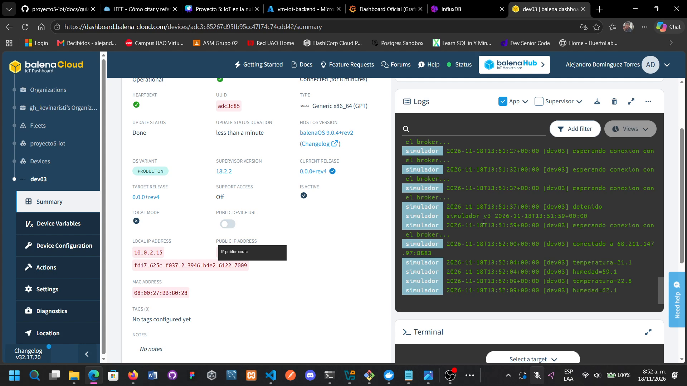

**Paso 7:** ver P8.3.

**Veredicto P8.1 (Intento 2):** ✅ **Cumple**. `dev03` quedó integrado por la Ruta A siguiendo la guía, sin tocar `backend/`, con datos visibles en Grafana. Sobre el tiempo: el reloj marcó 62 min, y la estimación sin las pausas de grabación ni los errores propios (Problemas 2 a 5) es de ≈ 27 min. Queda a criterio del revisor si esa estimación basta para el criterio de 30 min.

**Revisado por:** _Pendiente_

---

## P8.2 — El backend no se modificó · Intento 2

**Cómo:** igual que en el Intento 1. Se comparó el último commit de `backend/` en `origin/main` y los contenedores de la VM, antes y después.

| Verificación | Antes (8:36) | Después (9:13) | ¿Igual? |
|---|---|---|---|
| Último commit en `backend/` | `fb35998 2026-11-17 19:29:07 -0500 R5.6: debug errores muestra solo msg.payload` | `fb35998` (el mismo) | ✅ |
| `backend-nodered-1` | Up About an hour (healthy) | Up 2 hours (healthy) | ✅ Sin reinicio |
| `backend-grafana-1` | Up About an hour | Up 2 hours | ✅ Sin reinicio |
| `backend-influxdb-1` | Up About an hour | Up 2 hours | ✅ Sin reinicio |
| `backend-mosquitto-1` | Up About an hour | Up 2 hours | ✅ Sin reinicio |

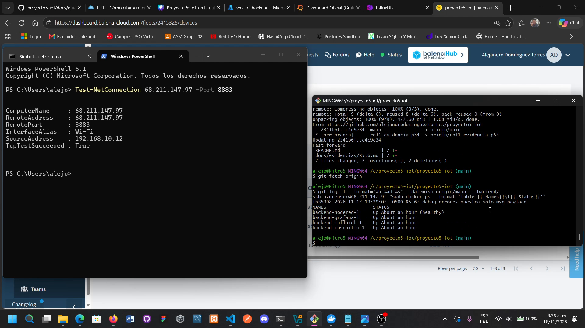
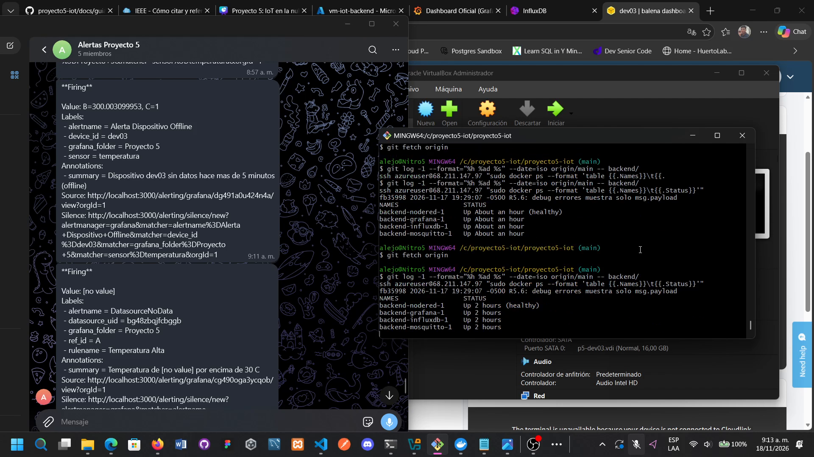

**Veredicto P8.2 (Intento 2):** ✅ **Cumple**

**Revisado por:** _Pendiente_

---

## P8.3 — dev03 aparece en el dashboard · Intento 2

**Resultado obtenido:**
- A las 8:52, con `device_id` en *All*, el panel de estado muestra `dev01` OFFLINE, `dev02` OFFLINE y **`dev03` ONLINE**.
- A las 8:53, con solo `dev03`: estadísticas de temperatura 20,8 / 28,7 / 23,8, estado **ONLINE** y series de temperatura y humedad propias.
- No se editó el dashboard.

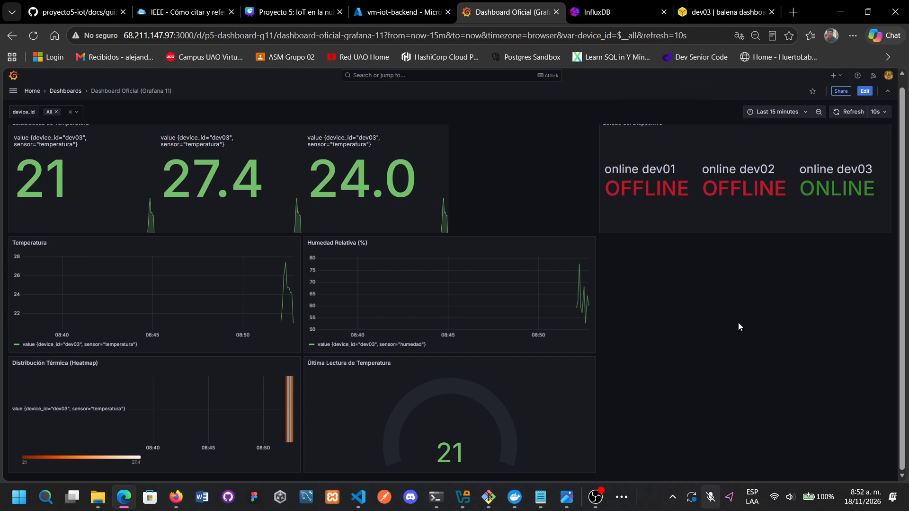
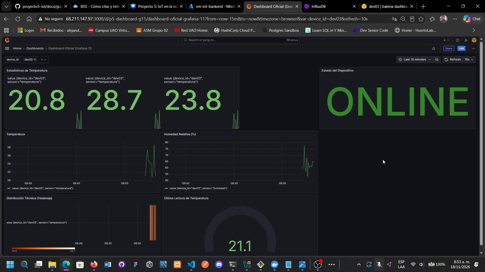

**Veredicto P8.3 (Intento 2):** ✅ **Cumple**

**Revisado por:** _Pendiente_

---

## P8.4 — Alertas con dev03 · Intento 2 (Telegram)

**Cómo:**
1. `TEMP_FORZADA` = `32` en Device Variables de `dev03` (8:54).
2. Se esperó la alerta en el chat "Alertas IoT Proyecto 5".
3. Se borró la variable y se esperó el *Resolved*.
4. Se apagó la VM con *Stop → Apagar* y se esperó la alerta de offline.

**Resultado obtenido:**

| Evento | Hora |
|---|---|
| `TEMP_FORZADA` = `32` aplicada | 8:54 |
| Log: `AVISO: TEMP_FORZADA activa (32.0 C)` | 13:55:25 UTC (8:55:25) |
| Primera lectura > 30 °C: `temperatura=31.8` | 13:55:29 UTC (8:55:29) |
| Telegram *Firing* "Temperatura Alta", `device_id = dev03`, `B=31.8` | 8:55 (Telegram muestra solo el minuto) |
| Reinicio sin `TEMP_FORZADA` | 13:56:48 UTC |
| Telegram *Resolved*, `B=26.6` | 8:57 |
| VM `p5-dev03` apagada con *Stop → Apagar* | entre 9:03 y 9:11 (≈ 9:06) |
| Telegram *Firing* "Alerta Dispositivo Offline", "Dispositivo dev03 sin datos hace más de 5 minutos" | 9:11 |

- La lectura alta llegó a las 8:55:29 y el mensaje está marcado 8:55, así que llegó **en 30 s o menos**.
- La alerta de offline llegó unos 5 minutos después del apagado, como se esperaba.

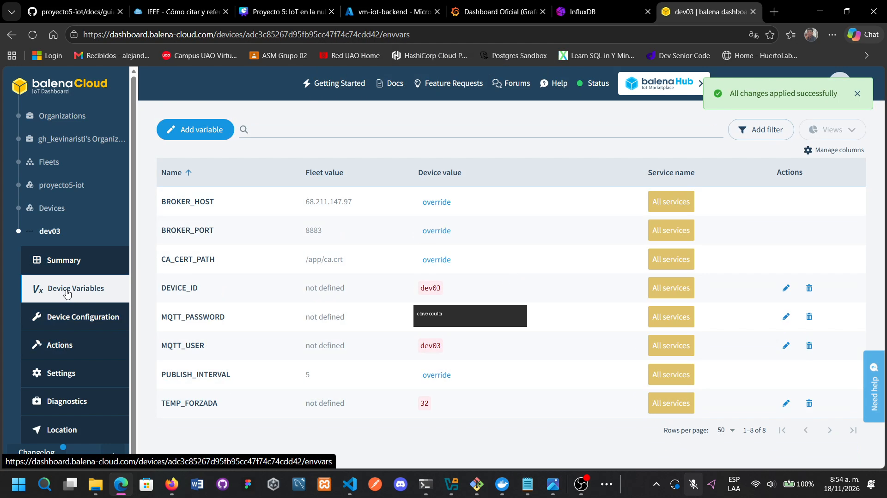
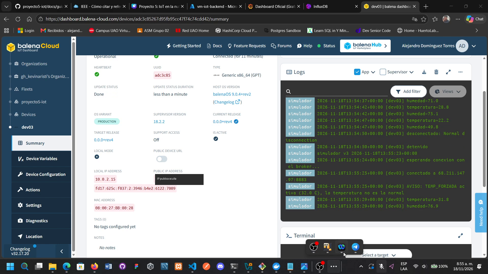
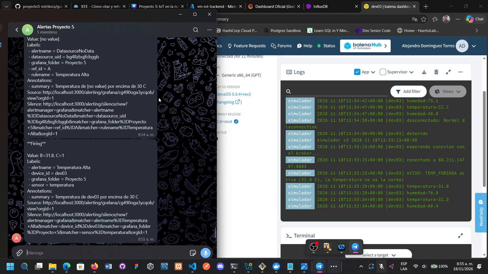
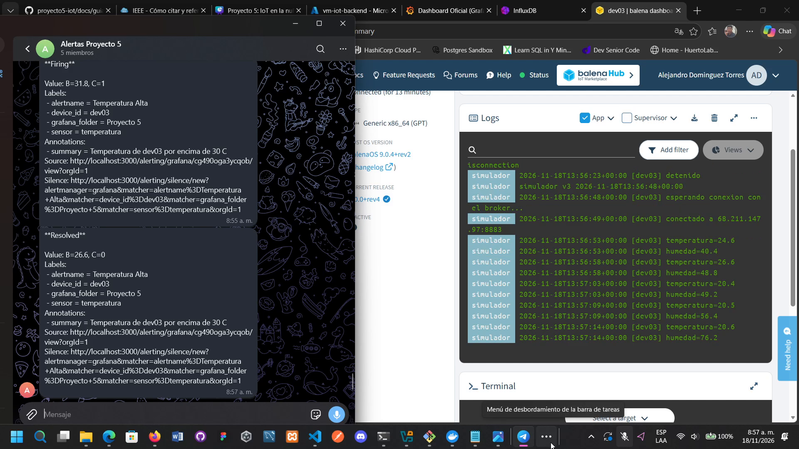
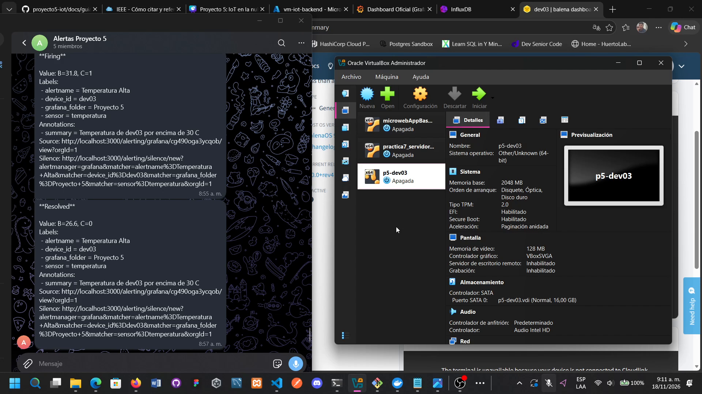
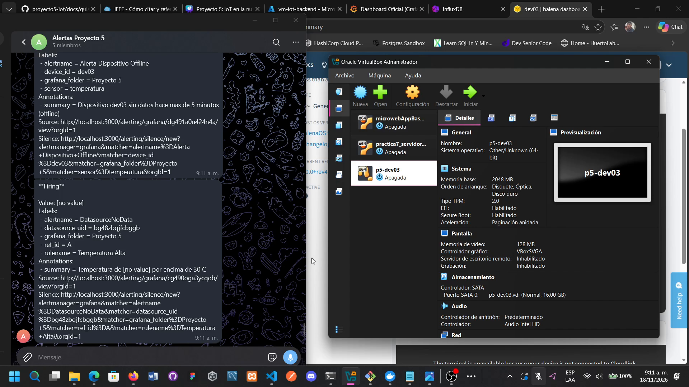

**Veredicto P8.4 (Intento 2):** ✅ **Cumple**

**Observaciones:**
- *Shut Down* (ACPI) no apagó la VM de balenaOS; hubo que usar *Stop → Apagar* (Problema 6). Es lo mismo que pasó en R5.7.
- A las 8:54 y a las 9:11 también llegó un `DatasourceNoData` de "Temperatura Alta": es el aviso de "sin datos" cuando ningún dispositivo publica temperatura. Confirma la sugerencia pendiente de poner `noDataState = OK` en esa regla.
- Solo llegaron mensajes de Grafana; no hubo duplicados de Node-RED.

**Revisado por:** _Pendiente_

---

## Hallazgos para la guía (Rol 1)

1. **"Al terminar":** cambiar *ACPI Shutdown* por *Máquina → Stop → Apagar*, porque ACPI no apaga la VM de balenaOS (también pasó en R5.7).
2. **A3:** advertir que el asistente de VirtualBox propone el tipo *Windows 11 (64-bit)*: hay que cambiarlo a *Other/Unknown (64-bit)* antes de terminar. También conviene decir explícitamente cómo debe quedar *Secure Boot*.
3. **A3:** ofrecer los comandos `VBoxManage storageattach` como alternativa para conectar los discos.
4. **A4:** remarcar que, después de quitar el instalador, **hay que volver a iniciar** la VM.
5. **[Verificar] resuelto:** con la invitación a la flota se pudo crear el dispositivo y descargar la imagen.

## Veredicto general R5.8 (Intento 2)

✅ **Cumple**, pendiente de revisión:
- P8.1 ✅ por las dos rutas (B el 2026-11-16 y A el 2026-11-18), con la nota de tiempo de la Ruta A.
- P8.2 ✅ y P8.3 ✅.
- P8.4 ✅, ahora con Telegram.

**Revisado por:** _Pendiente_