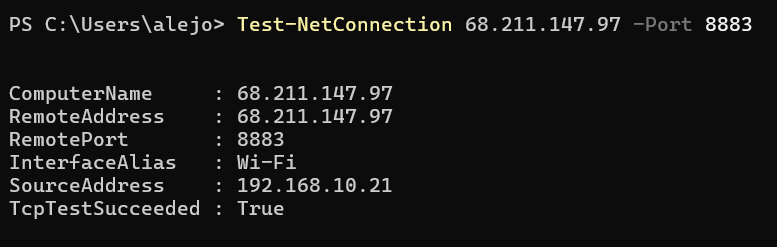
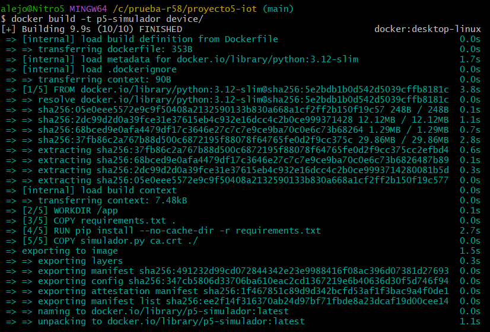
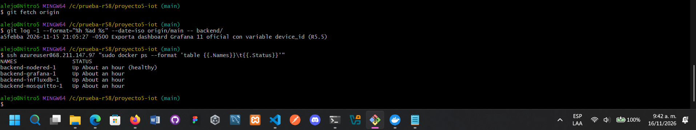
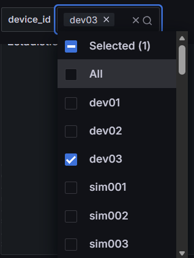
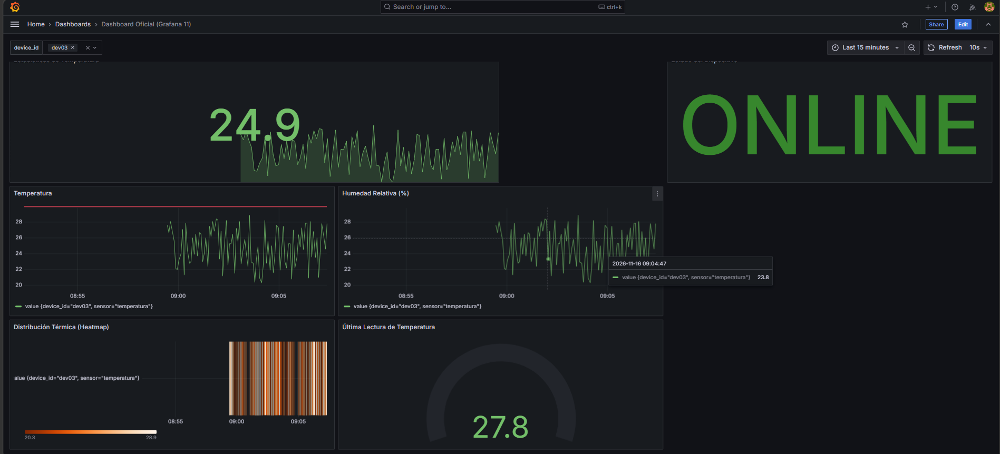
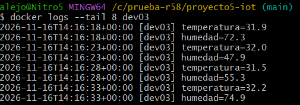
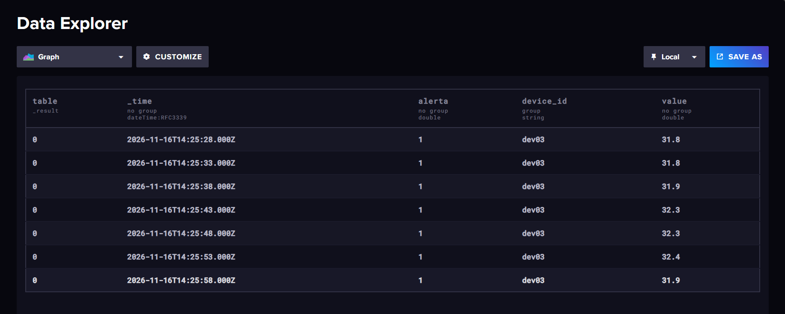
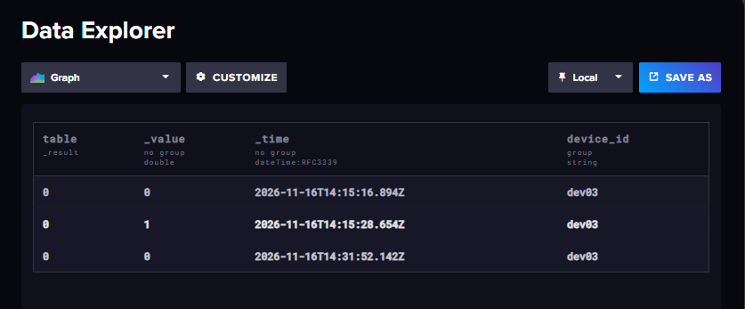

# Evidencia R5.8 — Tercer dispositivo

| Campo | Valor |
|---|---|
| Criterio de aceptación | Nuevo dispositivo integrado en menos de 30 minutos siguiendo la guía; datos visibles en dashboard. |
| Responsable | Rol 5 · Rol 1 |
| Estado | 🟨 Parcial (falta Telegram en P8.4) |
| Pruebas definidas en | [requerimientos.md](../requerimientos.md) |
| Plantilla | [PLANTILLA.md](PLANTILLA.md) |
| Guía probada | [guia-nuevo-dispositivo.md](../guia-nuevo-dispositivo.md) |
| Capturas | `docs/evidencias/img/R5.8/` |

## Resumen


| ID | Prueba | Veredicto | Fecha | Revisado por |
|---|---|---|---|---|
| P8.1 | Guía seguida en menos de 30 min | ✅ | 2026-11-16 | |
| P8.2 | Sin cambios en el backend | ✅ | 2026-11-16 | |
| P8.3 | dev03 visible en el dashboard | ✅ | 2026-11-16 | |
| P8.4 | Alertas funcionan con dev03 | 🟨 | 2026-11-16 | |

Leyenda: ⬜ Pendiente · ✅ Pasa · ❌ Falla · 🟨 Parcial

---

# R5.8 — Escalabilidad: incorporar un tercer dispositivo (dev03) sin modificar el backend

| Campo | Valor |
|---|---|
| **Requerimiento** | R5.8 — Un integrante que no escribió la guía agrega un dispositivo nuevo siguiendo `docs/guia-nuevo-dispositivo.md`, sin tocar el backend |
| **Ejecutada por** | Alejandro Domínguez Torres (Rol 5) |
| **Fecha y hora** | 2026-11-16, 8:38 a 9:42 (Bogotá, UTC−5) = 13:38 a 14:42 UTC |
| **Entorno** | PC Windows 11 (Nitro5), Git Bash (MINGW64), Docker Desktop (`desktop-linux`). Backend en la VM de Azure `vm-iot-backend` (68.211.147.97): Mosquitto 2.0.20, Node-RED 4.0, InfluxDB 2.7, Grafana 11.3.0 |
| **Ruta de la guía** | Ruta B (Docker local), dispositivo `dev03` |
| **Revisado por** | _Pendiente — Kevin Aristi (Rol 1, autor de la guía)_ |

## Precondiciones

- VM de Azure encendida y los 4 contenedores del backend arriba (ver P8.2 "antes").
- Usuario `dev03` ya existente en Mosquitto, con su ACL (creado por Rol 2). Su clave se recibió por el chat privado del grupo y se cargó con `read -rsp`, así que no aparece en comandos, historial ni capturas.
- Clon **limpio** del repositorio en una carpeta nueva (`/c/prueba-r58`), para simular a un integrante nuevo.
- dev01 y dev02 no son necesarios para esta prueba.

---

## P8.1 — Agregar dev03 siguiendo la guía y medir el tiempo

**Qué se probó:** que una persona que no escribió la guía pueda conectar un dispositivo nuevo solo con la guía, y cuánto tarda.

**Cómo:** se ejecutaron los pasos 1 a 7 de la Ruta B de `docs/guia-nuevo-dispositivo.md`, con el tiempo de cada paso.

**Resultado esperado:** dev03 conectado por TLS (8883), publicando según el contrato y visible en InfluxDB y Grafana sin cambios en el backend.

### Tiempos

| Paso | Inicio | Fin | Duración activa | Problemas |
|---|---|---|---|---|
| 1. Broker responde (`Test-NetConnection … -Port 8883`) | 8:38 | 8:39 | 34 s | Ninguno |
| 2. Descargar repo (`git clone`) | 8:39 | 8:40 | 34 s | Ninguno |
| 3. Construir imagen (`docker build -t p5-simulador device/`) | 8:41 | 8:41 | 16,83 s | Ninguno |
| 4. Cargar clave (`read -rsp`) | 8:47 | 8:48 | 37,98 s | Ninguno |
| 5. Ejecutar dispositivo (`docker run`) | 8:49 | 8:49 | 5 s | **Sí: ver Problema 1** |
| 6. Revisar log (`docker logs dev03`) | 8:59 | 8:59 | 15,36 s | Ninguno, después de la corrección |
| 7. Datos en el sistema (broker, InfluxDB, Grafana) | 9:04 | 9:09 | 4 min 41 s | Ninguno |
| **Total** | **8:38** | **9:09** | **≈ 7 min 4 s activos** | **31 min de reloj** |

- La columna **Duración activa** mide solo la ejecución de cada paso; los saltos entre pasos no se contabilizan.
- Esos saltos se deben a dos causas ajenas al procedimiento:
  - el diagnóstico del Problema 1 (≈ 10 min, 8:49 a 8:59), un error exclusivo de Git Bash;
  - el tiempo dedicado a tomar las capturas de evidencia.
- Sumando solo los pasos, agregar dev03 toma **≈ 7 min 4 s**, muy por debajo del límite de 30 min.

### Problema 1: Git Bash convierte la ruta del certificado (hallazgo para la guía)

- **Síntoma:** el primer `docker run` (8:49) dejó a dev03 en un ciclo de reinicios con `FileNotFoundError` en `tls_set`.
- **Causa:** Git Bash (MSYS) convierte `-e CA_CERT_PATH=/app/ca.crt` en una ruta de Windows (`C:/Program Files/Git/app/ca.crt`), que no existe dentro del contenedor.
- **Verificación:** `docker inspect dev03 --format '{{range .Config.Env}}{{println .}}{{end}}' | grep CA_CERT`
- **Solución (8:59):** anteponer `MSYS_NO_PATHCONV=1` al comando:

```bash
MSYS_NO_PATHCONV=1 docker run -d --name dev03 --restart unless-stopped \
  -e DEVICE_ID=dev03 -e MQTT_USER=dev03 -e MQTT_PASSWORD \
  -e BROKER_HOST=68.211.147.97 -e BROKER_PORT=8883 \
  -e CA_CERT_PATH=/app/ca.crt -e PUBLISH_INTERVAL=5 \
  p5-simulador
```

- **Recomendación para Rol 1:** agregar `MSYS_NO_PATHCONV=1` a la guía, o quitar `-e CA_CERT_PATH`, porque el simulador v3 ya usa `/app/ca.crt` por defecto. Después, quitar la marca de "borrador".

### Resultado obtenido

**Paso 1.** Puerto 8883 alcanzable: `TcpTestSucceeded : True`.



**Paso 2.** Clon limpio (414 objetos), con `device/ca.crt` presente.


**Paso 3.** Imagen `p5-simulador` construida en 9,9 s (10/10 FINISHED). Se copia `simulador.py ca.crt` a `/app`.



**Paso 6.** Log de dev03: `simulador v3`, luego `conectado a 68.211.147.97:8883`, y lecturas cada 5 s de temperatura (26,7 a 28,1) y humedad.


**Paso 7.** El broker de Azure recibe a dev03. Se verificó con `mosquitto_sub` en la VM, con el usuario `nodered`, el tópico `iot/dev03/#` y TLS:

```
iot/dev03/status online
iot/dev03/temperatura {"device_id": "dev03", "sensor": "temperatura", "value": 20.4, "unit": "C", "ts": "2026-11-16T14:11:26Z"}
iot/dev03/humedad {"device_id": "dev03", "sensor": "humedad", "value": 67.6, "unit": "%", "ts": "2026-11-16T14:11:26Z"}
iot/dev03/temperatura {"device_id": "dev03", "sensor": "temperatura", "value": 20.6, "unit": "C", "ts": "2026-11-16T14:11:31Z"}
iot/dev03/humedad {"device_id": "dev03", "sensor": "humedad", "value": 78.1, "unit": "%", "ts": "2026-11-16T14:11:31Z"}
iot/dev03/temperatura {"device_id": "dev03", "sensor": "temperatura", "value": 27.7, "unit": "C", "ts": "2026-11-16T14:11:36Z"}
iot/dev03/humedad {"device_id": "dev03", "sensor": "humedad", "value": 63.2, "unit": "%", "ts": "2026-11-16T14:11:36Z"}
Timed out
```

- Los tópicos (`iot/dev03/{sensor}` y `iot/dev03/status`) y el payload JSON cumplen el contrato, con `ts` en UTC terminado en `Z`.
- La clave de `nodered` se leyó del `.env` de la VM y no aparece en el comando.

**Veredicto P8.1:** ✅ **Cumple**. Criterio "menos de 30 min": la suma de las duraciones activas de los pasos 1 a 7 es ≈ 7 min 4 s. Los 31 min de reloj (8:38 a 9:09) no reflejan el procedimiento: incluyen ≈ 10 min de diagnóstico del Problema 1 (conversión de rutas propia de Git Bash, que no ocurre en CMD ni PowerShell) y el tiempo de las capturas de evidencia. Queda un hallazgo para corregir en la guía (Problema 1).

---

## P8.2 — El backend no se modificó

**Qué se probó:** que agregar dev03 no requirió cambios en el código ni reinicios del backend.

**Cómo:** se comparó el último commit que toca `backend/` en `origin/main` y el estado de los contenedores de la VM, antes y después de la prueba.

**Resultado esperado:** el mismo commit antes y después, y contenedores sin reinicio (el tiempo "Up" solo aumenta).

### Antes (8:38)

```
$ git log -1 --format="%h %ad %s" --date=iso origin/main -- backend/
a5febba 2026-11-15 21:05:27 -0500 Exporta dashboard Grafana 11 oficial con variable device_id (R5.5)

$ ssh azureuser@68.211.147.97 "sudo docker ps --format 'table {{.Names}}\t{{.Status}}'"
NAMES                 STATUS
backend-nodered-1     Up 12 minutes (healthy)
backend-grafana-1     Up 12 minutes
backend-influxdb-1    Up 12 minutes
backend-mosquitto-1   Up 12 minutes
```

### Después (9:42)

```
$ git fetch origin
$ git log -1 --format="%h %ad %s" --date=iso origin/main -- backend/
a5febba 2026-11-15 21:05:27 -0500 Exporta dashboard Grafana 11 oficial con variable device_id (R5.5)

$ ssh azureuser@68.211.147.97 "sudo docker ps --format 'table {{.Names}}\t{{.Status}}'"
NAMES                 STATUS
backend-nodered-1     Up About an hour (healthy)
backend-grafana-1     Up About an hour
backend-influxdb-1    Up About an hour
backend-mosquitto-1   Up About an hour
```



### Resultado obtenido

| Verificación | Antes (8:38) | Después (9:42) | ¿Igual? |
|---|---|---|---|
| Último commit en `backend/` (`origin/main`) | `a5febba` | `a5febba` | ✅ |
| `backend-nodered-1` | Up 12 minutes (healthy) | Up About an hour (healthy) | ✅ Sin reinicio |
| `backend-grafana-1` | Up 12 minutes | Up About an hour | ✅ Sin reinicio |
| `backend-influxdb-1` | Up 12 minutes | Up About an hour | ✅ Sin reinicio |
| `backend-mosquitto-1` | Up 12 minutes | Up About an hour | ✅ Sin reinicio |

- El commit de `backend/` es el mismo después de `git fetch`.
- El tiempo de actividad de los 4 contenedores solo aumentó, de unos 12 min a alrededor de una hora, lo que coincide con la hora de reloj transcurrida (8:38 a 9:42), así que ninguno se reinició.
- dev03 se incorporó, publicó, disparó alertas y se desconectó sin editar ningún archivo de `backend/` ni reiniciar ningún servicio.

**Veredicto P8.2:** ✅ **Cumple**

---

## P8.3 — dev03 aparece automáticamente en el dashboard

**Qué se probó:** que Grafana muestre el dispositivo nuevo sin editar el dashboard.

**Cómo:** se abrió "Dashboard Oficial (Grafana 11)" en Azure y se revisó la variable `device_id`.

**Resultado esperado:** `dev03` aparece en la lista de la variable y sus paneles muestran datos.

**Resultado obtenido:**

- `dev03` aparece en la variable `device_id`, junto a dev01 y dev02, sin cambios en el dashboard.
- Con dev03 seleccionado:
  - "Estado del Dispositivo" muestra **ONLINE**;
  - "Temperatura" muestra valores entre 20 y 28 °C;
  - "Última Lectura" muestra 27,8;
  - el tooltip de las 09:04:47 marca 23,8.





**Veredicto P8.3:** ✅ **Cumple**

---

## P8.4 — Alerta y estado OFFLINE del dispositivo nuevo

**Qué se probó:**
- que dev03 dispare la alerta de temperatura mayor a 30 °C;
- que su desconexión quede registrada (`estado = 0`).

**Cómo:**

1. **9:15:** se recreó dev03 con `TEMP_FORZADA=32` (simulador v3), con el mismo comando de P8.1 más `-e TEMP_FORZADA=32`.
2. Se revisaron el log, InfluxDB (measurement `lecturas`, campo `alerta`) y Grafana.
3. **9:31:** se ejecutó `docker stop dev03` y se consultó el measurement `estado`.

**Resultado esperado:**
- lecturas mayores a 30 con `alerta = 1` en InfluxDB;
- el dashboard refleja el valor;
- notificación de Telegram;
- `estado = 0` al detener el dispositivo.

### Resultado obtenido

**Log de dev03 con temperatura forzada:**

| Hora UTC | Temperatura (°C) |
|---|---|
| 14:16:18 | 31,9 |
| 14:16:23 | 32,0 |
| 14:16:28 | 31,5 |
| 14:16:33 | 32,2 |



**InfluxDB.** Node-RED marcó `alerta = 1` en todas las lecturas mayores a 30, por ejemplo de 14:25:28Z a 14:25:58Z, con valores entre 31,8 y 32,4.



**Grafana:**
- "Estadísticas de Temperatura" muestra `alerta = 1` y el valor 32,0;
- "Última Lectura" muestra **32,1 en rojo** (por encima del umbral);
- la serie de temperatura se mantiene por encima de la línea roja de 30.


**Estado en InfluxDB (measurement `estado`, dev03):**

| `_time` (UTC) | `_value` | Evento |
|---|---|---|
| 2026-11-16T14:15:16.894Z | 0 | Se detuvo el dev03 normal para recrearlo con `TEMP_FORZADA` |
| 2026-11-16T14:15:28.654Z | 1 | Se conectó dev03 con `TEMP_FORZADA=32` (9:15) |
| 2026-11-16T14:31:52.142Z | 0 | `docker stop dev03` (9:31) → OFFLINE |



**Telegram:** no evaluado. La notificación de alertas en Azure (R5.6/R5.7, Rol 4) aún no está desplegada.

**Veredicto P8.4:** 🟨 **Parcial**
- La alerta se detecta y se almacena (`alerta = 1`) y se ve en Grafana.
- El estado OFFLINE se registra.
- Falta la notificación de Telegram, que depende de R5.6/R5.7.

---

## Mediciones

| Métrica | Valor |
|---|---|
| Tiempo activo para agregar dev03 (suma de los pasos 1–7) | ≈ 7 min 4 s |
| Tiempo de reloj 8:38 a 9:09 (no contabilizado: incluye diagnóstico y capturas) | 31 min |
| Diagnóstico del Problema 1 (solo Git Bash) | ≈ 10 min (8:49 a 8:59) |
| Cambios en el backend | 0 commits en `backend/` (`a5febba` antes y después) |
| Reinicios de contenedores del backend | 0 (de "Up 12 minutes" a "Up About an hour") |
| Intervalo de publicación | 5 s (`PUBLISH_INTERVAL=5`) |
| De `docker stop` a `estado = 0` en InfluxDB | Inmediato (14:31:52Z) |

## Observaciones

1. **Guía (Rol 1):** agregar `MSYS_NO_PATHCONV=1` en la Ruta B para Git Bash, o quitar `-e CA_CERT_PATH` (ver Problema 1). Después de corregirlo, quitar la marca de "borrador". Indicar también en la guía qué terminal usar: los comandos están escritos para Bash (`read -rsp`, `\` al final de línea). En CMD o PowerShell la ruta no se convierte, pero esos comandos necesitan otra sintaxis.
2. **Dashboard (Rol 4).** Las capturas en Azure se tomaron con la versión de `main` (commit `a5febba`) y muestran tres defectos que ya corrige el PR de revisión del Rol 5 sobre `rol4-grafana-y-alertas`:
   - El panel "Humedad Relativa (%)" grafica `sensor="temperatura"`. El PR lo cambia a `r.sensor == "humedad"`.
   - Los paneles "Temperatura", "Estadísticas" y el heatmap mezclan el campo `alerta` con `value`, porque falta el filtro `r._field == "value"`, que el PR agrega.
   - **Nuevo:** "Estado del Dispositivo" mostró **No data** durante la prueba de temperatura forzada. El estado solo se escribe al conectar o desconectar, y el último cambio (14:15:28Z) quedó fuera del rango "Last 15 minutes". Se recomienda que ese panel consulte un rango amplio (por ejemplo `range(start: -30d)` con `last()`) para mostrar siempre el último estado.
3. **Variable `device_id`:** la lista incluye identificadores de pruebas anteriores (`sim001`, `sim002`, `sim003`). Se recomienda limpiar esos datos de prueba del bucket `iot`, o restringir la variable a `dev*`.
4. **Contrato:** `TEMP_FORZADA` (simulador v3) se usó solo para forzar la alerta. Su inclusión en el contrato está pendiente de aprobación del grupo.
5. **Seguridad:** ninguna captura muestra claves, tokens ni la IP pública del hogar. La dirección 192.168.10.21 de P8.1 paso 1 es privada.
6. **Limpieza:** al terminar, se eliminó el contenedor (`docker rm dev03`) y se apagó la VM desde el portal de Azure.

## Veredicto general R5.8

🟨 **Parcial**
- P8.1 ✅, P8.2 ✅, P8.3 ✅.
- P8.4 🟨, pendiente solo de la notificación de Telegram (R5.6/R5.7).
- Cuando la alerta de Telegram esté desplegada, repetir solo la parte de Telegram de P8.4 (con `TEMP_FORZADA=32`) y actualizar este veredicto a ✅.

**Revisado por:** _Pendiente — Kevin Aristi (Rol 1)_