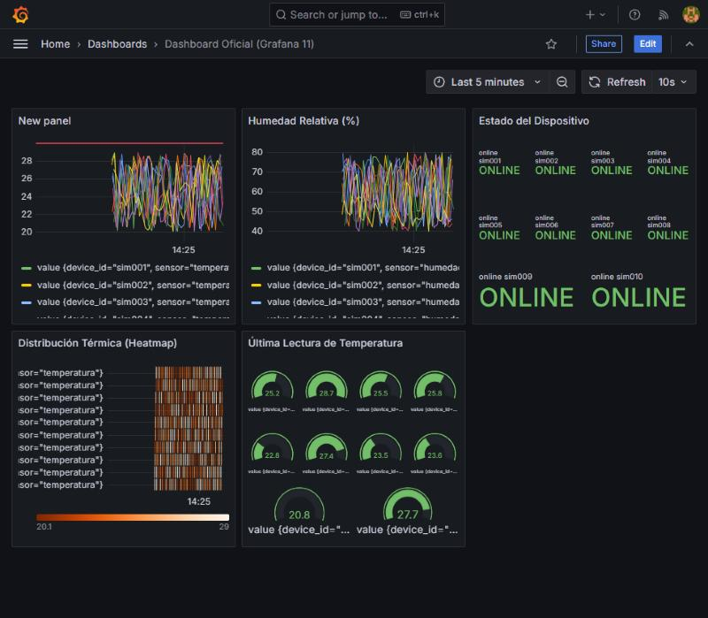
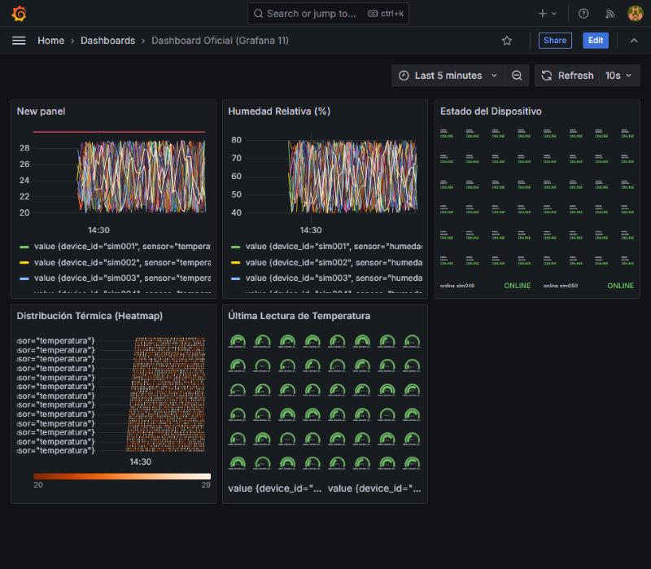

# Evidencia — Escalado: impacto de agregar dispositivos

| Campo | Valor |
|---|---|
| Objetivo del enunciado | Escalar el sistema agregando dispositivos y medir el impacto en la infraestructura. |
| Responsable | Rol 5 · Rol 2 |
| Estado | ✅ Cumplido (consumo, pérdida y dashboard medidos con 2, 10 y 50 simuladores; falta la firma de los Intentos 2) |
| Pruebas definidas en | [requerimientos.md](../requerimientos.md) |
| Plantilla | [PLANTILLA.md](PLANTILLA.md) |
| Capturas | `docs/evidencias/img/escalado/` |

## Resumen

| ID | Prueba | Veredicto | Fecha | Revisado por |
|---|---|---|---|---|
| PE.1 | Línea base con 2 dispositivos | ✅ (2 simuladores en lugar de dev01 y dev02) | 2026-11-11 | Alejandro Domínguez Torres |
| PE.2 | 10 simuladores extra | ✅ (captura del dashboard en el Intento 2) | 2026-11-15 | Alejandro Domínguez Torres (Intento 1) |
| PE.3 | 50 simuladores extra | ✅ (captura del dashboard en el Intento 2) | 2026-11-15 | Alejandro Domínguez Torres (Intento 1) |
| PE.4 | Pérdida de mensajes | ✅ | 2026-11-11 | Alejandro Domínguez Torres |

Leyenda: ⬜ Pendiente · ✅ Pasa · ❌ Falla · 🟨 Parcial

Condiciones de la prueba:

| Dato | Valor |
|---|---|
| Tamaño de la VM de Azure | Standard_B2als_v2 (2 vCPU, 4 GiB RAM, 30 GB SSD), Chile Central, Ubuntu 24.04 |
| Duración de cada escenario | 5 minutos |
| Usuario MQTT temporal | `escalado`, creado y eliminado por el script en cada corrida el 2026-11-11 (14:29–14:49) |
| Máquina que generó la carga | La misma VM: contenedores del simulador de `device/` en la red de Compose |

---

## Cómo se corrió (común a PE.1–PE.4)

| Campo | Valor |
|---|---|
| Ejecutada por | Santiago Osorio (Rol 2) |
| Fecha y hora | 2026-11-11, de 14:29 a 14:49 (19:29–19:49 UTC) |
| Entorno | VM `vm-iot-backend` · rama `rol2-infraestructura` en `3b9cd70` (= `main` + arreglos de `escalado.sh`) · Mosquitto 2.0.20, Node-RED 4.0 con el flujo del Rol 3, InfluxDB 2.7, Grafana 11.3.0 |
| Precondiciones | Backend arriba; flujo de Node-RED guardando en `lecturas`. dev01 y dev02 (VMs de Balena del Rol 1) **apagados** ese día |

En la VM, desde `~/proyecto5-iot/backend`, los tres escenarios seguidos (5 minutos cada uno):

```bash
sudo bash escalado/escalado.sh 2 5     # PE.1: línea base (2 simuladores en lugar de dev01 y dev02)
sudo bash escalado/escalado.sh 10 5    # PE.2
sudo bash escalado/escalado.sh 50 5    # PE.3
```

Cada corrida crea el usuario MQTT temporal `escalado`, lanza N contenedores del simulador de
`device/` (`sim001`, `sim002`, …, un mensaje por sensor cada 5 s), registra `docker stats` cada
15 s, cuenta lo que llega al broker (suscriptor con el usuario `nodered`) y lo que Node-RED guardó en
InfluxDB en la misma ventana de 300 s (PE.4). Al terminar borra los simuladores, sus puntos en
InfluxDB y el usuario temporal, y restaura `acl.conf`. Al mismo tiempo, un ciclo midió cada 15 s el
tiempo de respuesta de Grafana (`/api/health`), InfluxDB (`/health`) y Node-RED (`/`).

Archivos completos en [mediciones/](mediciones/): `escalado-N{2,10,50}-2026-11-11-resumen.txt`,
`-docker-stats.csv` y `-latencia.txt`.


**Revisado por:** Alejandro Domínguez Torres, 2026-11-12. Nota de revisión: los escenarios son 2, 10 y 50 simuladores en total (no 2 reales + N), porque dev01 y dev02 estaban apagados, y la carga se generó en la misma VM; ambas cosas están explicadas arriba y no cambian la conclusión.

## PE.1

### PE.1 — Línea base · Intento 1

**Qué se probó:** Consumo del backend con 2 dispositivos publicando.

**Resultado obtenido** (`escalado-N2-2026-11-11-resumen.txt`):

```
contenedor              CPU prom%   CPU max% Mem prom MiB  Mem max MiB
backend-grafana-1             0.1        0.2          241          241
backend-influxdb-1            0.1        0.4          236          256
backend-mosquitto-1           0.1        0.1            9            9
backend-nodered-1             0.1        0.5          141          142
simuladores (total)           0.1        0.2           26           26
Simuladores: esperados 240 · llegaron al broker 240 · guardados en InfluxDB 240
```

**Veredicto:** ✅ Pasa

**Observaciones:** dev01 y dev02 estaban apagados, así que la línea base se hizo con 2 simuladores
con el mismo código y el mismo intervalo que los de Balena (`device/simulador.py`). La carga es la
misma; lo único que cambia es que llegan por la red interna de Docker y no por Internet.

## PE.2

### PE.2 — 10 simuladores · Intento 1

**Resultado obtenido** (`escalado-N10-2026-11-11-resumen.txt`):

```
contenedor              CPU prom%   CPU max% Mem prom MiB  Mem max MiB
backend-grafana-1             0.1        0.1          241          241
backend-influxdb-1            0.4        0.8          240          242
backend-mosquitto-1           0.1        0.3            9            9
backend-nodered-1             0.4        0.7          141          142
simuladores (total)           0.3        0.5          129          130
Simuladores: esperados 1200 · llegaron al broker 1200 · guardados en InfluxDB 1200
Respuesta: Grafana prom 0,002 s (máx 0,012 s) · InfluxDB 0,001 s · Node-RED 0,001 s
```

**Veredicto:** 🟨 Parcial: consumo registrado y servicios respondiendo; falta la captura del dashboard.

**Observaciones:** El dashboard de R5.5 todavía no está montado en el Grafana de la VM, así que no
hay captura con datos. La respuesta de Grafana se midió por su API.

### PE.2 — 10 simuladores · Intento 2 (dashboard)

| Campo | Valor |
|---|---|
| Ejecutada por | Santiago Osorio (Rol 2) |
| Fecha y hora | 2026-11-15 14:23–14:28 (19:23–19:28 UTC) |
| Entorno | VM Azure · `main` en `ab26ed3` · Grafana 11.3.0 con el dashboard del Rol 4 (copia "Dashboard Oficial (Grafana 11)"; ver P3.2 en [R5.3.md](R5.3.md)) |

**Cómo:** `sudo bash escalado/escalado.sh 10 5`. A los 2,5 min se abrió el dashboard (últimos 5
minutos, refresco cada 10 s) y se midió en el navegador el tiempo de carga de la página y de cada
consulta a InfluxDB (`performance` del navegador, peticiones `/api/ds/query`).

**Resultado obtenido:**

```
Simuladores: esperados 1200 · llegaron al broker 1200 · guardados en InfluxDB 1200 (0,0 %)
Dashboard: página cargada en 0,60 s · 10 consultas, 0,17 s de promedio y 0,19 s de máximo
```



**Veredicto:** ✅ Pasa (con el Intento 1, que registra el consumo)

**Observaciones:** El dashboard muestra los 10 simuladores (`sim001`–`sim010`) en todos los paneles
y responde sin demora.

## PE.3

### PE.3 — 50 simuladores · Intento 1

**Resultado obtenido** (`escalado-N50-2026-11-11-resumen.txt`):

```
contenedor              CPU prom%   CPU max% Mem prom MiB  Mem max MiB
backend-grafana-1             0.1        0.2          241          241
backend-influxdb-1            1.7        2.0          250          250
backend-mosquitto-1           0.4        0.5           10           10
backend-nodered-1             2.3        9.0          152          154
simuladores (total)           1.4        1.6          645          646
Simuladores: esperados 6000 · llegaron al broker 6000 · guardados en InfluxDB 6000
Respuesta: Grafana prom 0,001 s · InfluxDB 0,001 s · Node-RED prom 0,001 s (máx 0,004 s)
```

**Veredicto:** 🟨 Parcial: consumo registrado, nada se degradó; falta la captura del dashboard.

**Observaciones:** Con 50 simuladores, Node-RED tuvo picos de 9 % de CPU y InfluxDB subió a 1,7 %
de promedio. Ningún servicio se degradó. La VM quedó con unos 3 GiB de RAM disponibles, y la mayor
parte de la memoria nueva la usan los propios simuladores (≈ 13 MiB cada uno), no el backend.

### PE.3 — 50 simuladores · Intento 2 (dashboard)

| Campo | Valor |
|---|---|
| Ejecutada por | Santiago Osorio (Rol 2) |
| Fecha y hora | 2026-11-15 14:29–14:35 (19:29–19:35 UTC) |
| Entorno | Igual que PE.2, Intento 2; esta vez con el dashboard abierto y las alertas del Rol 4 activas |

**Cómo:** `sudo bash escalado/escalado.sh 50 5`, y a los 2,5 min la misma medición del dashboard
que en PE.2.

**Resultado obtenido:**

```
contenedor              CPU prom%   CPU max% Mem prom MiB  Mem max MiB
backend-grafana-1             1.7       11.5          279          288
backend-influxdb-1            2.7        9.0          254          263
backend-mosquitto-1           0.5        0.5           10           10
backend-nodered-1             2.4        9.5          152          156
simuladores (total)           1.4        1.6          645          646
Simuladores: esperados 6000 · llegaron al broker 6000 · guardados en InfluxDB 5998 (0,0 %)
Dashboard: página cargada en 0,48 s · consultas de 0,35 s de promedio y 0,47 s de máximo
```



**Veredicto:** ✅ Pasa (con el Intento 1)

**Observaciones:**
- El dashboard sigue fluido con 50 dispositivos: cada consulta tarda el doble que con 10 (0,35 s
  frente a 0,17 s), pero la página carga en menos de medio segundo. Lo que sí se degrada es la
  **lectura**: con 50 series, las leyendas, los gauges y el panel de estado quedan muy pequeños.
  Para muchos dispositivos convendría una variable `device_id` para filtrar.
- Con el dashboard abierto y las alertas evaluándose, Grafana pasó de 0,1 % a 1,7 % de CPU, con
  picos de 11,5 %, y de 241 a 279 MiB. Es el contenedor que más crece cuando alguien mira el
  dashboard.
- InfluxDB guardó 5 998 de 6 000: los 2 que faltan caen en el borde de la ventana de medición
  (±1 por serie), no son pérdida. El broker recibió los 6 000.

## PE.4

### PE.4 — Pérdida de mensajes · Intento 1

| Escenario | Esperados | Llegaron al broker | Guardados en InfluxDB | Pérdida |
|---|---|---|---|---|
| 2 simuladores | 240 | 240 | 240 | 0,0 % |
| 10 simuladores | 1 200 | 1 200 | 1 200 | 0,0 % |
| 50 simuladores | 6 000 | 6 000 | 6 000 | 0,0 % |

Esperados = simuladores × 2 sensores × 60 mensajes (300 s, uno cada 5 s).

**Veredicto:** ✅ Pasa

**Observaciones:**
- Hubo dos corridas previas el mismo día que no cuentan, porque fallaban por errores del script, no
  del sistema. En la primera, el conteo de InfluxDB daba siempre 0 porque la salida de `influx query`
  deja vacía la columna `result` (commit `8a09ff9`). En la segunda, InfluxDB contaba unos segundos de
  más, porque la ventana se cerraba después del último `docker stats`, y daba pérdida negativa
  (commit `3b9cd70`). En esas dos corridas el broker igual recibió 99,8–100 % de los mensajes.
- Como el QoS es 1, un mensaje repetido se guarda en InfluxDB con la misma hora (`ts`) y la misma
  serie, así que reemplaza al anterior y no infla el conteo.

---

## Resultados consolidados

| Escenario | Dispositivos | CPU backend (%) | Memoria backend (MiB) | Contenedor más cargado | Puntos esperados | Puntos recibidos | Pérdida (%) | ¿Dashboard fluido? |
|---|---|---|---|---|---|---|---|---|
| Base | 2 | 0,4 | 627 | Grafana (memoria) | 240 | 240 | 0,0 | Sin captura; API responde en 0,001 s |
| 10 | 10 | 1,0 | 631 | InfluxDB y Node-RED (CPU 0,4 %) | 1 200 | 1 200 | 0,0 | Sí: carga en 0,60 s, consultas de 0,17 s |
| 50 | 50 | 4,5 | 653 | Node-RED (CPU 2,3 %, picos de 9 %); con el dashboard abierto, Grafana (picos de 11,5 %) | 6 000 | 6 000 | 0,0 | Sí: carga en 0,48 s, consultas de 0,35 s; se lee mal con 50 series |

Como dev01 y dev02 estaban apagados, cada escenario tiene solo los simuladores, no
"2 + N". CPU y memoria del backend = suma de los promedios de Mosquitto, Node-RED, InfluxDB y
Grafana (`docker stats`, el 100 % equivale a un vCPU), sin contar los simuladores.
Puntos esperados = dispositivos × 2 sensores × 60 mensajes (5 minutos, un mensaje cada 5 s).
Pérdida (%) = (esperados − recibidos) ÷ esperados × 100.

**Conclusión:** Lo que más crece con la carga es la CPU de Node-RED y de InfluxDB: con 25 veces
más dispositivos (2 → 50), el backend pasa de 0,4 % a 4,5 % de un vCPU, con picos de Node-RED de
9 %. Mosquitto casi no cambia (0,1 → 0,4 % y 9 → 10 MiB), y la memoria del backend sube solo 26 MiB.
Con 50 dispositivos (10 mensajes por segundo) no se perdió ningún mensaje y la VM quedó con unos
3 GiB de RAM libres, así que la B2als_v2 aguanta con mucha holgura la carga del proyecto. Por la
tendencia (CPU casi lineal con los mensajes por segundo), el primer límite sería la CPU de
Node-RED, varios cientos de dispositivos más arriba. Para escalar más se haría, en orden: subir el
intervalo o agrupar lecturas en lotes, escribir en InfluxDB por lotes desde Node-RED, darle más
vCPU a la VM, y por último separar InfluxDB en otra VM o servicio administrado.